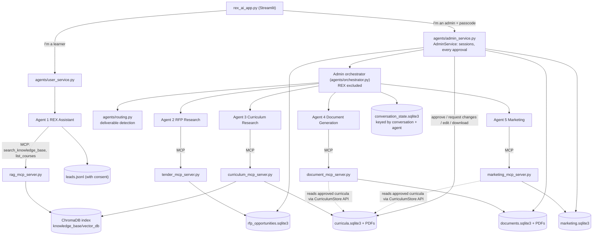

# REX AI — Complete Project Implementation and Change Report

## Report scope and method

This report documents what exists in the REX AI project **as of 3 November 2026**, what was changed in the recent development and audit-fix work, and what has and has not been verified.

- **Source of truth:** the current source files, tests, `git status`/`git diff`, the Git history, and the existing documents. Documentation was not treated as proof that a feature exists.
- **Read-only:** this report is the only file created. No source, test, configuration, documentation, database or Git state was changed. Nothing was staged, committed or pushed.
- **Evidence labels** used throughout:

| Label | Meaning |
|---|---|
| **Implemented** | The code exists in the working tree. |
| **Tested** | Covered by automated tests (fake models, temporary databases, no network). |
| **Browser-verified** | Exercised once in a real headless Chrome against an isolated app copy. |
| **Manually verified** | A person ran the manual test plan. **Nothing is in this state yet.** |
| **Not tested** | No test or run exists. |
| **Known limitation** | Behaviour that is real and accepted or unsolved. |
| **Pending decision** | Needs a decision from the project owner. |

- **Attribution of changes:** the working tree contains substantial uncommitted work. Where the session records support it, changes are tagged *audit-fix round* (the most recent round) or *Agent 4/5 work* (earlier in the same working tree). No dates or authors are assigned beyond that. Everything marked uncommitted is simply "part of the current working-tree changes".

---

# 1. Project overview

**REX AI** is a bilingual (English/Arabic) multi-agent system for an educational academy (the demonstration data is a synthetic catalogue for "Andalusia Academy"). It has two doors in one Streamlit application:

- **Learner door:** chat with **REX Assistant**, which recommends courses and answers questions from a knowledge base.
- **Admin door** (passcode): a dashboard that runs the specialist agents through an **orchestrator**, and where every approval happens.

| Item | Actual value (from the source) |
|---|---|
| Entry point | `rex_ai_app.py` (Streamlit, about 2,050 lines); run with `python -m streamlit run rex_ai_app.py` |
| Language | Python 3.13 (both test interpreters report 3.13.3) |
| Agent workflows | LangGraph state graphs, LangChain chat models (`langchain-ollama`) |
| LLM runtime | Ollama, default model `qwen2.5:3b` (`agents/config.py`; per-agent overrides via `REX_LLM_MODEL`, `CURRICULUM_LLM_MODEL`, `DOCUMENT_LLM_MODEL`, `MARKETING_LLM_MODEL`) |
| Knowledge base | ChromaDB + sentence-transformers embeddings, reranking and Arabic→English query translation (`knowledge_base/`) |
| Agent tools | MCP (official `mcp` SDK) — **five** stdio MCP servers |
| Storage | One SQLite database per agent, plus a shared `conversation_state.sqlite3` and the ChromaDB index |
| PDFs | ReportLab (+ `arabic-reshaper`, `python-bidi`) |
| Tests | pytest, 2,796 tests in 77 test files (collected now); Streamlit `AppTest` for UI |

## 1.1 Agents present in the project

`Orchestrator.AGENT_NAMES` (in `agents/orchestrator.py`) lists exactly five agents. All five are implemented.

| # | Agent | Package | Side |
|---|---|---|---|
| 1 | REX Assistant | `agents/rex_assistant/` | Learner (direct, not via the orchestrator) |
| 2 | RFP & Tender Research | `agents/rfp_research/` | Admin |
| 3 | Curriculum Research | `agents/curriculum_research/` | Admin |
| 4 | Educational Document Generation | `agents/document_generation/` | Admin |
| 5 | AI Marketing Agent | `agents/marketing/` | Admin |

---

# 2. Architecture

## 2.1 Diagram

The diagram shows only connections that exist in the code.

Notes on accuracy:
- The Document and Marketing stores read curricula only through the Curriculum store's public methods (`get`, `list_approved`, `count_approved`), never its tables.
- `AdminService` calls the agents' toolboxes **in process** for approval, edit and download actions. The MCP servers expose no approval tool.
- The user side has no orchestrator. The orchestrator's admin instance excludes REX.

## 2.2 Request flow

1. **User interacts.** A learner chats with REX; an admin signs in with the shared passcode and uses the tabs (Tender review, New tender search, Ask agents, Tender dashboard, Curricula, Documents, Marketing, Application profile, Audit trail) or the "Ask agents" chat.
2. **Interpretation and routing.** Learner messages go straight to REX. Admin chat messages go to the orchestrator, which detects the language and chooses agents with deterministic Python rules (`Orchestrator._make_plan`, `agents/routing.py`). Requests from the Documents and Marketing forms carry `context["document_request"]` / `context["marketing_request"]` and are routed to Agent 4 / Agent 5 without keyword matching.
3. **Agents execute.** Each agent is a LangGraph workflow. Where several agents are requested they run in order, and later agents can see earlier results (`previous_results`).
4. **State.** Admin-side agents keep short open-question state in `ConversationStore` (SQLite, keyed by conversation id and agent name). REX keeps its own conversation state for the learner (in the application session).
5. **Results.** Agents return a common envelope (`status`, `result`, `error_message`); the UI renders it.
6. **Review and approval.** Curricula, documents and campaigns are saved as `pending_review` (or `draft`). Only an administrator, through `AdminService` methods that check a session token, can approve. Tenders have their own review states.
7. **Download.** Approved campaigns download as Markdown/JSON; documents download as PDF (an approved PDF after approval, a labelled review copy before); the approved Curriculum PDF downloads read-only. Nothing is published, e-mailed or sent.

---

# 3. Agent documentation

## 3.1 Agent 1 — REX Assistant (`agents/rex_assistant/`)

| Item | Detail |
|---|---|
| Purpose | Recommend academy courses and answer course/academy questions in English, Arabic, Egyptian Arabic and mixed input, from retrieved evidence only. |
| Main files | `graph.py` (LangGraph), `discovery.py` (questionnaire), `course_context.py`, `recommendation.py`, `prompts.py`, `lead_store.py`, `mcp_client.py`, `interface.py` |
| Input | A learner message plus the conversation's stored state. |
| Workflow | `detect_language` → `understand` → `ask_question` (one discovery question at a time: background, goal, level, delivery, budget, time), or `general`, or `clarify_course`, or `retrieve` → `generate`; `handle_consent` for the consent reply. |
| Tools | MCP server `rag_mcp_server.py`: `search_knowledge_base` (returns evidence, never an answer) and `list_courses`. REX writes the answer itself with its own chat model. |
| State | Discovery profile and course focus are kept for the learner conversation; leads are saved to `leads.jsonl` only after consent. |
| Routing relationship | Reached directly by `user_service.py`. The admin orchestrator **excludes** it (`excluded_agents`), so admin chat cannot reach REX. |
| Registration | `agents/register_agents.py` (REX is wired for the user side; the admin orchestrator is built by `create_admin_orchestrator()` without it). |
| Tests | `test_rex_assistant.py` (132), `test_rex_course_context.py` (102), `test_course_intent.py` (86), `test_rex_answer_generation.py` (39), `test_rex_recommendation.py` (21), retrieval/ingestion tests, `test_rex_ai_app.py` (25). |
| Changes in this work | None to its logic. Its connection and the orchestrator docstring were the only touch points. |
| Limitations | A 3B model sometimes produces odd Arabic wording and off-by-one citation numbers (recorded in the technical guide). Lead storage is a JSONL placeholder. |

## 3.2 Agent 2 — Educational RFP & Tender Research (`agents/rfp_research/`)

| Item | Detail |
|---|---|
| Purpose | Find education/training tenders for **Egypt and Saudi Arabia**, extract and filter them, assess qualification, store them for admin review. |
| Main files | `graph.py`, `agent.py`, `tender_tools.py`, `opportunity_store.py`, `application_profile.py`, `applications.py`, `api_clients/`, `mcp_client.py` |
| Workflow | `validate_request` → `query_apis` (World Bank) → `web_research` (Tavily, only if a key exists) → `filter_relevant` → … → `assess_and_filter` → `apply_business_rule` (Egypt flagged for immediate review, Saudi monitored) → `store_opportunities` → `compose_response`. |
| Tools | MCP server `tender_mcp_server.py`: `search_procurement_notices`, `search_tender_web_pages`, `find_known_tenders`, `save_discovered_tenders`. |
| Output | Tenders stored as **pending**; an admin approves/rejects in the UI (`AdminService`); an application workflow follows approval (manual route or a *dry-run* EOI e-mail). |
| Changes in this work | **Connection settings only** in `opportunity_store.py` and `application_profile.py` (busy timeout, foreign keys via `sqlite_utils.connect`). No schema or logic change. |
| Tests | `test_rfp_web_research.py`, `test_rfp_research.py`, `test_opportunity_store.py`, `test_application_*.py`, `test_tender_*`, `test_rfp_api_clients.py`, `test_tavily_client.py`. |
| Limitations | Saudi tenders come only from web research (no API); alerts are in-app only; live e-mail sending is not implemented (dry run). Without `TAVILY_API_KEY`, web research is skipped and says so. |

## 3.3 Agent 3 — Curriculum Research (`agents/curriculum_research/`)

| Item | Detail |
|---|---|
| Purpose | Draft structured English/Arabic curricula, validate them, revise as versions, suggest new courses from the catalogue, align with approved framework files, produce PDFs. |
| Main files | `graph.py`, `curriculum_agent.py`, `curriculum_store.py`, `curriculum_tools.py`, `validation.py`, `revisions.py`, `alignment.py`, `pdf.py`, `understanding.py`, `request_parser.py`, `llm.py` |
| Workflow | Routes chosen in `understand`: generate (academy context → research → generate → validate → repair → save → render PDF → reply), revise, suggest, show/align/help. **Nothing in the graph can approve.** |
| Tools | MCP server `curriculum_mcp_server.py` (13 tools: academy courses, overlap and gap checks, research search, frameworks, validate, compare, save draft, get, list, render PDF). |
| Lifecycle | Statuses `draft`, `pending_review`, `changes_requested`, `approved`. Versions are immutable. An approved version stays the approved one until a newer version is approved (`approved_version`). Approval/changes-requested exist only in `AdminService`. |
| Interaction with others | Agents 4 and 5 read **approved** curricula only (through its public store methods). |
| Changes in this work | `curriculum_store.py` (connection settings, write transactions, race-free `_review`); `llm.py` (new `describe_model_error`, so a failure says "model not installed" / "Ollama not reachable" instead of only an exception name). |
| Tests | `test_curriculum_*.py` (many), `test_admin_curricula.py`, and the new `test_curriculum_review.py` (22). |
| Limitations | Research is off unless approved domains are configured; no accreditation framework ships (alignment reports "unable to determine"). |

## 3.4 Agent 4 — Educational Document Generation (`agents/document_generation/`)

*New in the working tree (the whole package is untracked).*

| Item | Detail |
|---|---|
| Purpose | Generate training documents from an **approved** curriculum, in the curriculum's language (not translated). |
| Main files | `graph.py`, `document_agent.py`, `templates.py` (types), `generator.py`, `composer.py`, `prompts.py`, `validation.py` (745 lines), `units.py`, `terms.py`, `understanding.py`, `document_store.py`, `document_tools.py`, `pdf.py`, `mcp_client.py`, `registration.py`; `agents/document_mcp_server.py` |
| Supported types (confirmed with `TEMPLATES`) | 1 `course_description`, 2 `course_proposal`, 3 `participant_guide`, 4 `capstone_brief`, 5 `outcomes_assessment_plan`, 6 `instructor_guide`, 7 `presentation_outline`, 8 `question_bank`, 9 `assessment_rubric`. A tenth item, `curriculum_pdf`, is **not generated**: it is the Curriculum Agent's own PDF, offered read-only for an approved curriculum (`AdminService.approved_curriculum_pdf`). |
| Workflow | `understand` → `fetch_curriculum` → `write` → `save` → `render` → `reply` (any step can stop with a clear error). Text copied from the curriculum is not rewritten by the model; the model writes the narrative parts. |
| Validation | Deterministic checks (`validation.py`), one repair attempt (two for the question bank). A text that still fails is **not saved**, and the error names the problem (`validation_failed`). |
| Storage | Own database (`documents`, `document_versions`, `document_audit`) and PDF folder; env `DOCUMENT_DB_PATH`, `DOCUMENT_OUTPUT_DIR`. |
| Lifecycle | Generated and valid → `pending_review`. Edits create a **new version** (needs review again). Approval (`AdminService.approve_document` → `DocumentToolbox.approve_document`) re-checks that the curriculum version is still approved, **then** renders the approved PDF, then records approval. Approved versions are never overwritten. Statuses are `draft`, `pending_review`, `approved`. |
| Download | Before approval a **review-copy PDF**; after approval the **approved PDF**. |
| MCP tools | `list_document_types`, `list_approved_curricula`, `get_approved_curriculum`, `save_document_draft`, `render_document_pdf`, `get_document`, `list_documents`. **No approve tool.** |
| Entry points | Chat ("Generate a course description for CUR-…") or the Documents tab (`context["document_request"]`). Writing can take many minutes on a small model; the tab shows each step. |
| Audit | `document_audit` records saves, edits and approvals with `admin-session-<hash>` as actor. |
| Tests | 706 tests across the `test_document_*.py` files (generation, validation quality, wording, question bank/repair, slides and rubrics, new types, PDF layout, admin, UI, curriculum-PDF UI, MCP). |
| Known limitations | **Arabic question banks are not reliably generated** by `qwen2.5:3b` (some failed validation after both repairs and were correctly not saved). E-mail distribution does not exist. |

## 3.5 Agent 5 — AI Marketing Agent (`agents/marketing/`)

*New in the working tree (the whole package is untracked).*

| Item | Detail |
|---|---|
| Purpose | Write marketing campaigns for an **approved** course, in the course's language (not translated). |
| Main files | `graph.py`, `marketing_agent.py`, `understanding.py`, `generator.py`, `composer.py`, `validation.py`, `facts.py`, `schemas.py`, `prompts.py`, `marketing_store.py`, `marketing_tools.py`, `mcp_client.py`, `registration.py`; `agents/marketing_mcp_server.py` |
| Deliverables | A strategy (objective, audience, main message, recommended channels, content sequence, call to action; no budgets or forecasts) and, for each selected channel, **1–3 variations (default 2)** of: social media captions, Facebook/Instagram ad copy, LinkedIn posts, e-mail (subject, preheader, body, button), WhatsApp promotional **messages (text only)**, campaign headlines, call-to-action suggestions. Tones: professional (default), friendly, inspiring, formal. |
| Workflow | `understand` → `fetch_course` → `audience` → `write` → `save` → `reply`. One model call for the strategy and one per channel (about eight for a full campaign). |
| Curriculum requirement | Only an approved course version is used. A draft, pending or changes-requested curriculum is refused with the reason; in a "curriculum then marketing" chain, the unapproved draft in `previous_results` is ignored. |
| Audience | The course's own target audience, confirmed or overridden by the admin (`source` = `curriculum` or `admin`). If none exists the agent **asks**; it never invents one. |
| Validation | Heuristic checks reject facts the course does not support: unstated numbers and hours, prices/fees/free/discounts/urgency, guarantees and job/salary promises, superlatives, certificate/accreditation claims, links, e-mail addresses, phone numbers, month names and deadlines, claims about required experience, foreign writing systems, English glued to Arabic, repeated sentences, unfinished text, wrong length (`schemas.LIMITS`), near-identical variations, CTA limits (≤ 8 words and ≤ 60 characters). A term present in the curriculum or the admin's own words is allowed. One repair attempt per content type; if it still fails nothing is saved and the error names the type. |
| Storage / lifecycle | `marketing.sqlite3` (`campaigns`, `campaign_versions`, `campaign_audit`; `MARKETING_DB_PATH`). `draft` → `pending_review` → `approved`. The agent can only save `pending_review` (valid) or `draft`. An admin edit that fails the checks is kept as a `draft` and **cannot be approved**. Versions are immutable. |
| Approval and download | `AdminService.approve_campaign` (session check, re-checks the course version is still approved). `AdminService.campaign_export` returns the **approved version only**, as UTF-8 Markdown or JSON; otherwise it raises. |
| MCP tools | `list_approved_courses`, `get_approved_course`, `save_campaign_draft`, `get_campaign`, `list_campaigns`. **No approve and no export tool.** |
| Follow-up behaviour | See §6.1. |
| Not implemented | Publishing, scheduling, e-mail sending, WhatsApp sending. A search of Agent 4/5 code and servers found no SMTP, WhatsApp API, HTTP-post or publish code. "WhatsApp" is only a *content type* (message text to copy). |
| Tests | 465 across `test_marketing_*.py` (validation 192, agent 76, follow-up 67, admin 66, tools 26, UI 17, store 17, MCP 4). |
| Known limitations | A full campaign takes many minutes on `qwen2.5:3b`; Arabic is checked strictly and **may fail validation** (nothing saved). The checks are heuristics, which is why an administrator approves everything. Real-model runs were made in English during development; they are not part of the automated suite. |

## 3.6 Relationship between Agent 4 and Agent 5

| Aspect | Agent 4 | Agent 5 |
|---|---|---|
| Source | Approved curriculum | Approved curriculum (course) |
| Own store | `documents.sqlite3` | `marketing.sqlite3` (separate; modelled on Agent 4's, shares no tables) |
| Lifecycle | draft / pending_review / approved | draft / pending_review / approved |
| Versions | Immutable; edits and regenerations are new versions | Same |
| Approval | `AdminService.approve_document` | `AdminService.approve_campaign` |
| Output | PDF (review copy, then approved PDF) | Markdown/JSON, approved version only |
| Audit | `document_audit` | `campaign_audit` |
| MCP approve tool | None | None |

A parity test checks that Agent 5's "approved only" rule agrees with Agent 4's for every status a curriculum can have (`tests/test_marketing_tools.py`). A single request can use both (for example "Generate a question bank for CUR-… and create a marketing campaign for the same course" runs Agent 4 then Agent 5).

---

# 4. Orchestration and routing

## 4.1 Before

In the committed code (`git show HEAD:agents/orchestrator.py`), `_make_plan` used keyword lists. A request containing a curriculum word **and** the word "marketing" (or "campaign", "social media", …) was planned as `["curriculum_research", "marketing"]`, and any marketing word alone went to Agent 5. Consequence: "Create a curriculum **about digital marketing**" would also be sent to Marketing, because the *subject* contained the word.

(An intermediate working-tree version also tried routing by the presence of a `CUR-…` id. Per the session records it was removed during the audit-fix round and never reached a commit; this is not visible in Git history.)

## 4.2 Now — `agents/routing.py` (96 lines, new)

`deliverables(text, creates_course)` returns an ordered subset of `("curriculum_research", "document_generation", "marketing")` — what the request asks to **receive**.

How it works:
1. The topic after a course noun is stripped ("a curriculum **about marketing analytics**" → just a curriculum).
2. The text is split into clauses (commas, `;`, "and", "then", "plus", "also", Arabic "ثم" and "و"+verb).
3. Each clause is classified, with this priority: **document** (Agent 4's own `find_document_type`/`is_document_request`, so "course description", "question bank" etc.) > **marketing** (campaign, social posts/ads/captions, LinkedIn/Facebook posts, e-mail or WhatsApp copy, Arabic equivalents) > **curriculum creation** (`_CREATES_CURRICULUM` or the orchestrator's `_is_course_creation`).
4. Results keep the order curriculum, documents, marketing.

The module imports nothing from the orchestrator (no circular import; a test checks it). `Orchestrator._make_plan` calls it: two or more deliverables → run them all; the RFP rule is checked next; a single document or marketing deliverable routes before the curriculum keyword rules (such a request often names a curriculum); otherwise the existing curriculum, Agent 4 keyword fallback and REX rules apply. The old combined curriculum+marketing rule and the bare-word marketing rule were **removed**.

Registration is unchanged in structure: `register_agents.create_admin_orchestrator()` registers each agent by name; `_plan_node` still routes `context["document_request"]` and `context["marketing_request"]` forms directly.

## 4.3 Examples (all are test cases in `tests/test_routing_deliverables.py`)

| Request | Agents run |
|---|---|
| Create a curriculum about digital marketing. | Curriculum only |
| Create a curriculum about marketing analytics. | Curriculum only |
| Create a social media campaign for approved course CUR-123. | Marketing |
| Write LinkedIn posts promoting approved course CUR-123. | Marketing |
| Create a course description for curriculum CUR-123. | Document Generation |
| Generate a question bank for CUR-123 and create a marketing campaign for the same course. | Document Generation, Marketing |
| Create a curriculum about data analysis and prepare a course proposal. | Curriculum, Document Generation |

Further tests: marketing alone with no deliverable routes nothing; no dependence on the shape of a course id; executing multi-agent plans with mock handlers; continuation of open questions; the previously existing orchestrator tests (updated only where the intended behaviour changed).

**Known routing limitations:** routing is a heuristic over wording; an unusual phrasing can fall through to the generic keyword rules. It has not been exercised through chat in a real browser or with a real model.

---

# 5. Complete changelog

Reminder: every file below is either an **uncommitted modification** of a tracked file (20 files, +1,566 / −134 lines vs `HEAD`) or an **untracked new file**. `HEAD` itself (`61f1e2f`) contains none of Agent 4/5. The "round" column says which work, per session records, the change belongs to: **A45** = Agent 4/5 work, **AUDIT** = the final-audit fix round, **BOTH** = touched in both.

## 5.1 New source files (untracked)

| File | Round | What it is | Why | Verification |
|---|---|---|---|---|
| `agents/document_generation/` (16 modules, ~3,840 lines) | A45 | Agent 4 package (§3.4). | Required agent 4. | ~706 tests |
| `agents/document_mcp_server.py` | A45 | Document MCP tools. | Agent tools via MCP. | `test_document_mcp_server.py` (6) |
| `agents/marketing/` (14 modules, ~1,980 lines) | A45 (follow-up logic: AUDIT) | Agent 5 package (§3.5). | Required agent 5. | 465 tests |
| `agents/marketing_mcp_server.py` | A45 | Marketing MCP tools. | Agent tools via MCP. | `test_marketing_mcp_server.py` (4) |
| `agents/routing.py` | AUDIT | Deliverable detection (§4.2). | Fix subject-vs-deliverable routing. | 68 tests |
| `agents/sqlite_utils.py` | AUDIT | `connect()`, `write_transaction()`, `DatabaseBusy`, `is_busy` (§6.4). | Safe, consistent SQLite use. | 21 + 22 tests |
| `requirements-dev.txt` | AUDIT | `-r requirements.txt` + pytest. | Separate test tools. | pip dry-run on both interpreters |

## 5.2 Modified tracked files

| File | Round | What changed | Why / impact |
|---|---|---|---|
| `agents/orchestrator.py` (+51/−…) | BOTH | Docstring now "five specialist agents" (was "Agent 6"); forced routing for `document_request` / `marketing_request`; `_make_plan` uses `deliverables()`; old marketing keyword rules removed. | Correct routing (§4). |
| `agents/register_agents.py` (+12) | A45 | Registers Agent 4 and 5 on the admin orchestrator; exposes `orchestrator.document_generation_agent`, `.marketing_agent`. | Agents are reachable. |
| `agents/admin_service.py` (+346) | BOTH | A45: document and campaign methods (generate, list, edit, approve, export/PDF, audit trail, counts, approved-curriculum PDF) – each starts with the session check. AUDIT: per-client lockout (`login(candidate, client_id)`, `is_locked(client_id)`, `_record_failure`, bounded records, global ceiling). | Admin-only approval; lockout isolation. |
| `agents/conversation_store.py` | AUDIT | Uses `sqlite_utils.connect`; `set()` is a `write_transaction` raising `DatabaseBusy`. | Safe concurrent writes. |
| `agents/curriculum_research/curriculum_store.py` (+56) | AUDIT | `connect`; `save_version`, `add_document` in transactions; `_review` re-reads status inside the transaction. | Closes the approval race. |
| `agents/curriculum_research/llm.py` | A45 | `describe_model_error()` and `from last_error` chaining. | Clear "model not installed / Ollama down" messages. |
| `agents/rfp_research/opportunity_store.py`, `application_profile.py` | AUDIT | Connection settings only. | Consistent busy timeout / FK pragma. |
| `agents/mcp_tool_client.py` (+45) | AUDIT | `_OPEN_CLIENTS` WeakSet, `close_all_clients()` registered with `atexit`; `close()` made idempotent and tolerant of a dead loop. | No orphan server processes. |
| `rex_ai_app.py` (+650) | BOTH | A45: Documents and Marketing tabs, EN/AR strings (`doc_*`, `mk_*`), progress display, downloads. AUDIT: per-session `admin_client_id` passed to `login`/`is_locked`. | UI for Agents 4/5; lockout isolation. |
| `requirements.txt` (+46/−…) | AUDIT | Version ranges for every dependency; `torch` and `typing_extensions` newly declared; pytest moved out (§6.8). | Reproducible install. |
| `.gitignore` | BOTH | Ignore Agent 4/5 databases and PDFs, `*.sqlite3-*` companions, `knowledge_base/vector_db/`. | Keep runtime files out of Git (§6.3). |
| `.env.example` | A45 | `DOCUMENT_LLM_MODEL`, `DOCUMENT_DB_PATH`, `DOCUMENT_OUTPUT_DIR`, `MARKETING_LLM_MODEL`, `MARKETING_DB_PATH` (no secrets). | Configuration. |
| `tests/conftest.py` (+49) | A45 | Autouse temporary document/marketing storage and in-process agents. | Tests never touch real data. |
| `tests/test_admin_architecture.py` | A45 | Expected admin agent set now includes `marketing` (one-line change). | Intended behaviour change, not a weakening. |
| `README.md`, `docs/architecture.md`, `docs/agent_interfaces.md`, `docs/PROJECT_TECHNICAL_GUIDE.md`, `docs/MANUAL_TEST_PLAN.md` | BOTH | See §9. | Accurate documentation. |

## 5.3 New test files (untracked)

| Group | Files | Tests |
|---|---|---|
| Agent 4 | 15 `test_document_*.py` + `document_fakes.py` | ~706 |
| Agent 5 | 8 `test_marketing_*.py` + `marketing_fakes.py` | 465 |
| Routing | `test_routing_deliverables.py` | 68 |
| SQLite | `test_sqlite_concurrency.py` (+ `sqlite_workers.py`) | 21 |
| Curriculum review | `test_curriculum_review.py` | 22 |
| Admin lockout | `test_admin_lockout.py` | 14 |
| MCP cleanup | `test_mcp_cleanup.py` (+ `pid_mcp_server.py`) | 6 |
| Runtime stability | `test_runtime_stability.py` | 10 |

**Deleted files:** none among tracked files (`git status` shows no `D`). **Databases:** none deleted, recreated or migrated.

---

# 6. Bug fixes and technical improvements (audit-fix round)

## 6.1 Agent 5 follow-up handling

- **Problem:** after Agent 5 asked "who is this campaign for?", the *next message of any kind* could be taken as the audience, and the question never expired.
- **Fix:** the question is stored as a pending state in `ConversationStore` (agent name `marketing`) with the original request text (first 200 characters), the course, the options chosen, and a `created_at` timestamp (`MarketingAgent`, `graph.py`).
- **Reply classification** (`understanding.classify_reply`): *audience* (a short description of a group, ≤ 14 words, no links/markup/long digit strings) continues the original request; *cancel* (English/Arabic) drops the question; a *new request* (starts with a request verb such as "create", "write", "show", Arabic starters) drops the old question and is routed on its own; *small talk, empty, ambiguous or invalid* text never becomes the audience — the agent asks again, **without extending the timer**.
- **Expiry:** `PENDING_TTL_SECONDS = 15 * 60`; the clock is injectable (`clock=time.time`), so tests need no waiting. A pending state without a numeric timestamp counts as expired.
- **Isolation:** state is per conversation id; another conversation never sees it. The Marketing form never leaves a chat question open, and it refuses an audience with links or markup.
- **Tests:** `tests/test_marketing_followup.py` — 67 tests (valid answer, Arabic, unrelated, small talk, ambiguous/invalid, empty, TTL boundary and expiry, new request while waiting, cancel EN/AR, conversation isolation, orchestrator-level stray message).

## 6.2 Orchestrator routing

Covered in §4. Regression tests: `tests/test_routing_deliverables.py` (68) plus the existing `test_orchestrator.py` (52) and `test_curriculum_routing.py` (111) which still pass.

## 6.3 ChromaDB and Git safety

- **Runtime vector database:** `knowledge_base/vector_db/` holds the ChromaDB index (`chroma.sqlite3` plus index folders). Running the app or re-ingesting rewrites the SQLite file, so it shows as modified in Git even when no one edited it.
- **Change:** `.gitignore` now ignores `knowledge_base/vector_db/` and `*.sqlite3-*` (WAL/SHM/journal companions).
- **Ignoring is not untracking.** Git ignore rules apply only to *untracked* files. A file already committed stays tracked and keeps showing as modified.
- **`skip-worktree`:** `git update-index --skip-worktree knowledge_base/vector_db/chroma.sqlite3` was applied. It is a local, reversible flag in this clone's index telling Git to stop looking for working-tree changes to that file. It does not delete, stage or untrack anything, and it is **not shared** with other clones.
- **Verified status (fresh):** the file exists locally (6,361,088 bytes, unchanged); `git ls-files -v` shows `S` (tracked + skip-worktree); it is in `HEAD`. **ChromaDB is still tracked.** It is **not** permanently untracked.
- **Pending decision (user):** permanent untracking is `git rm -r --cached knowledge_base/vector_db`, which stages deletions and must be committed. It was not run. To undo the flag: `git update-index --no-skip-worktree knowledge_base/vector_db/chroma.sqlite3`.

## 6.4 SQLite improvements

`agents/sqlite_utils.py`:
- `connect(path)`: busy timeout of **30 s**, `PRAGMA foreign_keys = ON`, `check_same_thread=False`; **journal mode untouched**.
- `write_transaction(connection, lock, error_class)`: takes the store's lock, runs `BEGIN IMMEDIATE`, commits on success, **rolls back on any exception**; a "database is locked" error becomes `error_class(BUSY_MESSAGE)` — **no automatic retry**, so an approval can never be applied twice.
- Applied to: curriculum store (`save_version`, `add_document`, `_review`), document store (`save_version`, `approve`, `attach_pdf`), marketing store (`save_version`, `approve`), conversation store (`set`). The two RFP stores only use `connect`.
- No transaction is held while a model, network or MCP call runs (agents compute first, save last).
- **Why WAL was not enabled:** the project lives in a OneDrive folder; WAL adds `-wal`/`-shm` files that a sync client can copy out of step, and it changes the database file; the write volume does not need it.
- **Compatibility:** schemas of existing tables were **not changed**, and no foreign-key declarations were added to existing tables (only the pragma is on). Old databases open unchanged; a test builds an old-format database and a pre-migration documents database.
- **Tests (`test_sqlite_concurrency.py`, 21):** shared settings on all six stores, FK enforcement, rollback, mid-way failure leaves no trace, busy timeout reported and not retried, closing twice releases the file, old-database compatibility, thread reads/writes, and **real multi-process tests** (spawned processes) for curriculum approval, version numbering, campaign approval and conversation state.

## 6.5 Curriculum approval concurrency

- **Original race:** `_review` checked the version's status and then updated it in separate steps, so two reviewers (or two processes) could both pass the check — e.g. one approving while another requested changes, leaving head and version disagreeing.
- **Fix:** the whole review is one `BEGIN IMMEDIATE` transaction. Inside it the code re-reads `current_version` and the version's status, requires version = current and status = `pending_review`, updates both tables (the version update also carries `AND status = pending_review`), and writes one audit row. The loser receives "This version is …: only a version pending review can be reviewed."
- **Tests (`test_curriculum_review.py`, 22 tests):** normal approval, approving twice (second refused, one audit row), non-reviewable states, only the current version, revisions never displacing the approved version, malformed/unknown ids, reviewer identity rules, two concurrent approvals (exactly one wins), approve vs request-changes race repeated five times, rollback after a failure mid-review, and `AdminService` still demanding a session. Real multi-process approvals are in `test_sqlite_concurrency.py`.

## 6.6 Admin lockout

- **Original concern:** one global failure counter and lock-until time: any person's five wrong passcodes locked **every** administrator out for a minute.
- **Now:** failures are counted **per client**; the app creates a random `admin_client_id` per browser session and passes it to `login()` and `is_locked()`. Constants: `MAX_FAILED_ATTEMPTS = 5`, `LOCKOUT_SECONDS = 60`. Callers without an id share one default client (existing tests/behaviour).
- **Ceiling:** `MAX_FAILED_ATTEMPTS_ALL_CLIENTS = 25` failures across all clients lock every client for 60 s, so opening many new sessions does not give unlimited guesses. `MAX_TRACKED_CLIENTS = 500` bounds memory.
- **Unchanged:** constant-time comparison (`hmac.compare_digest`), passcode from `REX_ADMIN_PASSCODE`, 30-minute sliding session, `AdminAuthError` for missing/forged/expired/signed-out tokens, admin-only approval.
- **Tests (`test_admin_lockout.py`, 14):** success, wrong passcode, threshold, expiry (injected clock), count restarts, success clears failures, client isolation, default client, global ceiling, bounded records, disabled service, authorization of approval and logged-out tokens, session expiry, and an `AppTest` of two sessions where one is locked and the other signs in.
- **Remaining limitation:** one shared passcode; there is **no individual administrator identity** (§8).

## 6.7 MCP process cleanup

- **How it works:** `McpToolClient` starts a server subprocess (`python -m <module>`) on a background thread/event loop on first use. Every client registers in `_OPEN_CLIENTS` (a `WeakSet`); `atexit` runs `close_all_clients()`.
- **Idempotent close:** `close()` can be called repeatedly, before start, and after the server or loop already ended (`RuntimeError` from a closed loop is caught); a failure closing one client does not stop others.
- **Eligible processes:** only servers started by clients of **this** Python process. Unrelated or user-owned processes are never touched.
- **Tests (`test_mcp_cleanup.py`, 6, using a tiny real MCP server `tests/pid_mcp_server.py` that records its PID):** close ends the subprocess and is idempotent; reuse after close; closing a never-started or dead-loop client; `close_all_clients` closes this process's servers but leaves an unrelated sleeping process alive and survives a failing client; the registry does not keep dead clients alive; **a separate process that never calls `close()` leaves no server behind after it exits**.

## 6.8 Dependencies

- `requirements.txt` now has ranges (`>=oldest tested, <next major`) for every direct dependency; `arabic-reshaper==3.0.1`, `python-bidi==0.6.12` and `sacremoses==0.2.0` stay pinned.
- **Added:** `torch` (needed by sentence-transformers), `typing_extensions` (imported directly by the orchestrator and Agent 4/5 graphs), and `streamlit`'s range.
- **Dev:** `requirements-dev.txt` = runtime + `pytest>=9.1,<10`; the README setup/testing steps use it.
- **Minimums** were set to the oldest version proven on **either** interpreter (e.g. `langchain-core>=1.6`, `torch>=2.11`, `pydantic>=2.13`), because the global interpreter has older packages than the `.venv`.
- **Validation:** `pip check` on the `.venv`: no broken requirements; `pip install --dry-run --no-index -r requirements-dev.txt` resolved with no error on both interpreters. No packages were installed, upgraded or removed.
- **Remaining concerns:** the two environments differ (`.venv`: `langgraph 1.2.17`, `torch 2.15.0`; global: `1.2.11`, `2.11.0+cpu`) yet both pass the whole suite; no lock file exists, so a fresh install may resolve newer minor versions than were tested.

---

# 7. Approval, security and data flow

## 7.1 Approval architecture

| Artifact | Who can approve | Where | Preconditions | Downloads |
|---|---|---|---|---|
| Tender | Admin | `AdminService` review methods | — | Dashboard of approved tenders |
| Curriculum | Admin | `AdminService.approve_curriculum` → `CurriculumStore.approve` | Current version, `pending_review` | Curriculum PDF |
| Document | Admin | `AdminService.approve_document` → `DocumentToolbox.approve_document` | Version pending review, curriculum version **still approved**; approved PDF rendered first | Review PDF before, approved PDF after |
| Campaign | Admin | `AdminService.approve_campaign` → `MarketingToolbox.approve_campaign` | Version pending review, valid, course version still approved | **Approved version only**; Markdown/JSON |

- Each `AdminService` method begins with `_require(token)`; the audit actor is `admin-session-<8-hex hash>`, never the token.
- Agents can only save drafts/pending versions. The Document and Marketing MCP servers define no approve/export tool (verified in the source).
- Versioning: versions are immutable; edits/regenerations create new versions; an approved version stays the approved one until a newer version is approved.
- **External publishing/sending: not implemented** (§3.5). Approval only enables download.

## 7.2 Trust boundaries and security limits

- **Admin authentication:** shared passcode from `REX_ADMIN_PASSCODE` (environment/`.env`), compared in constant time; server-side random session tokens (in memory, 30-min idle expiry); the browser holds only the token. Without a passcode the Admin interface is disabled.
- **User/Admin split:** the welcome-screen choice is navigation only; the user path (`user_service.py`) has no way to reach the admin orchestrator or `AdminService`.
- **MCP servers:** local subprocesses over stdio. An MCP server cannot tell who is calling, which is why approvals are not tools.
- **Database access:** each agent owns its file; no agent reads another's tables.
- **Limitations (do not overstate):** a shared passcode proves *an* admin is present, not *which*; audit identity is a session hash; sessions are lost when the server restarts; tokens are held in process memory (single-process deployment); marketing validation is heuristic; this is a demonstration-grade deployment, not hardened production software.

---

# 8. Database and data safety

| Store | File (default) | Git status |
|---|---|---|
| Tenders, profile | `agents/rfp_research/rfp_opportunities.sqlite3` | ignored (existing rule) |
| Curricula | `agents/curriculum_research/curricula.sqlite3` (+ `documents/` PDFs) | ignored |
| Documents | `agents/document_generation/documents.sqlite3` (+ `documents/`) | ignored (new rule) |
| Campaigns | `agents/marketing/marketing.sqlite3` | ignored (new rule) |
| Conversation state | `agents/conversation_state.sqlite3` | ignored (existing) |
| ChromaDB | `knowledge_base/vector_db/` | **tracked** (`chroma.sqlite3` marked `skip-worktree`) |

- Existing databases and PDFs were **not deleted, recreated or migrated** by this work. The existing curriculum, tender and conversation databases remain on disk (they appear in the folder listing). Agent 4 added a documents database and Agent 5 a marketing database; both create their tables on first use.
- Distinctions: **on disk** (the data exists); **tracked** (Git stores and compares it — true for `chroma.sqlite3`); **ignored** (applies only to untracked files — it is *not* a cure for tracked ones); **skip-worktree** (a local flag that hides working-tree changes of a tracked file from `git status`/`git add -A`, without untracking it).
- **Pending cleanup decisions:** whether to run `git rm -r --cached knowledge_base/vector_db` (and commit) or keep the flag.
- During tests, every store writes to temporary paths (autouse fixtures in `tests/conftest.py`), so test runs do not touch real data. The browser smoke test used a separate **copy** of the app and fresh databases.

---

# 9. Testing and verification

## 9.1 Full suite (fresh run during the latest verification)

| Environment | Python | Command | Result | Time |
|---|---|---|---|---|
| Project `.venv` | 3.13.3 | `.venv/Scripts/python -m pytest -p no:cacheprovider -q` | **2796 passed, 0 failed, 0 skipped, 0 warnings** | 489.9 s |
| Global | 3.13.3 | `"/c/Program Files/Python313/python" -m pytest -p no:cacheprovider -q` | **2796 passed, 0 failed, 0 skipped, 0 warnings** | 560.4 s |

Collection (`--co`) confirms 2,796 tests in 77 files. No test was left unexecuted. No test was deleted or weakened; the only existing expectation changed is the admin agent set including `marketing`.

## 9.2 Focused tests (all are subsets of the 2,796, **not additional**)

| Area | File | Passed | What it verifies |
|---|---|---:|---|
| Agent 5 follow-up | `test_marketing_followup.py` | 67 | Reply classification, pending state tied to the request, 15-minute expiry (injected clock), cancel, new request, conversation isolation |
| Routing | `test_routing_deliverables.py` | 68 | Deliverable detection, every required example, mixed requests, no course-id dependence, no circular import, continuations |
| SQLite | `test_sqlite_concurrency.py` | 21 | Busy timeout, FK, rollback, old-DB compatibility, threads, real multi-process writes |
| Curriculum approval race | `test_curriculum_review.py` | 22 | Review rules, concurrent approvals, consistency, rollback, admin guard |
| Admin lockout | `test_admin_lockout.py` | 14 | Per-client lockout, ceiling, expiry, authorization, two-session UI test |
| MCP cleanup | `test_mcp_cleanup.py` | 6 | Idempotent close, atexit cleanup, unrelated process protected |
| **Total** | | **198** | (combined run: 198 passed in about 32 s) |

## 9.3 Automated tests vs. browser vs. manual

- **Automated tests** use fake language models, temporary databases and Streamlit `AppTest` (a simulation of the UI, not a browser). They never call Ollama or the internet.
- **Browser verification** (headless Chrome through the DevTools protocol; run once; **not repeated** in the latest verification): an isolated copy of the app on port 8611, a throwaway passcode and seeded data (one approved course, one pending campaign). It passed: welcome screen with both doors; passcode dialog; an incorrect passcode refused; real sign-in to the admin dashboard; the Marketing tab; the "Create campaign" form; the seeded campaign opening with its strategy and variations and showing "Pending review"; approved course offered; the Documents tab rendering its form; the Approve button; approval confirmed with "Nothing was published or sent"; both approved download buttons (Markdown, JSON) present after the page was scrolled to them (Streamlit lazy-loads below-viewport elements).
- **The browser run does not establish:** real-model generation (no model was called); complete Agent 4 document generation or its approval/PDF download in a browser; Arabic generation; chat routing through the Ask-agents tab; the complete approve → file-download round trip (button presence was checked, files were not downloaded and opened).
- **Manual testing:** sections **J4 (Agent 4, 16 steps), J5 (Agent 5, 22 steps) and J6 (admin lockout, 3 steps)** of `docs/MANUAL_TEST_PLAN.md` are written but **not run by a person**; their Result columns are empty and must not be read as passed. They cover: Documents tab empty/populated states, generating several document types, edit/approve/versions/PDFs, hours wording, the Curriculum PDF, chat routing examples, Arabic, absence of send/publish controls (J4); the Marketing tab states, generation, invented-fact checks, approval and downloads, routing examples, audience follow-ups including nonsense, new request, cancel, 15-minute expiry, and Arabic (J5); and two-window lockout behaviour (J6).

## 9.4 Summary

| Evidence | Status |
|---|---|
| Automated tests | 2,796 / 2,796 passed on both interpreters |
| Focused areas | 198 passed (included in the above) |
| Headless-Chrome smoke test | Passed once, limited scope (above), not re-run |
| Real-model runs | Made in English by the developer during Agent 4/5 work; not recorded as repeatable tests |
| Manual plan J4–J6 | Not run |
| Not executed | None of the automated tests; manual J4–J6; real-model/Arabic generation in a browser |

---

# 10. Documentation: updates and discrepancies

| Document | Content | Status |
|---|---|---|
| `README.md` | Overview, agents, stack (five MCP servers), structure, setup (`requirements-dev.txt`), configuration, lockout note, new "Git and runtime files" section, running, testing | Updated |
| `docs/architecture.md` | Overview, each agent's workflow, authorization (lockout), new "Routing by deliverable" and "SQLite usage" sections, storage table | Updated |
| `docs/agent_interfaces.md` | Agent input/output contracts; §4.4/4.5 now "implemented"; routing and follow-up paragraph | Updated |
| `docs/PROJECT_TECHNICAL_GUIDE.md` | Learning guide; Agent 4/5 rows, orchestrator row, diagram, MCP row, checklists, test count (2,796) updated | Partly updated |
| `docs/MANUAL_TEST_PLAN.md` | New J4, J5, J6 sections; section L extended; A.1 count | Updated |
| `docs/CURRICULUM_AGENT_ARCHITECTURE.md` | Curriculum Agent design (dated 2026-10-28) | **Not updated** |
| `PROJECT_HANDOVER.md` | Earlier handover | **Not updated; outdated** |

**Discrepancies found (reported, not silently fixed):**

1. `docs/CURRICULUM_AGENT_ARCHITECTURE.md` still says "1284 passing" (row R29, and §20 "Final verification (Phase 6, 2026-10-28)"). The §20 sentence is dated and reads as a historical snapshot; the **R29 table row is undated** and could mislead a reader into taking 1284 as the current count. The current count is 2,796.
2. `PROJECT_HANDOVER.md` describes a three-agent, 96-test project and references the old state. It is also listed in `.gitignore` (untracked), so it is not part of the repository and can mislead anyone who reads the folder.
3. `docs/PROJECT_TECHNICAL_GUIDE.md` still states in its header that everything was "checked against the source on 2026-10-27", although several parts were edited later; only the touched rows were refreshed, and its detailed sections do not describe Agents 4/5 in depth (they point to `architecture.md`).
4. Several documents reference `CLAUDE.md` (the technical guide header, the curriculum architecture document R30), but **no `CLAUDE.md` exists** in the project. The Git history has a commit titled "Remove project instructions from Mena".
5. Manual-plan sections J4–J6 exist but are unexecuted (stated in the document itself).

---

# 11. Remaining limitations

| Limitation | Current behaviour | Impact | Workaround / next step |
|---|---|---|---|
| Shared admin passcode | One passcode for all admins | Cannot tell administrators apart | Per-person accounts (not implemented) |
| Audit identity is a session | Actor recorded as `admin-session-<hash>` | Audit shows which session, not which person | Same as above |
| Arabic question banks / campaigns can fail validation on the small model | Strict checks; output rejected | An Arabic request may produce an error and no result | Try a larger local model (`DOCUMENT_LLM_MODEL` / `MARKETING_LLM_MODEL`); validation was deliberately not relaxed |
| Failed validation saves nothing | Result discarded after the repair attempt(s) | The admin sees only the error text | Re-run; adjust the request |
| Long generation times | A full campaign is about eight model calls; a document is one call per module | Minutes per item on `qwen2.5:3b` | UI shows progress; use a faster model/hardware |
| Heuristic marketing validation | Regex/word-list checks | Can miss or over-block claims; hence admin approval | Admin review is mandatory |
| Routing is heuristic | Wording-based deliverable detection | Unusual phrasing may route to the generic rules | Use the Documents/Marketing tabs for explicit requests |
| Manual J4–J6 unrun | Result columns empty | UI/real-model behaviour of Agents 4/5 unproven by a person | Run them with Ollama |
| Browser coverage is small | One smoke run, fake-seeded data | Not an end-to-end proof | See §9.3 |
| ChromaDB remains tracked | `chroma.sqlite3` tracked; `skip-worktree` set locally | Flag is local; other clones still see modifications | Owner decides on `git rm -r --cached` |
| Outdated handover/old docs | `PROJECT_HANDOVER.md`; R29 count | Reader confusion | Update or archive (user decision) |
| No lock file | Dependency ranges only | A fresh install may use newer versions than tested | Freeze tested versions if needed |
| Existing-table FKs absent | Pragma on, but older tables declare no FKs | Referential integrity not enforced for old tables | Requires table rebuilds (not done) |
| REX / tenders limitations | 3B-model wording quirks; Saudi tenders only via web research; EOI e-mail is a dry run | As described in the technical guide | Not changed by this work |
| Production readiness | Single-process, in-memory sessions, shared passcode | Not production software | Out of scope |

---

# 12. Current Git state

| Fact (verified fresh) | Value |
|---|---|
| Branch | `habiba` |
| HEAD | `61f1e2f` ("Merge remote-tracking branch 'origin/Mena' into habiba") |
| Staged files | 0 |
| New commits / pushes by this work | None (reflog's latest entry is the existing merge) |
| Relation to remote | `habiba` is **ahead of `origin/habiba` by 3 commits** |
| Working tree | 60 entries: 20 modified tracked files (+1,566 / −134) and the rest untracked |
| ChromaDB | Present on disk; tracked; `skip-worktree` (`S`) |

- **What "ahead by 3" means:** three local commits exist that the remote branch does not have. They are the earlier merge/commit history visible in the log and the reflog (for example "Merge remote-tracking branch 'origin/Mena' into habiba" and "Merge Mena branch into habiba using Mena version"). They existed **before** this work and are **not** attributable to it.
- **What is uncommitted:** everything described in §5 — all of Agent 4 and Agent 5, the routing, SQLite, lockout and MCP changes, the tests, the documentation and requirements files. They are working-tree changes of mixed origin (earlier Agent 4/5 work and the later audit-fix round); the Git state alone cannot separate them, so §5 uses the session records for that.
- **Why no commit or push without an explicit decision:** committing would bake the owner's unreviewed working state into history; pushing would publish it (and the three unpushed earlier commits) to the remote. The owner must also decide the ChromaDB question first, since `git add -A` interacts with tracked runtime files.

---

# 13. Readiness assessment

| Area | Status | Evidence | Remaining work |
|---|---|---|---|
| Five agents implemented and registered | Verified (automated) | `AGENT_NAMES`, `create_admin_orchestrator()` registers four admin agents, REX direct | — |
| Routing by deliverable | Verified (automated) | 68 tests + orchestrator/curriculum routing suites | Real-browser chat routing not tried |
| Approval workflows (Agents 4, 5, 3) | Verified (automated) + partly browser (Agent 5 approve) | Tests; source has no approve tool in MCP servers; browser approval of a seeded campaign | Manual J4/J5 |
| Approved-only downloads | Verified (automated); button presence browser-verified | Export raises without approval; tests | Download a file and open it |
| Follow-up expiry/isolation | Verified (automated) | 67 tests, injected clock | 15-minute real wait in J5.19 |
| SQLite safety / race | Verified (automated, incl. real processes) | 21 + 22 tests | None beyond limits in §11 |
| Admin lockout | Verified (automated) | 14 tests | Two-window manual J6 |
| MCP cleanup | Verified (automated, real subprocesses) | 6 tests | — |
| Full suite | Verified | 2796/2796 on two interpreters, fresh | — |
| Browser verification | Partially verified | One headless run, limited scope | More coverage optional |
| Manual testing | **Pending** | J4–J6 unrun | Run with Ollama |
| Real-model Arabic output | **Known limitation** | Small-model failures recorded | Larger model or accept |
| Documentation | Partially verified | Main docs updated; two files outdated | Decide on old docs |
| Git/database safety | Verified | No staged files, no commits, no deletions; chroma preserved | Decide on untracking |
| Production readiness | **Not claimed** | Shared passcode, in-memory sessions | Out of scope |

**Assessment.** From a software-verification standpoint the project is in a good state for **academic submission**: all five agents exist and are registered, the approval architecture is enforced in code and tests, 2,796 automated tests pass on two interpreters with no failures, skips or warnings, concurrency and cleanup behaviour were tested with real processes, and a browser smoke test passed. It is **not** claimed production-ready, and the submission should openly state the unrun manual sections J4–J6, the limited browser coverage, the Arabic limitation on the small model, the shared-passcode limitation, the tracked ChromaDB file and the two outdated documents.

---

# 14. Final summary

## A. What was accomplished
Two new agents (Document Generation and Marketing) were integrated end to end — agents, MCP servers, stores, admin methods and UI tabs — each with an admin-only approval workflow, versioning, audit and approved-only downloads. A final-audit round then fixed routing, follow-up handling, SQLite safety, an approval race, admin lockout scope, MCP process cleanup, dependency declarations, Git safety for the vector database, and the documentation.

## B. What changed technically
`agents/routing.py` (deliverable-based routing); `agents/sqlite_utils.py` (busy timeout, foreign keys, `BEGIN IMMEDIATE` transactions, rollback, no auto-retry); a race-free `CurriculumStore._review`; per-client admin lockout with a global ceiling; MCP clients that close their servers at exit; Marketing's pending follow-up with classification and a 15-minute expiry; version-ranged `requirements.txt` plus `requirements-dev.txt`; `.gitignore` and `skip-worktree` handling for ChromaDB.

## C. What was verified
Full suite fresh: **2796 passed, 0 failed, 0 skipped, 0 warnings** on `.venv` (489.9 s) and global Python (560.4 s), both Python 3.13.3. Focused groups: 67 + 68 + 21 + 22 + 14 + 6 = **198 passed** (inside the 2,796). Headless Chrome smoke test: passed once, scope limited as stated; not repeated.

## D. What remains
Manual sections J4–J6 (unrun); real-model and Arabic generation checks in a browser; the decision on permanently untracking ChromaDB; outdated `PROJECT_HANDOVER.md` and the undated "1284" row in the curriculum architecture document; the missing `CLAUDE.md` referenced by documents; the shared-passcode limitation; the decision whether and how to commit.

## E. Recommended next steps (prioritized, none performed)
1. Run manual sections J4, J5 and J6 with Ollama and fill the Result columns honestly.
2. Decide on ChromaDB: keep the local `skip-worktree` flag or run `git rm -r --cached knowledge_base/vector_db` and commit.
3. Resolve the documentation discrepancies (update or archive `PROJECT_HANDOVER.md`; date the R29 count; fix or remove `CLAUDE.md` references).
4. Review the working tree and decide what to commit; push only after that.
5. State the known limitations (Arabic on the small model, shared passcode, limited browser coverage) in the submission.
