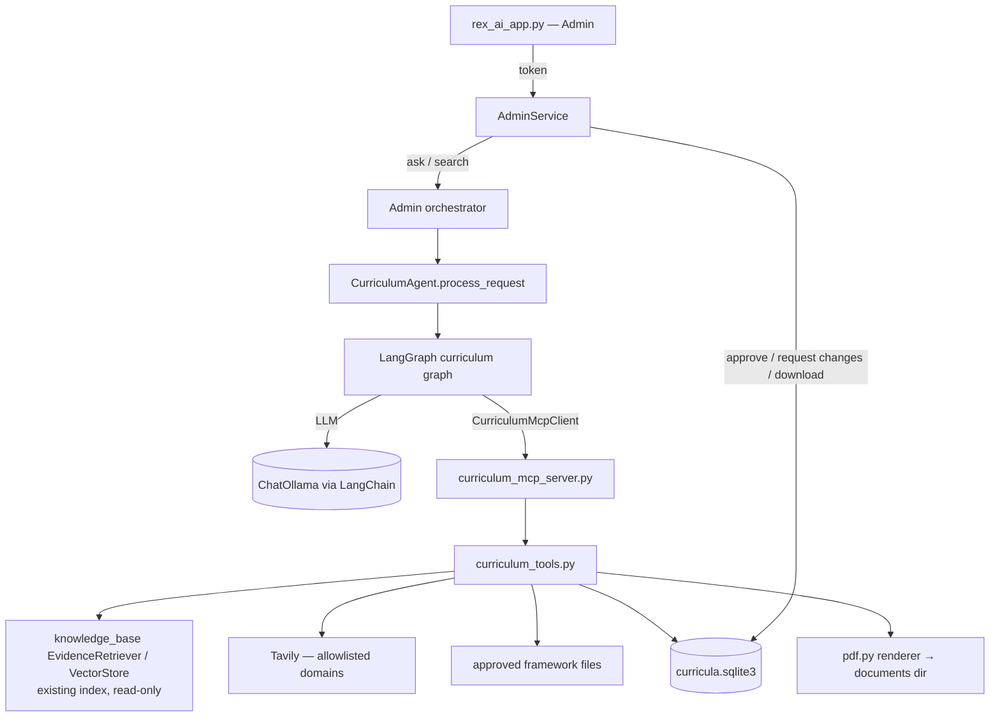
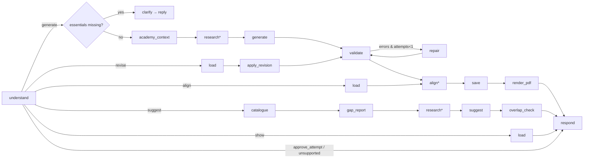

# Agent 3 — Curriculum Research & Accreditation Alignment Agent

**Architecture, contracts and requirements checklist (Phase 1).**
Status: **approved 2026-10-27** with the decisions in §15; **implemented 2026-10-28 (Phases 2–6 complete)**. Owner decisions still open: the research allowlist (§16), the model (§17), official framework files (D4).
Date: 2026-10-27.

Sources used (all inspected, not assumed):

- **[B]** the authoritative brief, *REX AI – Smart Academy Multi-Agent System – Scope of Work & WBS* (11 pages): Agent 3 on pp. 3–4, architecture p. 5, sprints pp. 6–7, acceptance criteria pp. 8–9, discovery questions and the implementation note pp. 9–10.
- **[P]** requirements from the previous Agent 3 prompt (workflows A/B, bilingual, LangChain/LangGraph/MCP, review lifecycle, metadata list).
- **[N]** requirements from the rebuild prompt (deterministic validation, bounded repair, research allowlist, cleanup, PDF quality, tests).
- The repository: `agents/curriculum_research/` (read for the first time in Phase 0), the orchestrator, `register_agents.py`, `admin_service.py`, `rex_ai_app.py`, the RAG engine (`knowledge_base/`), `agents/mcp_tool_client.py`, the real Chroma index (read-only), installed packages.

Legend for status: ❌ missing · ⚠️ partial · ✅ present and verified.

---

## 1. Requirements checklist

| ID | Requirement | Src | Current (verified) | Proposed implementation | Components | Verified by | Open question |
|---|---|---|---|---|---|---|---|
| R1 | Research curriculum topics using approved, credible sources | B18, N11 | ❌ only 5 synthetic examples are searched | `search_curriculum_sources` tool: Tavily restricted to an **allowlist** (`CURRICULUM_RESEARCH_DOMAINS`); keeps title, URL, publisher, date, excerpt, retrieval time | `curriculum_tools.py`, server | tool tests (mocked Tavily), allowlist enforcement test | **D3**: which domains are approved (default: none → research reported as not configured) |
| R2 | Analyse educational and industry skill requirements | B19 | ❌ | Research excerpts + academy course skills/outcomes fed to the LLM; output lists competencies with source ids; no source → marked "proposed, unverified" | graph `research`/`generate` nodes, validator | generation tests with mocked LLM; reference-integrity validation | — |
| R3 | Generate a structured curriculum | B20, B-acceptance | ⚠️ fixed 4-module template | LLM generation in bounded steps with Pydantic structured output; topic-, level-, audience- and duration-specific; no fixed module count | `schemas.py`, `prompts.py`, graph | EN/AR generation tests; template-free test (module count varies) | — |
| R4 | Required sections: title, overview/rationale, objectives, audience, prerequisites, level, measurable outcomes, modules+topics, module hours, exercises/activities, assessments, capstone, tools/resources, skills/competencies, alignment, references, assumptions/limitations/questions | B21, P5, N10 | ⚠️ 9 of 17 (template text) | `Curriculum` schema with all 17 sections; validator checks completeness | `schemas.py`, `validation.py` | completeness tests | — |
| R5 | Deterministic validation: fields/types, positive module hours, sum = requested total, measurable outcomes, outcome↔module↔assessment links, source references, framework evidence, no accreditation claims | N10 | ❌ (only even hour split) | Pure-Python `validate_curriculum` (also exposed as an MCP tool) | `validation.py` | one test per rule, EN and AR | — |
| R6 | Bounded repair; never silently change the requested duration | N10 | ❌ | One LLM repair pass with the validator's errors; if hours still disagree, a deterministic proportional rebalance that **keeps the requested total** and is recorded in *assumptions*; any remaining error → saved as `draft` with the issues listed | graph `repair` node | repair tests (fixed after 1 pass; still invalid → draft) | — |
| R7 | Compare against selected accreditation/competency standards; covered / partially covered / not covered / unable to determine; evidence for each | B22, P6, N11 | ❌ (refuses honestly) | Framework files in an approved folder (schema §7.3); `compare_with_framework` gives a deterministic evidence pre-mapping; the LLM judges each requirement citing curriculum element ids; the validator downgrades any mapping without valid evidence to *unable to determine* | `frameworks/`, tools, graph `align` node | mapping tests incl. fabricated-evidence rejection; missing-framework test | **D4**: real framework documents to load |
| R8 | Identify missing topics or learning outcomes | B23 | ❌ | Uncovered framework requirements + uncovered outcomes/modules from validation → "gaps" section with recommendations | align node, validator | gap tests | — |
| R9 | Never claim official accreditation | B p.4, P6, N11 | ✅ in notices | Validator rejects "accredited/certified/approved by …/معتمد من" claims; fixed disclaimer in every alignment report and PDF | `validation.py`, `pdf.py` | claim-rejection tests EN/AR | — |
| R10 | Professional PDF curriculum | B24, P10, N15 | ❌ | ReportLab renderer: cover with metadata/version/status, section hierarchy, module-hour table, references, page numbers; Arabic RTL with shaping | `pdf.py`, `render_curriculum_pdf` tool | PDF tests: parse back with `pypdf`, page/size checks, content-vs-data check, Arabic glyph/order check | **D1/D2** packages and fonts |
| R11 | Review and request modifications **before approval** | B25, P11, N14 | ⚠️ edits only, no approval | Lifecycle `draft → pending_review → changes_requested → approved` per version; admin actions in `AdminService` (token + audit); agent can never approve | `curriculum_store.py`, `admin_service.py`, UI | auth tests (forged token refused), "agent cannot approve" test, audit tests | — |
| R12 | Knowledge base with structured, filterable metadata (department, audience, level, industry, duration, outcomes, prerequisites, framework, country, source & update date) | B pp.3–4 | ✅ in the index (see §6.1); ❌ not used by Agent 3 | `list_academy_courses` / `get_course_details` read the **existing** index metadata (filters: department, level, audience, industry, language) and return source + update date + `data_status` | tools over `knowledge_base` | metadata accuracy tests on a temp index | — |
| R13 | Use stored information, do not ask again | B p.10, P4 | ⚠️ parser only | Slot filling from request → academy course record → conversation state; ask only for missing essentials (§5.3) in one combined question | graph `understand`/`clarify` | follow-up tests (asks only for what is missing; none when catalogue has it) | — |
| R14 | Discovery questions (course, audience, level, outcomes, hours, framework, projects/assessments) | B p.9–10 | ⚠️ | Same questions, asked only when unresolved and essential; non-essential ones become labelled assumptions | graph | follow-up tests | — |
| R15 | Workflow A — generate a requested curriculum end to end (parse → retrieve → research → generate → validate → align → save → PDF → reply) | P4, N8 | ⚠️ template | Graph route `generate` (§5.2) | graph, tools, store, pdf | end-to-end tests EN + AR through MCP | — |
| R16 | Revisions update the intended curriculum; history kept | P4, N14 | ⚠️ in-memory draft only | Route `revise`: load current version → deterministic or LLM change → validate → **new version** with change summary; old versions kept | graph, store | revision tests (hours, level, capstone, language, AR edits); version history test | — |
| R17 | Workflow B — catalogue analysis and evidence-based suggestions; select one to generate | P4, N9 | ❌ | Route `suggest` (§5.2): catalogue → deterministic gap report → optional research → LLM shortlist citing gap/source ids → overlap check → stored shortlist; "generate suggestion 2" → route `generate` | graph, tools | suggestion tests (no invented courses, overlap flagged, demonstration label) | — |
| R18 | Distinguish facts, hypotheses, recommendations; label synthetic data | P4, N9, N12 | ⚠️ notices | Every claim carries an origin: `academy_data` (with course id + file), `research` (source id), `proposed` (model); `data_status` from the index drives a "demonstration data" label | schemas, validator, pdf | labelling tests | — |
| R19 | Bilingual: detect, respond in request language, explicit output-language override, AR/EN curricula, reports and PDFs, keep technical terms | P7, N7 | ⚠️ messages only | `knowledge_base.language` (`detect_language`, `detect_explicit_language_request`); output language stored per curriculum; prompts generate in that language; RTL PDF | graph, prompts, pdf | full workflow tests in both languages + cross-language override | — |
| R20 | LangChain for models, prompts, structured output | P8, N6 | ❌ | `ChatOllama` + `ChatPromptTemplate` + `with_structured_output`, model from `CURRICULUM_LLM_MODEL` (default: REX's model) | `prompts.py`, graph | mocked-LLM tests | **D5** model |
| R21 | LangGraph with explicit state, nodes, conditional routing, retries | P8, N6 | ❌ | `StateGraph(CurriculumState)` (§5) | `graph.py`, `state.py` | route tests per request type | — |
| R22 | Every agent-callable capability through a Curriculum MCP server + client | P8, N6, N13 | ❌ (`server.py` is a demo, not MCP) | `agents/curriculum_mcp_server.py` + `CurriculumMcpClient(McpToolClient)`; the graph calls tools only through the client | server, client | stdio subprocess tests (tool list, schemas, calls, errors) | — |
| R23 | Tools validate input, protect paths, keep credentials server-side, structured errors | P8, N13 | ❌ | Ids validated by pattern; no path parameters; files addressed by store ids; keys only in the server | tools | traversal/invalid-input tests | — |
| R24 | Reuse the existing course retrieval; no duplicate KB; no re-index | P9, N12 | n/a | Tools use `knowledge_base.evidence.EvidenceRetriever` and `VectorStore` (same index, read-only); nothing copied, nothing re-indexed | tools | temp-index tests; real index untouched check | — |
| R25 | Draft storage: stable ids, versions, timestamps, language, content, sources, validation, alignment, status, history | P11, N14 | ❌ | SQLite store (§8), additive schema, gitignored | `curriculum_store.py` | store tests on temp DB | — |
| R26 | Orchestrator routes generate / suggest / catalogue gaps / compare / revise, EN + AR | P12, N16 | ⚠️ suggest/gap phrases go to REX or nowhere (verified) | Small shared routing change (§10.1) | `orchestrator.py` | routing tests incl. "learner phrases still go to REX" | — |
| R27 | Student side cannot reach curriculum administration | P12, N14, N16 | ✅ by design (user path = REX only) | Unchanged; tests added | — | access test | — |
| R28 | Admin UI: view drafts/versions, approve, request changes, download PDF | P10, P11, N16 | ❌ (results only as raw JSON) | "Curricula" tab in the admin dashboard | `rex_ai_app.py` | AppTest tests | — |
| R29 | Tests: behaviour, temp stores, mocked externals, real MCP subprocess | P13, N17 | ⚠️ 396 tests of the old behaviour | §12 | tests | full suite | — |
| R30 | Documentation | P14, N18 | ⚠️ describes the old agent | Update `CLAUDE.md`, technical guide, architecture, test plan, README | docs | review | — |
| R31 | Clean up obsolete Agent 3 code | N5 | n/a | §3 | — | cleanup report + full suite | — |
| R32 | Connects with Marketing (B41) and the example workflow "Curriculum Approved → Marketing" (B p.5); at least one two-agent workflow (B p.9) | B | ❌ Marketing agent does not exist | Out of scope for Agent 3, but approved curricula are exposed in a stable format (store + `get_curriculum`) so Agents 4/5 can read them | store | — | team plan for Agents 4/5 |

---

## 2. Git and ownership

- Branch `Mena`, merge `origin/habiba` (`aa7e00cf69`) in progress, **0 conflicts**.
- Agent 3 files are staged merge results (added/modified). Editing or deleting them creates working-tree changes on top; the staged index content is not lost. Shared staged files the rebuild must touch: `agents/orchestrator.py`, `agents/register_agents.py` (small changes only).
- The Agent 3 commits are authored by Habiba Montasser; the account running this session uses the same person's email. **This machine's git identity is "Mena"** — commits made here would be credited to Mena (brief §7 evaluates individual contributions). Not changed by me; for the owner to decide.

---

## 3. Current files — audit and cleanup plan

| File | Purpose today | Callers (verified) | Decision | Reason |
|---|---|---|---|---|
| `agent.py` | rule-based dispatcher (create/search/refine/unsupported) | `registration.py`, `server.py`, `__init__.py`, tests | **Replace** (new thin entry over the graph) | old design: no LLM/graph/MCP |
| `curriculum_builder.py` | fixed 4-module template, invented defaults ("Basic computer skills", "Beginners") | `agent.py`, `refinement.py` | **Remove after replacement** | template generation is not allowed; defaults are invented facts |
| `data.py` | keyword search over `data/curriculum_examples.json` | `tools.py`, `__init__.py`, tests | **Remove after replacement** | searches synthetic examples, not academy data |
| `tools.py` | `search_examples`, `get_curriculum_details` (no caller) | `agent.py` | **Remove after replacement** | replaced by MCP tools |
| `server.py` | local demo `main()` (not MCP) | none | **Remove after replacement** | misleading name; replaced by the MCP server |
| `agent_card.py` | capability dictionary | none | **Remove** | dead code; capabilities documented here instead |
| `refinement.py` | even hour redistribution, add module/capstone, change audience on the old schema | `agent.py` | **Replace** by `revisions.py` (new schema, proportional rebalance), then remove | tied to the old schema |
| `request_parser.py` | regex EN/AR: topic, hours (incl. per-week), audience, creation intent, accreditation words, edit detection | `agent.py`, 169 tests | **Adapt**: keep the deterministic slot extraction (hours, audience, topic, explicit edits) as a pre-parse; remove functions only the old dispatcher needs (`looks_like_edit_attempt`, `is_unsupported_action`, `refinement_takes_priority` if unused after the rebuild) with their tests | reliable, tested, language-aware; avoids a second parser |
| `registration.py` | `register_curriculum_research(orchestrator, store)` | `register_agents.py` (both orchestrators), tests | **Keep signature**, new internals | integration contract |
| `__init__.py` | exports | package users | **Adapt** | new exports |
| `data/curriculum_examples.json` | 5 synthetic examples | only `data.py` | **Remove after replacement**; update `data/README.txt` | no consumer left; must not be mistaken for academy data |
| Tests `test_curriculum_request_parser.py` | parser | — | **Keep**; drop only tests of removed functions | |
| `test_curriculum_routing.py` | orchestrator routing | — | **Keep**; add suggest/gap phrases | |
| `test_curriculum_integration.py` | through the orchestrator | — | **Adapt** to the new agent (mocked LLM, MCP via in-process tools) | |
| `test_curriculum_research.py`, `test_curriculum_review_regressions.py` | old agent/template/data behaviour | — | **Replace** test by test: keep every behaviour still required (empty input, unrelated messages not hijacked, Arabic replies, honest unsupported answers); remove template- and example-search-specific tests with a reason each | |

Nothing outside Agent 3 is removed.

**New files (Phases 2–3).** Phase 2: `curriculum_mcp_server.py`, `curriculum_research/{mcp_client, curriculum_tools, curriculum_store, academy_courses, research, frameworks, validation, schemas}.py`. Phase 3: `curriculum_agent.py` (new entry point, `CurriculumAgent`; the old `agent.py` stays registered until Phase 5 switches `registration.py` over and its integration tests pass), `graph.py` (LangGraph workflow), `state.py`, `prompts.py` (LangChain templates), `llm.py` (ChatOllama factory, structured calls with one retry), `understanding.py` (intents and values on top of `request_parser.py`), `revisions.py` (replaces `refinement.py`). Phase 4: `pdf.py` (renderer), `alignment.py` (framework comparison).

---

## 4. Architecture

| Part | Responsibility |
|---|---|
| `CurriculumAgent` (`curriculum_agent.py`) | entry point (`process_request`), builds the graph, holds the MCP client |
| LangGraph (`graph.py`, `state.py`) | routing, steps, bounded repair, conversation memory |
| LLM (LangChain) | request understanding fallback, content generation, suggestion writing, semantic alignment judgements |
| `CurriculumMcpClient` | the only way the graph reaches tools |
| `curriculum_mcp_server.py` | exposes the tool interface; reads `.env` and settings |
| `curriculum_tools.py` | validated operations (no business decisions by the LLM) |
| `validation.py` | deterministic rules (pure functions) |
| `curriculum_store.py` | drafts, versions, documents, audit |
| `pdf.py` | English and Arabic PDFs |
| `AdminService` | the only place that approves or requests changes (token + audit) |

---

## 5. LangGraph design

### 5.1 State (`CurriculumState`, TypedDict)

`request_text`, `language` (detected), `output_language` (explicit or = language), `conversation_id`, `intent` (`generate` / `revise` / `suggest` / `align` / `show` / `approve_attempt` / `clarify_answer` / `unsupported`), `slots` (topic, course_ref, total_hours, level, audience, outcomes_given, framework_id, capstone_required, assessment_wishes), `missing` (list), `course_evidence` (records from tools), `sources` (research results), `framework` (requirements or unavailable), `draft` (Curriculum), `validation` (result), `repair_attempts` (0–1), `alignment`, `saved` (curriculum_id, version, status), `document` (document id), `suggestions`, `messages_out`, `response`.

Persisted per conversation in `ConversationStore` under `curriculum_research`: `active_curriculum_id`, `pending_slots` + `asked` (when waiting for an answer), `last_suggestions`.

### 5.2 Nodes and routes

\* optional: research runs only when approved domains are configured and the request needs external evidence; alignment only when a framework is selected. A revision skips research unless the change needs it (e.g. a new topic area).

**As built (Phase 3).** Nodes: `understand`, `academy_context`, `clarify`, `research`, `generate`, `validate`, `repair`, `save`, `render_pdf`, `curriculum_reply`, `revise`, `suggest`, `show`, `align`, `simple_reply`, `finish`.
- `understand` is rule-based (`understanding.py` over `request_parser.py`); the model (`RequestSlots`) is asked only when a creation request has no topic the rules can find, and its values are kept only if they appear in the message.
- `academy_context` treats a catalogue course as *the* course only on an exact id or name match; similar courses are passed as "related" and flagged as possible duplicates.
- `generate` makes three structured calls (`CurriculumOutline`, `ModuleDetailList`, `CurriculumExtras`), then deterministic clean-up: ids renumbered (`LO*`, `M*`, `A*`) with references remapped, the requested/catalogue level kept, citations to sources that were not retrieved removed (and reported).
- `repair` runs at most once: one `RepairPatch` call for content errors (none when only hours are wrong), then the proportional hour rescale (recorded in *assumptions*) and removal of dangling outcome references; whatever is still invalid is saved as `draft` with the errors in the reply.
- `revise`: hours, audience, module removal and capstone removal are deterministic (`revisions.py`); "add a module" and "add a capstone" ask the model for that part only (`NewModule`, `CapstoneItem`); level, language and free-form instructions regenerate from the current version (the prompt carries the current curriculum and the requested change). Every revision is a new version.
- `align` (Phase 4, `alignment.py`): needs an approved framework file. If none is loaded, the result is *unable to determine*. If several are loaded and none is named, the agent asks which. The comparison runs on the stored version: the tool's word-overlap pre-mapping is passed as a hint, and the model judges requirements in batches of 12. Deterministic checks then apply: every requirement gets exactly one result, a missing judgement becomes *unable to determine*, *covered* or *partially covered* without an existing element id becomes *unable to determine*, unknown ids are dropped, and not/partially covered requirements become gaps with the model's recommendation. The result is saved as a new version (content unchanged) and validated against the framework, including the accreditation-claim rule on the explanations. A PDF is rendered. A generation request that names an approved framework ("… aligned with X") is aligned before saving. Any later revision clears the alignment and says so.
- Model failures (`CurriculumModelError`) and tool failures become error replies; nothing is saved after a model failure.

- **understand**: `request_parser` pre-parse (hours, audience, topic, explicit edits) + `detect_language` / `detect_explicit_language_request`; LLM structured fallback only for intent/slots the rules cannot settle; pending-question answers merged with stored slots.
- **academy_context**: `find_course` / `get_course_details` (by course name or id), and related courses; fills slots that the catalogue states (hours, level, audience, prerequisites) with origin `academy_data`.
- **generate**: three bounded structured calls — (1) outline: title, overview, rationale, objectives, outcomes, module list with hours; (2) per-module detail: topics, activities, outcome links; (3) assessments, capstone, tools/resources, competencies, assumptions. Each call receives only the evidence it needs and cites source ids.
- **validate** → `validate_curriculum` tool. **repair**: one LLM pass with the errors; then the deterministic hour rebalance (keeps the requested total, noted in assumptions).
- **save**: `save_curriculum_draft` (status `pending_review` if valid, `draft` otherwise). **render_pdf**: `render_curriculum_pdf`.
- **approve_attempt**: the agent answers that only an administrator can approve, in the Curricula tab.

### 5.3 Follow-up policy

Essential (asked if not found in request, conversation or catalogue): **topic/course**, **total hours** (unless the catalogue states the course hours), **level** (unless stated or catalogue). One combined question; the admin may reply "use defaults", in which case only clearly labelled defaults are used (level "Beginner", audience "general learners at that level") and listed under *assumptions*. Non-essential (outcomes, framework, projects/assessments): proposed by the model, labelled `proposed`, never asked unless the admin raises them.

---

## 6. Data sources

### 6.1 Academy courses (existing index — verified)

- Index `knowledge_base/vector_db`, collection `rex_knowledge`, 94 chunks from 9 files (`course_list.md` not yet indexed).
- 14 course ids (AI-, DA-, MKT-, MOB-, SW-) in the catalogue PDFs; course chunks carry `field_course_id`, `field_department`, `field_level`, `field_target_audience`, `field_duration`, `field_industry`, `field_accreditation`, `field_language_of_instruction`, `field_updated`, `field_data_status`, `section_path`, `filename`, `page`; outcomes, topics and prerequisites are in the chunk text under their section paths. Departments: Artificial Intelligence, Data Analytics, Digital Marketing, Mobile Development, Software Development. Levels: Beginner, Intermediate, Advanced.
- `field_data_status` is "synthetic" → every Workflow B result and any academy-derived fact is labelled **demonstration data**.
- Tools group chunks by `field_course_id` (data-agnostic: any file that indexes `course_id`/`department`/`level` fields works); missing fields are returned as `null` with a `missing` list, never filled in.

### 6.2 Research (Tavily, allowlist)

- Reuses `api_clients.tavily.search_tavily(include_domains=…)`. Allowed domains come only from `CURRICULUM_RESEARCH_DOMAINS` (comma list). **Empty by default** → `status: "not_configured"`, and the curriculum says research was not performed.
- Kept per source: `source_id`, title, URL, publisher (domain), published date (if given), excerpt, retrieved_at. Research is evidence for "industry relevance", never for academy facts or framework requirements.

### 6.3 Frameworks (approved files)

- Folder `CURRICULUM_FRAMEWORKS_DIR` (default `agents/curriculum_research/frameworks/`). One JSON file per framework: `framework_id`, `name`, `publisher`, `version`, `source_url`, `retrieved_on`, `language`, `licence_note`, `requirements: [{id, text, category}]`. Loaded only by id (pattern-validated, no paths).
- None is shipped. Without a file: alignment status **unable to determine** for the whole framework, stated in the reply and PDF.

---

## 7. MCP tool contracts (`agents/curriculum_mcp_server.py`)

All return a JSON object with `status` (`ok` / `invalid_request` / `not_found` / `not_configured` / `error`) and a `message` on failure. No tool accepts a file path. Ids: `CUR-[0-9a-f]{12}`, framework ids `[a-z0-9_-]{2,40}`.

| Tool | Input | Output | R/W |
|---|---|---|---|
| `list_academy_courses` | `department?`, `level?`, `audience_contains?`, `limit≤200` | `courses: [{course_id, name, department, level, target_audience, duration, industry, accreditation, language, updated, data_status, source_files, missing}]` | read |
| `get_course_details` | `course` (id or name) | `course` + `sections: [{section_path, text, source, page}]` (outcomes, topics, prerequisites as written) | read |
| `check_course_overlap` | `title`, `topics[]`, `outcomes[]` | `overlaps: [{course_id, name, score, shared_terms}]`, `duplicate: bool` (deterministic similarity) | read |
| `catalogue_gap_report` | `department?` | per department: levels present/missing, prerequisite chains, topic/skill inventory, near-duplicates; `data_status` | read |
| `search_curriculum_sources` | `query`, `max_results≤8` | `sources: [{source_id, title, url, publisher, published, excerpt, retrieved_at}]` | read (external) |
| `get_framework_requirements` | `framework_id` | framework metadata + `requirements[]` or `not_found` | read |
| `validate_curriculum` | `curriculum`, `requested_hours` | `valid`, `errors[]`, `warnings[]` (codes + paths) | read |
| `compare_with_framework` | `curriculum`, `framework_id` | `pre_mapping: [{requirement_id, candidate_elements, matched_terms}]` | read |
| `save_curriculum_draft` | `curriculum`, `validation`, `alignment?`, `sources[]`, `curriculum_id?`, `change_summary` | `curriculum_id`, `version`, `status` (`draft`/`pending_review`; **never approved**) | write |
| `get_curriculum` | `curriculum_id`, `version?` | content + metadata + status + history summary | read |
| `list_curricula` | `status?`, `limit` | summaries | read |
| `render_curriculum_pdf` | `curriculum_id`, `version`, `language` | `document_id`, `filename`, `pages`, `bytes` | write (documents dir) |

Not tools (admin only, in `AdminService`): approve, request changes, download PDF bytes for the UI.

---

## 8. Curriculum schema and validation

`Curriculum` (Pydantic): `title`, `language`, `overview`, `rationale`, `objectives[]`, `target_audience`, `prerequisites[]`, `level`, `total_hours`, `learning_outcomes[{id "LO1", statement}]`, `modules[{id "M1", title, hours, description, topics[], outcome_ids[], activities[{type, description}]}]`, `assessments[{id "A1", type, description, outcome_ids[]}]`, `capstone{title, description, outcome_ids[], deliverables[]} | null + reason`, `tools_resources[]`, `competencies[{name, source_ids[]}]`, `references[{source_id…}]`, `academy_evidence[{course_id, field, value, source}]`, `assumptions[]`, `open_questions[]`, `data_notice`.

Deterministic rules (codes in brackets):
- required sections present and typed [missing_section, bad_type];
- module hours integers > 0 [module_hours]; Σ module hours = requested hours [hours_total];
- each outcome starts with a measurable verb from an EN/AR verb list; "understand/know/learn/فهم/معرفة/يتعلم" rejected [outcome_not_measurable];
- every outcome is covered by ≥1 module and ≥1 assessment; every module and assessment cites ≥1 existing outcome; capstone cites ≥1 [outcome_unlinked, dangling_outcome_ref];
- every cited `source_id` exists in `references`, and every reference came from a tool result [unknown_source];
- alignment entries: requirement id exists in the framework; "covered/partial" cite existing element ids, else → unable to determine [alignment_evidence];
- no official-accreditation claims [accreditation_claim];
- content language matches `output_language` (Arabic-letter ratio) [language_mismatch].

---

## 9. Storage, lifecycle and authorisation

`curricula.sqlite3` (gitignored; `CURRICULUM_DB_PATH`), additive schema:

- `curricula` — `curriculum_id`, `title`, `topic`, `language`, `level`, `target_audience`, `total_hours`, `framework_id`, `status`, `current_version`, `approved_version`, `created_at`, `updated_at`, `origin` (`request` / `suggestion`), `source_request`.
- `curriculum_versions` — `curriculum_id`, `version`, `content_json`, `validation_json`, `alignment_json`, `sources_json`, `change_summary`, `created_at`, `created_by` (`system:curriculum_agent` or admin session).
- `curriculum_documents` — `document_id`, `curriculum_id`, `version`, `language`, `filename`, `sha256`, `pages`, `created_at` (files in `CURRICULUM_DOCUMENTS_DIR`, gitignored, name `CUR-…_v{n}_{lang}.pdf`).
- `curriculum_audit` — `event`, `curriculum_id`, `version`, `previous_status`, `new_status`, `actor`, `notes`, `at`.

Statuses (mapping to the tender convention `pending/approved/rejected`): `draft` (validation failed or incomplete), `pending_review` (≈ pending), `changes_requested` (admin asked for changes; ≈ rejected-with-feedback), `approved` (per version, admin only). A revision always creates a new version (`pending_review` if valid); an approved version stays approved until a newer one is approved. The save tool refuses `approved`; `AdminService.approve_curriculum(token, id, version)` and `request_curriculum_changes(token, id, version, notes)` call `_require(token)` and write the audit row.

---

## 10. Integration

### 10.1 Orchestrator (shared, minimal)

Verified today: "Suggest new courses for the AI track", "recommend new courses we should add to the catalogue", "اقترح دورات جديدة للأكاديمية" → REX (refused on the admin side); "Review the catalogue and identify missing learning paths" → no agent. Proposed: one rule before the REX rule — *new* + course/curriculum words + a planning cue (we/our/academy/catalogue/track/department/introduce/add/offer/launch/gap/learning path; Arabic: جديدة/جديد + دورات/مناهج/كورسات/مسارات + اقترح/نضيف/الأكاديمية/فجوات) → `curriculum_research`. Learner phrases ("recommend a course for me", "رشحلي كورس") keep going to REX (tests). The continuation check becomes "this conversation has an active curriculum or a pending question".

### 10.2 Admin UI

New **Curricula** tab: list with status filter, version selector, sections, validation and alignment results, sources, assumptions; **Download PDF** (`st.download_button`), **Approve** and **Request changes** (notes) through `AdminService`. The chat ("Ask agents") shows a curriculum summary with its id and version.

### 10.3 Student side

Unchanged: `RexUserService` → REX only. Test asserts the curriculum agent is unreachable there.

---

## 11. PDF

**As built (Phase 4, `pdf.py`).** `TextBlock` wraps every paragraph in *logical* order, then shapes (`arabic-reshaper`) and reorders (`python-bidi`) each line on its own. Each line is drawn in runs, and each run's font is chosen from the bundled fonts' character maps: Arabic letters in Noto Naskh Arabic, Latin letters and symbols such as `%`, `—` and `()` in Noto Sans. A character neither font has becomes `?`. In an Arabic PDF, mostly-Latin paragraphs (references, English framework requirements) keep a left-to-right base direction and stay right-aligned. Tables put the first column on the right. Words longer than a line, such as URLs, are broken. Only the bundled fonts are referenced, and they are embedded as subsets; the default Helvetica is never used. The status is printed on the cover ("Pending review (not approved)" and similar), along with a data notice and the disclaimer. Later pages hold the alignment table, gaps and validation problems. Every page has a footer with the id, version and page number. Checked visually on English and Arabic pages, including a live `qwen2.5:3b` output, and by `tests/test_curriculum_pdf.py`, which reads the text back with pypdf in logical order, checks the shaped letter forms, the wrapping order and the embedded fonts.

- ReportLab 4.2.5 (installed). Arabic: `arabic-reshaper` 3.0.1 (letter joining) + `python-bidi` 0.6.12 (right-to-left order); both resolve for Python 3.14 on Windows (dry run, not installed). ReportLab's own RTL option needs `fribidi`, which is not installed.
- Fonts: bundle **Noto Naskh Arabic** and **Noto Sans** (SIL Open Font Licence, redistributable) in `agents/curriculum_research/fonts/`; Windows' Arial is not redistributable.
- Layout: cover (title, course id link if any, language, version, status, date, data notice), sections in brief order, module table (module, topics, hours, outcomes), assessments table, alignment table with status and evidence, references with URLs, assumptions; page numbers; RTL paragraph alignment and right-to-left tables for Arabic; Latin runs inside Arabic text keep their order.
- Tests read the PDF back with `pypdf` (text present, page count, metadata), compare it with the stored version, and check Arabic glyph order.

---

## 12. Testing strategy

- **Tools** (in-process): every tool, invalid inputs, ids/paths refused, temp DB and documents dir, temp Chroma index built from fixture files with fake embeddings (existing pattern in `test_ingestion_pipeline.py`).
- **MCP** (real subprocess): tool list and schemas, calls, schema-breaking input, errors.
- **Graph** (mocked LLM returning fixed structured objects; in-process tools): each route, follow-up questions, repair once, draft-on-failure, revisions/versions, suggestions with overlap, alignment with and without a framework, accreditation-claim rejection, EN and AR end to end, explicit output language.
- **PDF**: EN and AR files parsed back; safe names; content matches data.
- **Admin/auth/UI**: forged token refused, agent cannot approve, audit rows, AppTest for the Curricula tab.
- **Routing/regression**: new phrases, learner phrases unchanged, REX/RFP/MCP suites unchanged, full suite.
- **Live (manual, temp stores)**: one Arabic and one English generation with the real model and MCP server.

---

## 13. Configuration

| Variable | Default | Purpose |
|---|---|---|
| `CURRICULUM_LLM_MODEL` | REX's model (`REX_LLM_MODEL`, default `qwen2.5:3b`) | model for this agent (temperature 0, 12,288-token context, thinking off for thinking models) |
| `CURRICULUM_RESEARCH_DOMAINS` | empty | approved research domains |
| `CURRICULUM_DB_PATH` | `agents/curriculum_research/curricula.sqlite3` | store |
| `CURRICULUM_DOCUMENTS_DIR` | `agents/curriculum_research/documents/` | PDFs |
| `CURRICULUM_FRAMEWORKS_DIR` | `agents/curriculum_research/frameworks/` | approved frameworks |
| `TAVILY_API_KEY` | existing | research (server-side only) |

---

## 14. Risks

1. A 3B model and long structured output → generation is split into small calls, validated, repaired once; quality may still be limited (D5).
2. Without approved domains (D3) and framework files (D4), research and alignment report "not configured" / "unable to determine" — honest but limited for the demo.
3. The old tests describe the old behaviour; each replaced test is listed with its reason.
4. A third process reading the Chroma index is fine for reads; re-indexing still needs every process stopped.
5. Deadline 2026-11-05: order of work = Workflow A + PDF + approval first, then B, then alignment.

## 15. Decisions (approved 2026-10-27)

- **D1 — approved.** Install `arabic-reshaper` and `python-bidi`, add them to `requirements.txt`, verify them on this Python, and test Arabic PDFs for readable, correctly ordered text. No duplicate dependencies.
- **D2 — approved.** Bundle Noto Arabic and Latin fonts with their licence files; check the required Arabic and English characters and embedding; test shaping, right-to-left layout, headings, tables and page layout. Never rely on Arial or other machine fonts.
- **D3 — research the sources; the allowlist needs review.** I research and recommend trusted sources (§16) with purpose, credibility, relevance, official site and the information each offers, separating *general industry research* from *official documents for framework/accreditation alignment*. Domain restrictions are configurable; **external research stays disabled until the owner approves the allowlist.** Inaccessible or insufficiently trustworthy sources are reported as such; no CAPTCHA, login or access control is bypassed.
- **D4 — no framework documents yet.** Alignment works with official framework documents obtained from approved sources or added later by an administrator, recording name, version, source and requirements. It compares only against requirements it can verify, gives evidence for every gap, and reports **unable to determine** when the documents are unavailable. No invented requirements; no accreditation or compliance claims. General research and alignment stay separate capabilities.
- **D5 — compare before switching.** The default stays `qwen2.5:3b` until a fair comparison of `qwen2.5:3b` and `qwen3.5:4b` on the same curriculum tasks (English and Arabic generation, structure and completeness, revision accuracy, structured-output reliability, time, resources, failures) supports a change. The model stays configurable (`CURRICULUM_LLM_MODEL`). If the comparison cannot be completed, the current model is kept and the reason recorded (§17).

Other instructions recorded: reuse `request_parser.py` (no second parser); reuse `rex_knowledge` with its demonstration status explicit; approval and changes only through `AdminService`; regression tests that admin requests for new academy courses reach Agent 3 while student recommendations still reach REX; no Git operations; a requirements coverage matrix maintained (§18).

---

## 16. Trusted sources — verification and recommended allowlist (D3; research stays OFF until approved)

**Status:** the 13 domains proposed in Phase 1 were accepted as *candidates*. Each was verified on 2026-10-27; the results are below. **External research remains disabled** (`CURRICULUM_RESEARCH_DOMAINS` empty) until the owner approves a list.

### 16.1 How the agent would use these sites

- **R — general research** (`search_curriculum_sources`): one search query per request through Tavily, at most 8 results, restricted to the allowlist. The agent keeps only the **search result** (title, URL, publisher domain, published date, a ≤ 800-character excerpt, retrieval time) and cites it. It does **not** crawl sites, download full documents (`include_raw_content=False`), store pages, or train on them. Results from any other domain are discarded. Research is evidence for *industry relevance*, never for academy facts or framework requirements.
- **F — framework documents** (§6.3): official requirement lists for alignment. These are **downloaded and added by an administrator by hand** after checking the licence, never fetched by the agent.

### 16.2 Verification method

For each domain: (1) open the official site or an official page on it and confirm the publisher identifies itself; (2) read the site's terms, copyright or licence page where reachable; (3) note whether automated access is restricted; (4) prefer the publisher's own pages over mirrors. Fetches were plain page reads from this session — no login, CAPTCHA or access control was touched. Where a site refused the read (HTTP 403), that is recorded and the finding rests on search results naming the official page; such points are marked *(indirect)*.

### 16.3 Results per domain

| Domain | Owner (verified) | Intended purpose | Use | Access / licence findings | Recommendation |
|---|---|---|---|---|---|
| `nist.gov` | US National Institute of Standards and Technology — the NICE Framework Resource Center page carries the US-government `.gov` banner and sits in NIST's site structure | NICE Workforce Framework for Cybersecurity (SP 800-181r1): work roles, competency areas, knowledge and skill statements; components poster dated March 2025 | R + F | NIST copyright page: web content "considered public information and may be distributed or copied"; credit requested; third-party images excluded | **Allow** |
| `onetonline.org` | Sponsored by US DOL Employment and Training Administration, developed by the National Center for O\*NET Development (licence page) | Occupations, skills, tools and technology (US labour market) | R + F | Site content **CC BY 4.0**: credit O\*NET OnLine and USDOL/ETA, link the licence, state changes, and note modifications are not endorsed by USDOL/ETA | **Allow** (attribution in references) |
| `onetcenter.org` | National Center for O\*NET Development (O\*NET Resource Center) | Downloadable O\*NET database (for an administrator to load as a framework file) | R + F | Database files **CC BY 4.0**; other site content under the separate *O\*NET Resource Center Content License*; career tools under another licence | **Allow** (cite; use only the CC BY database for F) |
| `esco.ec.europa.eu` | European Commission, DG Employment, Social Affairs and Inclusion (co-manager of the site) | Occupations and skills taxonomy; **available in Arabic** (one of 28 languages, verified on the ESCO languages page) | R + F | Commission documents reusable under Decision 2011/833/EU (credit the source, do not distort meaning); ESCO's own licence FAQ answer was not retrievable — to be read before loading ESCO as a framework file | **Allow** |
| `oecd.org` | OECD (direct fetch refused, HTTP 403) *(indirect)* | Skills outlooks, education and training policy evidence | R | Content published from 1 July 2024 is **CC BY 4.0** by default (OECD press release, July 2024); earlier content under OECD terms similar to CC BY; third-party material excluded; adaptations must not be presented as OECD views *(indirect)* | **Allow** |
| `ilo.org` | International Labour Organization (UN agency); the cited "Rights and permissions" page is on ilo.org *(indirect)* | Labour-market and skills reports | R | Open-access policy from **3 May 2023**: new knowledge products generally **CC BY 4.0**, reusable with citation; older works need their own copyright page checked; photos and logos excluded *(indirect)* | **Allow** |
| `weforum.org` (incl. `reports.weforum.org`) | World Economic Forum (direct fetch refused, HTTP 403) *(indirect)* | *Future of Jobs Report 2025* (January 2025; >1,000 employers, 55 economies): skills expected to grow (AI and big data, networks and cybersecurity, technological literacy) | R | Reports state **CC BY-NC-ND 4.0** "and in accordance with our Terms of Use" (seen on several report pages; the Terms page itself was not retrieved). Quoting with citation is fine; no derivative republication. Global employer survey, not Egypt/Saudi-specific | **Allow** (cite only; quote figures from the official report) |
| `etec.gov.sa` | Saudi Education and Training Evaluation Commission — the site states it is "an official government website affiliated with the Government of the Kingdom of Saudi Arabia" | **National Qualifications Framework, 3rd edition** (launched mid-2026, reported 6 July 2026): levels 0–8 and, new in this edition, **short-programme certificates, professional qualifications and professional certifications**; NCAAA (higher-education accreditation); **MASAR — National Center for Training Evaluation and Accreditation** (accredits training institutions) | R + F | Terms of use not located; the 3rd-edition text was seen only on a university mirror and a news report (Okaz) — the official copy must come from etec.gov.sa. **Correction to Phase 1:** §16 said "2nd ed. 2023"; the current edition is the 3rd. Alignment with NQF descriptors is **not** NCAAA or MASAR accreditation | **Allow** (most relevant source for Saudi short courses) |
| `naqaae.eg` | Egypt National Authority for Quality Assurance and Accreditation of Education — official site `naqaae.eg/en/` per the INQAAHE member directory *(indirect)*; **direct fetch refused (HTTP 403)** | Quality-assurance standards; Egyptian NQF (activation stage, ETF 2025) | R + F | Terms not reachable. Accredits education institutions/programmes, not short training courses | **Allow, but unverified directly** — confirm in a browser before approval |
| `computer.org` | IEEE Computer Society — the SWEBOK page states the Guide is "published by the IEEE Computer Society" | **SWEBOK v4.0a** (revised 25 Sept 2025): 18 software-engineering knowledge areas | R + F | Download through a form; permitted: personal copy, internal intranet, quoting reasonable passages with citation, non-profit educational use with full citation; **prohibited:** redistribution, public posting, translation, altering text. The IEEE CS Digital Library terms **prohibit robots and intelligent agents** (CSDL only) | **Allow for search citations only**; SWEBOK as a framework file only if added by an admin and kept internal (no translation, no republication) |
| `acm.org` (incl. `csed.acm.org`) | ACM; CS2023 site shows ACM, IEEE-CS and AAAI and their endorsement dates (Jan–Feb 2024) | **CS2023** curricula (knowledge areas, competencies); ACM Data Science competencies (2021) | R + F | `csed.acm.org` shows no licence statement; `acm.org` refused direct fetch (HTTP 403). ACM's Digital Library policy (archived page) says users should **not use robots or intelligent agents**; a current policy page was not found | **Owner decision.** Search snippets only (no agent access to `dl.acm.org`); CS2023 as a framework file only after an admin checks the report's copyright page |
| `unesco.org` | UNESCO (the AI competency frameworks page is on unesco.org) | **AI competency frameworks** for students (12 competencies) and teachers (15), **available in Arabic** | R + F | UNESCO Terms of Use (read directly): §7(c) bars accessing, scraping or crawling Materials "by any Automated System"; §8 **reserves text-and-data-mining, automated extraction and AI-training rights**; §9 requires prior written authorisation for systematic extraction. Individual publications may carry an IGO Creative Commons licence (to be checked per document) | **Not recommended for automated research.** An administrator may load the framework document by hand if its own licence (likely CC BY-SA 3.0 IGO — unverified) permits |
| `ieee.org` | IEEE | Standards and papers (IEEE Xplore) | — | Paywalled; IEEE's Xplore API terms bar robots, spiders and retrieval tools and bulk presentation; library notices relay that IEEE "does not permit robots or intelligent agents" on Xplore *(indirect)*. Nothing it offers is needed that `computer.org` does not already cover | **Remove from the list** |

### 16.4 SFIA — why it is excluded

SFIA (`sfia-online.org`, the Skills Framework for the Information Age) is excluded for a specific licensing reason, read directly from the SFIA Foundation's **Corporate User licence** page (the free licence):

- it permits only "in-house management of staff" and "personal use by the organisation's staff";
- it does **not** permit "**mapping offerings, such as training courses, qualifications or certifications for external use**", "any commercial exploitation of SFIA", use of the SFIA trademark, or "any distribution or publication of SFIA material in any form".

Agent 3 would do exactly what is excluded: map the academy's training courses to SFIA skills and put that mapping in curricula and PDFs shown outside the organisation. Search results indicate *(indirect)* that mapping requires a fee-bearing licence (a Mapping licence, or under the January 2026 terms a Partner licence, with the mapping done to the Foundation's professional standards by an accredited consultant). **SFIA is not used for external mapping unless the academy obtains a licence that permits this use.**

### 16.5 Recommended allowlist (for approval)

`nist.gov, onetonline.org, onetcenter.org, esco.ec.europa.eu, oecd.org, ilo.org, weforum.org, etec.gov.sa, naqaae.eg, computer.org`

- **Removed** from the Phase 1 candidates: `ieee.org` (robot prohibition, paywalled, not needed) and `unesco.org` (terms reserve automated extraction and require authorisation).
- **Owner decision:** `acm.org` — useful for CS2023, but ACM's stated policy discourages robots. If approved, it is used for search snippets only.
- **Before approval:** confirm `naqaae.eg` opens in a browser as the authority's site (it refused automated reads).

Every reference keeps its URL and retrieval time; licences with attribution terms (O\*NET, OECD, ILO, WEF) are satisfied by the reference list in each curriculum and PDF. Not verified: whether Tavily's index covers each site and returns useful excerpts. That can only be measured once research is enabled.

### 16.6 Not recommended

| Source | Reason |
|---|---|
| SFIA | §16.4 |
| `unesco.org`, `ieee.org` | §16.3 (automated-access terms) |
| Vendor certification outlines (CompTIA, AWS, Microsoft…) | Commercial and product-specific; add individually if a course targets that certification |
| Blogs, course marketplaces, aggregators, Wikipedia, university mirrors of official documents | Not authoritative; mirrors may be outdated (e.g. the Saudi NQF 2nd edition still circulates) |
| Egypt ETQAAN (TVET quality assurance) | Official site not found; add once verified |

Sources consulted (2026-10-27): [CS2023 site](https://csed.acm.org/), [SWEBOK](https://www.computer.org/education/bodies-of-knowledge/software-engineering), [IEEE CS Digital Library terms](https://computer.org/digital-library/terms-of-use), [IEEE Xplore API terms](https://developer.ieee.org/API_Terms_of_Use2), [ACM DL end-user policy (archived)](https://www.acm.org/publications/policies/usage-old), [NIST NICE Resource Center](https://www.nist.gov/itl/applied-cybersecurity/nice/nice-framework-resource-center), [NIST copyrights](https://www.nist.gov/oism/copyrights), [UNESCO AI competency frameworks](https://www.unesco.org/en/digital-education/ai-future-learning/competency-frameworks), [UNESCO terms of use](https://www.unesco.org/en/terms-use), [ESCO languages](https://esco.ec.europa.eu/en/about-esco/escopedia/escopedia/esco-languages), [Decision 2011/833/EU](https://eur-lex.europa.eu/eli/dec/2011/833/oj), [O\*NET OnLine licence](https://www.onetonline.org/help/license), [O\*NET database licence](https://www.onetcenter.org/license_db.html), [OECD open-by-default policy](https://oecd.org/en/about/oecd-open-by-default-policy.html), [OECD press release July 2024](https://www.oecd.org/en/about/news/press-releases/2024/07/oecd-data-publications-and-analysis-become-freely-accessible.html), [ILO rights and permissions](https://www.ilo.org/node/9321), [ILO open access](https://www.ilo.org/resource/news/international-labour-organization-goes-open-access), [WEF Future of Jobs 2025](https://www.weforum.org/publications/the-future-of-jobs-report-2025), [WEF report PDF](https://reports.weforum.org/docs/WEF_Future_of_Jobs_Report_2025.pdf), [ETEC](https://etec.gov.sa/en), [Okaz on NQF 3rd edition](https://www.okaz.com.sa/local/saudi-arabia/2255712), [NAQAAE (INQAAHE directory)](https://www.inqaahe.org/member/national-authority-for-quality-assurance-and-accreditation-of-education), [Egypt NQF (ETF 2025)](https://www.etf.europa.eu/sites/default/files/2025-11/NQF%20Egypt.pdf), [SFIA Corporate User licence](https://sfia-online.org/en/about-sfia/licensing-sfia/corporate-user-licence), [SFIA choosing a licence](https://sfia-online.org/en/licensing-sfia/choosing-a-licence).

## 17. Model comparison for Agent 3 (D5)

**Question.** Should Agent 3 keep `qwen2.5:3b` (the current default, shared with REX) or switch to `qwen3.5:4b`?

### 17.1 Method

- **Same workflow for both:** the Phase 3 graph (`graph.py`) with identical prompts, temperature 0, a 12,288-token context, and thinking disabled for thinking models (`llm.get_llm`).
- **Same data:** a **copy** of the knowledge-base index (94 chunks, 14 courses, synthetic demonstration data). The real `knowledge_base/vector_db` was not opened. Each model got its own temporary database, documents folder and conversation store. Research was disabled, so neither model saw web sources.
- **Fair order:** models ran one after the other on an otherwise idle machine. Each was warmed up with one untimed call and unloaded afterwards (`ollama stop`). Peak GPU memory was sampled every second with `nvidia-smi`.
- **Hardware:** NVIDIA GeForce RTX 3060 Laptop GPU (6 GB VRAM), Ollama local server.
- **Tasks (11 per model):**
  - 6 generations: 3 in English and 3 in Arabic, at 20–60 hours and all three levels (topics: Python for data analysis, cybersecurity awareness, MLOps, Excel data analysis, digital marketing, Flutter mobile development).
  - 4 revisions: add a module (EN and AR), change the level, translate EN→AR.
  - 1 Workflow B request: suggest new Data Analytics courses.
- **Measures:**
  - first-pass validity (before any repair);
  - final validity (`pending_review` vs `draft`) and the remaining error codes;
  - whether the model's own module hours matched the requested total;
  - completeness (11 section checks);
  - language correctness;
  - revision accuracy (the requested change applied and the total hours kept);
  - structured-output failures (answers that did not fit the schema);
  - seconds per task, number of model calls, and peak GPU memory;
  - for suggestions: count, citations of real catalogue gaps, and duplicates flagged.
- The script is `curriculum_model_eval.py` in the session scratchpad. It is an evaluation tool, not part of the application.

### 17.2 Prompt and schema fix found by the first run

The first run (before the fix) showed `qwen2.5:3b` returning outlines with **no learning outcomes, no objectives and no capstone** for every English task. The cause was not the model alone. Fields with defaults are *optional* in the JSON schema sent to Ollama, so constrained decoding let the model skip them. The step schemas now make every needed field **required, with minimum list sizes** (`schemas.py`, regression test `test_the_model_must_write_every_needed_section`). The results below are from the rerun with that fix; both models used the same fixed schemas.

A second run then stalled. `qwen2.5:3b` gave no answer for 34 minutes on the first Arabic generation. The model calls had no limit on output length or waiting time. **Fixes:**
- every call is now capped at 4,096 output tokens and 240 s, and a timeout is not retried (`llm.py`, tests `test_model_calls_are_bounded`, `test_a_timeout_is_not_retried`);
- every text and list in the step schemas has a maximum size, which Ollama enforces while decoding (checked with a direct call: a 40-character limit gave exactly 40 characters);
- the prompts ask for short text.

The cause was one Arabic assessment description that kept running until it used up the whole token budget. Before the size limits, 3 of 4 Arabic tasks failed for `qwen2.5:3b` with JSON cut off at the token limit. The final run below used all fixes for both models.

The final run also exposed a **validation gap**. The language check measured the whole document, so an Arabic curriculum whose assessments were all in English still passed. The check now also flags any substantial field written in the wrong language (`validation._wrong_language_fields`, test `test_assessments_and_capstone_count_for_the_language`). The results below were re-checked with that rule; the check is deterministic and needs no model calls.

### 17.3 Results (final run, 2026-10-28)

| Measure | `qwen2.5:3b` | `qwen3.5:4b` |
|---|---|---|
| Generations valid (re-checked with the per-field language rule) | **2 / 6** (EN 1/3, AR 1/3) | **4 / 6** (EN 2/3, AR 2/3) |
| Generations valid on the first pass (no repair) | 0 / 6 | 3 / 6 |
| Model's own module hours matched the requested total | 2 / 6 | 5 / 6 |
| Section completeness (11 checks, mean) | 0.95 (Arabic: only 3 outcomes each) | 1.00 |
| Arabic content in Arabic throughout | 1 / 3 (two had English assessments) | 3 / 3 |
| Revisions applied correctly (change made, hours kept) | 4 / 4 | 4 / 4 |
| Revisions valid afterwards | 3 / 4 (Arabic add-module kept the English assessments of its base) | 3 / 4 (translation: one outcome not assessed) |
| **All 10 curriculum tasks valid** | **5 / 10** | **7 / 10** |
| Workflow B suggestions | 1 suggestion, cites a real gap, flagged as a likely duplicate of DA-301 | 1 suggestion, cites a real gap, not a duplicate |
| Answers that did not fit the schema | 0 | 2 (both on `ar2`, recovered by the retry) |
| Requests that ended in an error | 0 | 0 |
| Time per generation: mean (range) | **37 s** (28–45) | **133 s** (41–378) |
| Time for all 11 tasks | **317 s** | **1,129 s** (3.6×) |
| Model calls per generation | 3–4 | 3–5 |
| GPU memory, peak / model size (`ollama ps`) | **2.6 GB** / 2.6 GB | **4.0 GB** / 3.4 GB |

Remaining errors after the one repair pass were `outcome_not_measurable` and `outcome_unlinked` (both models) and `language_mismatch` (`qwen2.5:3b` only). In every case the curriculum was saved as a **draft**, with the problems listed in the reply. Nothing invalid reached `pending_review`.

**Content (one Arabic case read side by side, *Excel data analysis, 30 h*).**
- `qwen2.5:3b` wrote three near-identical outcomes ("يطبق المتدربين استخدام …", which is also ungrammatical), five modules that differ only in one word, and assessments in English.
- `qwen3.5:4b` wrote four distinct measurable outcomes (statistics formulas, dashboards, comparing cleaning methods, reports), five modules with concrete content, and Arabic assessments.

### 17.4 Decision

**The default stays `qwen2.5:3b`** (no change made), and `CURRICULUM_LLM_MODEL` remains the switch. The results are a trade-off, not a clear case for switching:

- **For `qwen3.5:4b`:** clearly better output. More curricula pass validation (7/10 vs 5/10), more pass on the first try (3/6 vs 0/6), the module hours usually add up without correction, all Arabic content is in Arabic, and the content reads noticeably better.
- **Against `qwen3.5:4b`:**
  - **Speed:** 3.6× slower; one Arabic generation took over 6 minutes.
  - **Memory:** 1.4 GB more GPU memory. REX keeps `qwen2.5:3b` loaded (2.6 GB), so both models together (≈ 6.6 GB) exceed this laptop's 6 GB GPU. Ollama would then have to swap models between agents. This was not measured.
  - **Reliability:** 2 schema failures, against 0.

**Recommendation for the owner:** if curriculum quality matters more than waiting time (curricula are generated rarely and reviewed by an administrator), set `CURRICULUM_LLM_MODEL=qwen3.5:4b`. Otherwise keep the default. Either way, validation keeps every curriculum that fails a rule out of review.

### 17.5 Limitations

- **Small sample:** one run per task, six generations per model. The differences are indicative, not statistically established.
- **Non-deterministic at temperature 0:** the same `qwen2.5:3b` Arabic request succeeded in a standalone check and failed in a full run before the size limits. Single results can vary.
- **Data and research:** synthetic catalogue only; research was disabled, so citation behaviour with real sources is untested.
- **Content quality** was judged by reading one case per model plus the automatic checks. There was no expert review.
- **Hardware:** one laptop GPU. Timings include Ollama's own scheduling. Both models running at the same time was not measured.
- **Superseded first runs:** the earlier runs, before the schema and size fixes, are kept in the session scratchpad as a record (`model_eval_run2_before_length_limits.txt`). Their numbers are not comparable with the final run.

---

## 18. Requirements coverage matrix (final, after Phase 6)

✅ done and tested · ⚠️ partly done · ❌ not yet (phase in brackets). "Tests" names the test files that check it (all with temporary storage, a stand-in model and no network).

| ID | Status | Where | Tests |
|---|---|---|---|
| R1 research, approved sources | ✅ tool and allowlist; **disabled** until the §16 list is approved | `research.py`, graph `research` | `test_curriculum_tools`, `test_curriculum_agent` (off-list result discarded) |
| R2 skill requirements | ⚠️ competencies cite retrieved source ids only; with research off they are model proposals, labelled | graph `generate` | `test_curriculum_agent` |
| R3 structured curriculum | ✅ three structured calls, no template; live quality in §17 | `graph.py`, `schemas.py`, `prompts.py` | `test_curriculum_agent` |
| R4 required sections | ✅ (alignment section: Phase 4) | `schemas.py`, `validation.py` | `test_curriculum_tools`, `test_curriculum_agent` |
| R5 deterministic validation | ✅ | `validation.py` (tool `validate_curriculum`) | `test_curriculum_tools` |
| R6 bounded repair, duration kept | ✅ one repair pass; proportional rescale recorded; else draft | graph `repair` | `test_curriculum_agent` |
| R7 framework comparison | ✅ four statuses, evidence required, batches; **no real framework file yet** (D4), so in practice "unable to determine" | `alignment.py`, graph `align` / `attach_alignment` | `test_curriculum_alignment` |
| R8 missing topics/outcomes | ✅ catalogue gaps (Workflow B) and framework gaps with recommendations | `academy_courses.gap_report`, `alignment.py` | `test_curriculum_tools`, `test_curriculum_alignment` |
| R9 no accreditation claims | ✅ validator (content and alignment explanations); disclaimer in replies and PDFs | `validation.py`, `pdf.py` | `test_curriculum_tools`, `test_curriculum_alignment`, `test_curriculum_pdf` |
| R10 PDF | ✅ English and Arabic, bundled embedded fonts, one PDF per saved version | `pdf.py`, `render_curriculum_pdf` | `test_curriculum_pdf` |
| R11 review before approval | ✅ approve / request changes (notes required) only in `AdminService` with a valid token, audited under the admin session; the agent's approval attempts are refused (error status) | `curriculum_store.py`, `admin_service.py`, graph `simple_reply` | `test_admin_curricula`, `test_curriculum_agent`, `test_curriculum_integration` |
| R12 metadata knowledge base | ✅ read-only over the existing index | `academy_courses.py` | `test_curriculum_tools`, `test_curriculum_mcp_server` |
| R13 no repeated questions | ✅ conversation memory, catalogue facts, merged answers | `curriculum_agent.py`, graph `understand`/`clarify` | `test_curriculum_agent` |
| R14 discovery questions | ✅ only topic, hours, level asked; the rest proposed and labelled | graph `clarify` | `test_curriculum_agent` |
| R15 Workflow A end to end | ✅ in-process in tests; **live over the real MCP server** with `qwen2.5:3b` (Phase 6, temp stores) | graph | `test_curriculum_agent`, `test_curriculum_alignment`, `test_curriculum_integration` |
| R16 revisions with history | ✅ new version per change | `revisions.py`, graph `revise` | `test_curriculum_understanding`, `test_curriculum_agent` |
| R17 Workflow B | ✅ gap ids and prerequisites checked against the catalogue, duplicates flagged, "generate suggestion N" | graph `suggest` | `test_curriculum_agent` |
| R18 facts vs proposals, synthetic label | ✅ data notice, suggestion basis, assumptions | graph | `test_curriculum_agent` |
| R19 bilingual | ✅ EN/AR generation, replies, revisions, alignment, PDFs, explicit output language | `understanding.py`, prompts, `pdf.py` | `test_curriculum_understanding`, `test_curriculum_agent`, `test_curriculum_pdf` |
| R20 LangChain | ✅ ChatOllama, ChatPromptTemplate, structured output | `llm.py`, `prompts.py` | `test_curriculum_agent` |
| R21 LangGraph | ✅ StateGraph with conditional routes and a bounded loop | `graph.py`, `state.py` | `test_curriculum_agent` |
| R22 MCP server + client | ✅; the agent's default tools are the MCP client | `curriculum_mcp_server.py`, `curriculum_agent.default_curriculum_tools` | `test_curriculum_mcp_server` |
| R23 tool safety | ✅ | `curriculum_tools.py` | `test_curriculum_tools` |
| R24 reuse retrieval, no re-index | ✅ | `academy_courses.py` | `test_curriculum_tools` |
| R25 draft storage | ✅ | `curriculum_store.py` | `test_curriculum_tools` |
| R26 orchestrator routing | ✅ catalogue-planning rule (new courses + academy cue, catalogue gaps; EN/AR); continuation check for questions, revisions, alignment, suggestions | `orchestrator.py`, `curriculum_agent.wants_follow_up` | `test_curriculum_routing`, `test_curriculum_integration` |
| R27 student side cannot reach it | ✅ the user side is REX only; learner phrases ("recommend new courses for me") still route to REX | `user_service.py`, `orchestrator.py` | `test_curriculum_routing`, `test_admin_architecture` |
| R28 admin UI | ✅ Curricula tab: status counts and filter, versions, sections, validation, alignment, references, PDF create/download, approve / request changes, review history (EN/AR) | `rex_ai_app.py` | `test_rex_ai_app` |
| R29 tests | ✅ 1284 passing in the full suite; temp stores, stand-in model, no network; real MCP subprocess | `tests/` | full suite |
| R30 documentation | ✅ this document, `CLAUDE.md`, `docs/PROJECT_TECHNICAL_GUIDE.md` §4.6, `docs/architecture.md`, `docs/MANUAL_TEST_PLAN.md` J3, `README.md`, `data/README.txt` | `docs/` | review |
| R31 cleanup | ✅ §19 | — | full suite |
| R32 Marketing hand-off | out of scope (stable store format kept) | — | — |

---

## 19. Cleanup report (Phase 5)

The new agent (`curriculum_agent.CurriculumAgent`) was registered in `registration.py` (same function and signature; the continuation check is now `wants_follow_up`). Its integration tests passed through the real orchestrator before anything was removed. Copies of every removed file are in the session scratchpad (`agent3_removed_backup/`), and the staged merge versions are still in the Git index (no Git command was run).

### 19.1 Removed code and data

| Removed | Was | Replaced by |
|---|---|---|
| `agent.py` | rule-based dispatcher | `curriculum_agent.py` + `graph.py` |
| `curriculum_builder.py` | fixed 4-module template with invented defaults | model generation in bounded steps + `validation.py` |
| `refinement.py` | even hour split on the old schema | `revisions.py` (proportional, versions) |
| `data.py`, `tools.py` | keyword search over synthetic examples | MCP tools over the academy catalogue (`curriculum_tools.py`) |
| `server.py` | local demo, not MCP | `agents/curriculum_mcp_server.py` |
| `agent_card.py` | unused capability dictionary | this document |
| `data/curriculum_examples.json` | 5 synthetic examples (only `data.py` read it) | — (`data/README.txt` updated) |
| `request_parser.is_unsupported_action` + its 13 tests | only the old dispatcher used it | translate / export / compare are now supported features; send/share is refused in `understanding.py` |

`request_parser.py` is otherwise kept and reused (hours, audience, topic, creation intent, draft edits, accreditation words), with its tests.

### 19.2 Old tests and what happened to each behaviour

`test_curriculum_research.py` (62 tests) and `test_curriculum_review_regressions.py` (49) were removed. `test_curriculum_integration.py` was rewritten (30 → 35 tests). Behaviours that still apply were moved into the new tests:

| Old behaviour | Now |
|---|---|
| Search of the synthetic examples (8 tests: EN/AR, unrelated, partial, broad, generic, back-compat) | **Removed with the examples file.** Catalogue access is tested in `test_curriculum_tools` (temporary index). |
| Hours, audience, Arabic and Arabic-Indic digits, hours per week are not a total, topic before a marketing clause | `test_curriculum_request_parser` (kept), `test_curriculum_understanding` (`request_slots`, rate), workflow hand-off in `test_curriculum_integration` |
| Defaults applied when nothing is specified (30 h, "Beginners") | **Changed on purpose:** invented defaults are not allowed. The agent asks for topic, hours and level once (`test_missing_essentials_are_asked_once…`); "use defaults" gives a labelled Beginner level. |
| Hours from `context["training_hours"]` | **Removed:** no caller used it. Values come from the message, the catalogue or the conversation. |
| Missing topic asks instead of inventing one; empty request is an error | `test_topic_found_by_the_model_only_when_it_is_in_the_message`, `test_empty_input_and_tool_failures…` |
| Accreditation / gap analysis "unsupported" | **Replaced** by real alignment (`test_curriculum_alignment`). Without a framework the answer is "unable to determine"; no claims (validator). |
| Refinements: duration, add module, audience, several changes, Arabic, repeated change, hours below the module count, failed change leaves the draft untouched | `test_curriculum_understanding` (detect/apply), `test_curriculum_agent` (each revision is a new version; an impossible change creates no version) |
| Capstone added as an extra module | **Changed:** the capstone is its own section; adding one when it exists changes nothing. |
| Removals reported as unsupported | **Changed:** removing a module or the capstone is supported (hours re-spread; links re-checked). |
| Creating again replaces the draft | **Changed:** a new request makes a new curriculum; earlier ones stay in the store for review (`test_make_a_curriculum_still_creates…`). |
| An edit that mentions creating is still an edit; topics that sound like actions (export, translation) still create | `test_an_edit_that_mentions_creating…`, `test_topics_that_sound_like_actions…` |
| Unsupported actions never reported as success | Sending/sharing and approval attempts return `status: "error"` (`test_the_agent_never_approves`, integration). |
| Conversations isolated; no state means no follow-up; blank or missing conversation ids; store failures; corrupted or stale state | `test_curriculum_integration` (`test_conversations_are_isolated`, `…without_state…`, `test_blank_or_missing_conversation_ids…`, `test_conversation_store_failures…`, `test_a_stale_active_curriculum_is_ignored`) |
| Answers meant for other agents not claimed; learning goals go to REX; REX state untouched | `test_curriculum_integration` (kept) |
| Search wording with a draft still searches | **Removed** with the example search; "show"/"list curricula" are tested instead. |
| Drafts survive a new agent on the same database; ConversationStore schema unchanged | Curricula now live in `curricula.sqlite3` (versions persist by design). The ConversationStore schema is covered by `test_conversation_store`. |

---

## 20. Final verification (Phase 6, 2026-10-28)

- **Automated:** `python -m pytest -q` gave **1284 passed** (1 warning, from a chromadb dependency). Lint (pyflakes) is clean for every file written in this rebuild. It still reports 5 unused imports in `agents/multilingual.py` and two RFP test files; those files are not part of this work and were left unchanged.
- **Live (manual run, not in the suite):** the real Curriculum MCP server (subprocess) with `qwen2.5:3b`, a copy of the index, and temporary database, PDF folder and conversations. Research was off; a test-only framework file was used.

  | Request (through the real orchestrator) | Result |
  |---|---|
  | EN generation, "intermediate SQL for business analysts, 24 hours" | 37.5 s → v1, `pending_review`, PDF |
  | "make it 30 hours" | v2, PDF |
  | "Align it with the test framework" | v3 with alignment, PDF |
  | "approve it" | refused (error) |
  | AR generation, cybersecurity, 20 h | 20.4 s → `pending_review`, Arabic PDF |
  | "Suggest new courses…" → "generate suggestion 1" | suggestions, then 24.2 s → curriculum |
  | "Recommend new courses for me" (learner phrase) | not routed to Agent 3 |
  | Admin: `AdminService.approve_curriculum` + PDF download | approved, audited as `admin-session-…` |

  The **first** live run found two bugs, which are now fixed and covered by regression tests:
  1. "generate suggestion 1" was taken by REX's course-intent rule. It is now part of the planning rule (`_PLANNING_PICK`).
  2. `qwen2.5:3b` prefixed "module1:" to the title, audience and module titles. Such numbering labels are now removed in `_clean_outline`.
- **Real data:** the real index was not opened after the Phase 2 finding (modified time still 2026-10-27 22:09), the real tender database is unchanged, and no real curriculum database or PDF folder was created. No Git command was run.
- **Not verified:** a browser click-through of the Curricula tab (covered by AppTest only; manual steps in `docs/MANUAL_TEST_PLAN.md` J3); research with real sources (off); alignment against a real framework (none provided).
