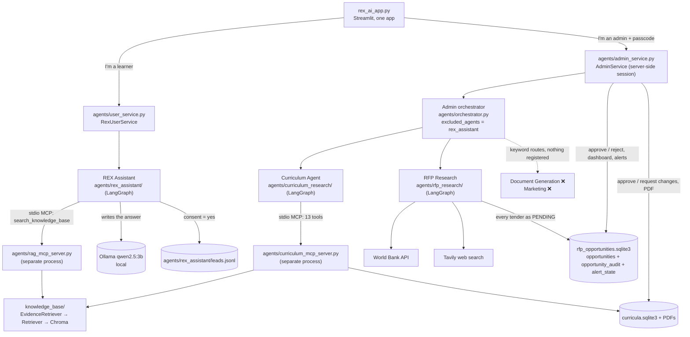
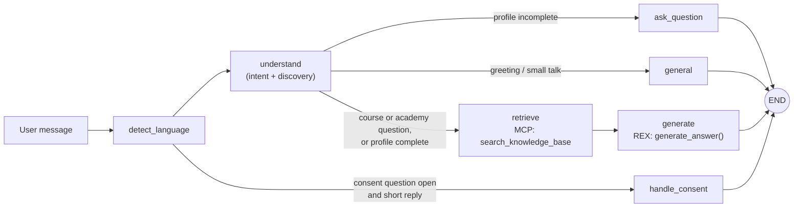
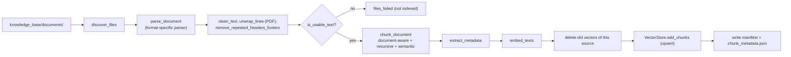
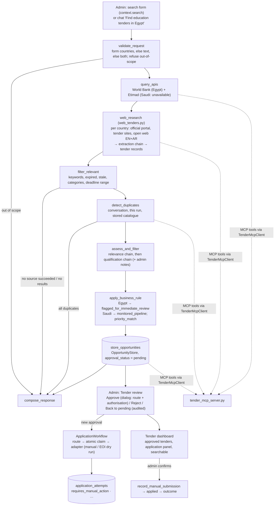

# REX AI — Project Technical Guide

A learning guide to the code as it actually exists. Every file name, function, model identifier and number below was checked against the source on **2026-10-27**. When something is planned, partial, or not verified, it says so.

- Short operational memory for AI assistants: [../CLAUDE.md](../CLAUDE.md)
- Shorter architecture summary: [architecture.md](architecture.md)
- Team agent contract: [agent_interfaces.md](agent_interfaces.md)

**How to read status labels in this guide**

| Label | Meaning |
|---|---|
| ✅ Verified live | Run with the real models/services/index and the result was checked |
| 🧪 Tested (mocked) | Automated tests pass, but external parts (LLM, API, MCP server) were replaced by fakes |
| ⚠️ Partial | Exists but incomplete, or only part of it is verified |
| ❌ Missing | Required by the brief but not implemented |
| 📋 Planned | Designed or stubbed, not working yet |

---

## Contents

1. [Project overview](#1-project-overview)
2. [Architecture](#2-complete-project-architecture)
3. [The RAG pipeline, step by step](#3-complete-rag-explanation)
4. [File-by-file reference](#4-file-by-file-technical-reference)
5. [Models, tools, libraries and services](#5-models-tools-libraries-and-services-inventory)
6. [Deep dive: recommendation.py](#6-deep-explanation-of-recommendationpy)
7. [Cross-encoder and reranking](#7-cross-encoder-and-reranking-explained)
8. [Data and knowledge base](#8-data-and-knowledge-base)
9. [Multilingual support](#9-multilingual-support)
10. [RFP research and approval workflow](#10-rfp-research-and-approval-workflow)
11. [Security and configuration](#11-security-and-configuration)
12. [Tests and evaluation](#12-tests-and-evaluation)
13. [Current status and remaining work](#13-current-status-and-remaining-work)
14. [Glossary](#14-glossary)
15. [Learning roadmap](#15-learning-roadmap)

---

## 1. Project overview

### 1.1 What REX AI is meant to do

The authoritative brief is **"REX AI – Smart Academy Multi-Agent System – AI Graduation Project – Scope of Work & Work Breakdown Structure (WBS)"** (Andalusia Academy, 11 pages, final submission 2026-11-05). It is **not stored in the repository**; it was provided as a PDF attachment during the working sessions. The brief asks for a working prototype (MVP) where specialised AI agents each finish a real task from start to end, coordinated through an orchestrator, with outputs traceable to source data.

### 1.2 Requirements vs. what exists

| Agent (brief) | What the brief requires | Current implementation | Status |
|---|---|---|---|
| **1. REX Assistant** | Arabic/English chatbot; ask follow-up questions (background, career goal, skill level, online/offline, budget, time); recommend courses and explain why; answer questions on content, duration, format, fees, offers, prerequisites, instructors, audience; use approved data only; capture leads with consent | `agents/rex_assistant/` LangGraph workflow, two modes (discovery and direct questions), RAG through MCP, consent-gated lead capture to a JSONL file | ✅ Verified live (with synthetic data) |
| **2. RFP & Tender Research** | Egypt + Saudi Arabia only; search portals; extract title, organisation, country, deadline, eligibility, category, link, date, documents; filter expired/unrelated; dedupe; summarise; assess qualification; store in a searchable dashboard; notify about new RFPs; flag Egypt immediately, monitor Saudi | `agents/rfp_research/`: World Bank API (Egypt), web research for both countries (official portals, tender sites, open web EN+AR via Tavily) with LLM field extraction, filters (expired, stale, works contracts, categories, deadline range), duplicates across sites, relevance + qualification chains, business rule, one admin review queue (pending → approved/rejected, audited), searchable dashboard of approved tenders, in-app alerts | ⚠️ Mostly — Saudi Arabia has no tender API (web research only); alerts in-app only; extraction quality limited by the 3B model and source pages |
| **3. Curriculum Research** | Generate structured curricula, compare with accreditation frameworks, PDF, review loop | `agents/curriculum_research/` **rebuilt 2026-10-27/28** (LangGraph + LangChain + Curriculum MCP server): generation in English/Arabic with deterministic validation and one repair, revisions as versions, catalogue suggestions (Workflow B), evidence-based framework alignment, English/Arabic PDFs, admin approval in the Curricula tab. Details: [CURRICULUM_AGENT_ARCHITECTURE.md](CURRICULUM_AGENT_ARCHITECTURE.md) | ⚠️ Works end to end (live over MCP, temp storage); research off and no framework files until the owner provides them; 3B content quality modest |
| **4. Document Generation** | At least three PDF document types | Routing keyword exists in the orchestrator; **no agent registered** | ❌ Missing |
| **5. Marketing** | Campaign content from course details | Routing keyword exists; **no agent registered** | ❌ Missing |
| Orchestrator | Route requests to agents; at least one workflow with 2+ agents | `agents/orchestrator.py` LangGraph router. Its curriculum→marketing workflow cannot finish because marketing is not registered | ⚠️ Partial |
| Knowledge base / RAG | Course catalogue, descriptions, instructors, pricing & promotions, schedules & formats, FAQs, admission; filterable metadata | `knowledge_base/` generic pipeline + synthetic Andalusia catalogue covering all those data types | ✅ Verified live (synthetic data) |

### 1.3 How the agents relate

- **Users (learners)** talk to **REX Assistant directly**.
- **Admins** talk to the **Admin orchestrator**, which routes to **RFP Research** and **Curriculum Research**. REX is deliberately excluded there. Curricula are approved in the Curricula tab through `AdminService`, never by the agent.
- REX reads the **knowledge base** through an **MCP tool**. The Curriculum Agent reads the same index (read-only) through its own MCP server. Tenders found by RFP Research are **never** added to the knowledge base: they stay in the tender store for admin review.

---

## 2. Complete project architecture

### 2.1 Overall architecture (as implemented)



### 2.2 The two doors and their security boundary

| | User door | Admin door |
|---|---|---|
| Entry | Welcome card "I'm a learner" | Welcome card "I'm an admin" → passcode dialog |
| Backend | `RexUserService` (`agents/user_service.py`) | `AdminService` (`agents/admin_service.py`) |
| Reaches | REX Assistant only | Admin orchestrator → RFP Research, Curriculum Research |
| Orchestrator? | **Never** | Yes, `create_admin_orchestrator()` |
| Authorisation | None needed | Passcode checked on the server; every action re-checks a session token |

Choosing a card on the welcome screen is **only navigation**. It does not grant access. The admin view checks `AdminService.is_valid(token)` on every render, and each admin method calls `_require(token)` (tested: `tests/test_admin_architecture.py`, `tests/test_rex_ai_app.py`).

### 2.3 How REX and the orchestrator interact

They don't, in the running app. The app sends user messages straight to REX through `RexUserService.chat()`. The orchestrator built by `create_admin_orchestrator()` refuses REX requests with a bilingual message (`_EXCLUDED_MESSAGE` in `agents/orchestrator.py`).

There is an **older path**, `create_orchestrator()` in `agents/register_agents.py`, which registers REX on an orchestrator through `make_rex_assistant_handler()`. It is kept for the existing tests and earlier callers. The app does not use it. Note that this legacy adapter saves REX state to `agents/conversation_state.sqlite3` before consent; the user path keeps state in Streamlit memory only.

### 2.4 REX Assistant + RAG retrieval flow



Inside the MCP server process:

```mermaid
flowchart LR
    Q["question (+ optional retrieval_query)"] --> P["language.prepare_retrieval_query<br/>keep original, translate Arabic part"]
    P --> EMB["embed_texts → 384-dim vector"]
    EMB --> VS["VectorStore.search<br/>50 nearest chunks (cosine)"]
    VS --> F["drop duplicates and<br/>low-information chunks"]
    F --> CE["CrossEncoder.predict<br/>score each (query, chunk)"]
    CE --> T["keep score ≥ -9.5, top 5"]
    T --> OUT["evidence dict:<br/>status + chunks + metadata"]
```



### 2.5 RAG ingestion flow



### 2.6 RFP research and approval flow



---

## 3. Complete RAG explanation

**RAG** (retrieval-augmented generation) means: first **retrieve** passages that are relevant to a question, then let a language model **generate** an answer using only those passages. In this project, these are two separate jobs:

- **Retrieval** lives in `knowledge_base/` and is exposed by the MCP tool. It never writes a user-facing answer.
- **Generation** is REX's own job: `generate_answer()` in `agents/rex_assistant/graph.py` builds the prompt from the retrieved chunks and calls the LLM. `knowledge_base/` contains no answer-writing code.

Ingestion (stages A–I) runs offline when you run the pipeline. Retrieval (J–T) runs on every question.

### A. File discovery and ingestion — `knowledge_base/pipeline.py`

- `ingest_directory(directory=DEFAULT_DOCUMENTS_DIR, vector_store=None, max_chars=DEFAULT_MAX_CHARS, metadata_path=DEFAULT_METADATA_PATH, manifest_path=DEFAULT_MANIFEST_PATH, strategy=STRATEGY_AUTO)` coordinates everything.
- `DEFAULT_DOCUMENTS_DIR = PROJECT_ROOT / "knowledge_base" / "documents"`.
- Command line: `python -m knowledge_base.pipeline [--dir DIR] [--store DIR] [--strategy auto|document|semantic] [--max-chars N]` (`main()`; exits 1 if any file failed).
- `discover_files()` (`file_loader.py`) walks the folder recursively, keeps files whose extension is supported, and skips Office lock files (`~$...`) and hidden files.

### B. File loading and format detection — `knowledge_base/file_loader.py`

- `SUPPORTED_EXTENSIONS = {.pdf, .docx, .txt, .md, .csv, .pptx, .xlsx, .json, .html, .htm}`.
- `get_file_type()` raises `ValueError("Unsupported file type ...")` for anything else.
- `check_signature()` reads the first bytes: PDF must start with `%PDF`; DOCX/PPTX/XLSX must start with `PK` (they are ZIP files). A renamed or broken file fails clearly instead of producing garbage.

### C. Parsing and text extraction — `knowledge_base/parsers.py`

`parse_document(path)` returns `{"source", "file_type", "pages": [...]}`. Two kinds of "page":

| Kind | Formats | Page content |
|---|---|---|
| Page | PDF (one per PDF page, `pypdf`), PPTX (one per slide), DOCX, TXT, MD, HTML (one page each) | `{"page": int or None, "text": str}` |
| Record | CSV, XLSX (one per row, every sheet), JSON (one per object) | `{"page": None, "record_id", "section", "fields", "text"}` |

Details that matter:
- **DOCX** (`_parse_docx`): paragraphs and tables are read **in document order**; heading styles become `#`/`##`; each table row becomes `header: value` lines so row relationships survive.
- **HTML** (`_parse_html`, BeautifulSoup with `html.parser`): drops `script`, `style`, `noscript`, `nav`, `template`, `svg`; headings → `#`, list items → `- `, tables row by row.
- **CSV/XLSX/JSON** (`_record_page`): the record id is the first field whose name ends in id/code/key/ref/sku/number/no (`_ID_FIELD`); the record title is the first field whose name ends in name/title/question/subject/heading/label (`_TITLE_FIELD`). These are generic naming conventions, not dataset fields. JSON objects holding lists of objects become one record per item, tagged with `collection` and the file's top-level scalar values (e.g. `updated`).
- Text files are decoded as UTF-8 (with or without BOM), falling back to `cp1256` (Windows Arabic).

### D. Cleaning and normalisation — `knowledge_base/cleaner.py`

Called from `_process_document()` in `pipeline.py`:
1. `unwrap_lines()` — **PDF only.** Re-joins lines the PDF layout broke mid-sentence, while keeping headings, bullets and `key: value` lines on their own lines.
2. `clean_text()` — normalises line endings and whitespace, keeps paragraph breaks.
3. `remove_repeated_headers_footers()` — removes lines that repeat at the top/bottom of at least 60% of pages (`min_repetition_ratio=0.6`). It looks at up to 4 edge lines per side (`max(2, min(4, n // 2))`) and ignores page numbers (`_edge_key` replaces digits with `#`).
4. `is_usable_text()` — if the whole document has fewer than 20 visible characters or is mostly unreadable, the pipeline raises `ValueError("No usable text could be extracted from this document")`. The file is listed in `files_failed` and **not indexed** (e.g. a scanned PDF).

### E. Metadata extraction — `knowledge_base/metadata_extractor.py`

Rule-based Python and regular expressions only — **no LLM**.
- `extract_explicit_fields(text)` finds `Key: value` lines written in the text (`Level: Beginner`, `Fee (EGP): 6500`). The key may be at most five words. Names are normalised (`normalize_field_name`: `"Delivery Mode"` → `delivery_mode`, `"Fee (EGP)"` → `fee_egp`); pure numbers become numbers (`normalize_field_value`: `"6500"` → `6500`).
- `extract_metadata(chunk)` returns technical metadata (`document_id`, `filename`, `file_type`, `page`, `page_end`, `section`, `section_path`, `record_id`, `chunk_strategy`, `data_source`), plus `dates`, `urls`, `keywords` found in the text, and `explicit_fields`, which combines the record or section fields with the chunk's own `key: value` lines.
- Nothing is invented: a chunk with no fields gets `explicit_fields == {}` (tested).

### F. Chunking — `knowledge_base/chunker.py`

`chunk_document(document, max_chars=1000, overlap_chars=120, min_chars=250, strategy="auto")`.

Why `max_chars = 1000`: the embedding model reads at most **256 tokens** (roughly 1,000 English characters). Anything longer would be cut off before embedding.

Three strategies work together:

1. **Document-aware (always).** `_heading_level()` recognises headings:
   - Markdown `#`…`######` → level 1–6
   - numbered `1.` / `1.2` → level by depth
   - ALL CAPS and Title Case lines → level from context (ALL CAPS ranks above Title Case when the document has no explicit levels)
   - not headings: lines with `:`, lines ending in `.`/`,`/`?`, durations like "50 guided learning hours"

   `_document_units()` keeps a heading **stack** across pages, so every section knows its full path ("Flutter Mobile App Development > Learning Outcomes") and inherits `key: value` fields from its parent sections. Small sections in the same branch are **packed** together up to `max_chars`; the branch is the first heading level where the document divides, so two courses are never packed into one chunk. **Records are never merged.**
2. **Recursive (when one unit is still too big).** `_recursive_split()` tries separators in order `"\n\n"`, `"\n"`, `". "`, `"؟ "`, `"; "`, `", "`, `" "`, and finally a hard cut. `_add_overlap()` copies up to `overlap_chars` of word-aligned text from the previous piece.
3. **Semantic (for long prose).** `_semantic_breakpoints()` embeds each sentence and measures the distance between neighbours. Breaks fall where the distance is in the **top 15%** for that section (`SEMANTIC_BREAKPOINT_PERCENTILE = 85`), and only once the current group has at least `min_chars`. Strategy `auto` uses this only for oversized prose sections (`_is_prose`: mostly sentences, at least `SEMANTIC_MIN_SENTENCES = 4`); `semantic` uses it for every multi-sentence section; `document` never calls the model. If embeddings fail, it falls back to size-based splitting.

**Context header:** every chunk's text starts with its section path, e.g.
```
Introduction to Artificial Intelligence and Python
Entry Requirements and Prerequisites
Entry requirements: No programming experience required. ...
```
That is why a retrieved "Entry requirements" passage always says which course it belongs to.

### G. Chunk metadata and source tracking

Each chunk dict carries `text`, `source`, `file_type`, `page`, `page_end`, `section`, `section_path`, `record_id`, `fields`, `chunk_strategy`, `chunk_id`. `_process_document()` adds:
- `source` = `document_id` = **project-relative path** (`_relative_source`, e.g. `knowledge_base\documents\faqs.json`; absolute only for files outside the project);
- `embedding_model` = `sentence-transformers/all-MiniLM-L6-v2`;
- `content_hash` = first 16 hex characters of the SHA-256 of the text.

### H. Document embeddings — `knowledge_base/embedding_service.py`

`embed_texts(texts, model_name=DEFAULT_MODEL_NAME)` loads `SentenceTransformer("sentence-transformers/all-MiniLM-L6-v2")` once (`lru_cache`) and returns L2-normalised vectors (`normalize_embeddings=True`) as Python lists. Each vector has **384** numbers (confirmed by running it). The model runs **locally** on your CPU; it is downloaded from Hugging Face the first time and cached.

### I. Chroma storage — `knowledge_base/vector_store.py`

- `VectorStore(persist_directory=DEFAULT_STORE_PATH, collection_name="rex_knowledge")` opens `chromadb.PersistentClient` at `knowledge_base/vector_db/` with `{"hnsw:space": "cosine"}`.
- `add_chunks(chunks, embeddings)` **upserts** with id `f"{source}::chunk_{chunk_id}"`.
- Chroma accepts only scalar metadata (str/int/float/bool). `_flat_value()` turns lists into `"a; b"` strings and drops empty or nested values. `explicit_fields` become `field_<name>` entries — e.g. `field_level`, `field_fee_egp` — which is what makes filters like `{"field_fee_egp": {"$lte": 6000}}` work (✅ verified on the real index: returns DA-101, MKT-101, MKT-201, SW-101).
- `search(query_embedding, top_k=5, where=None)` returns `{"text", "metadata", "distance"}`; `delete_source(source)` removes all chunks of one source.

### J. Query preprocessing and language detection — `knowledge_base/language.py`

- `detect_language(text)` classifies the **script**: `"ar"`, `"en"`, `"mixed"`, `"other"`, `"empty"`.
- `looks_like_arabizi(text)` spots Egyptian Arabic written in Latin letters ("Ana 3ayez...").
- `prepare_retrieval_query(original_query)` returns a `RetrievalQuery(original, query, language, translation, error)`; `translation` is `not_needed`, `translated` or `failed`.

### K. Arabic and mixed-language translation

Inside `prepare_retrieval_query()`:
1. English → passed through untouched (`not_needed`).
2. Arabizi → `transliterate_arabizi()` converts known words to Arabic script.
3. `egyptian_to_msa()`:
   - writes Arabic-spelled technology names back in Latin script (`_TECH_TERMS`: فلاتر → Flutter, بايثون → Python, باور بي آي → Power BI …);
   - maps Egyptian words to Modern Standard Arabic (`_EGYPTIAN_TO_MSA`: عايز → أريد, كورس → دورة تدريبية …).
4. Arabic-Indic digits become 0–9 (`_ARABIC_INDIC_DIGITS`).
5. **Latin spans** (names, codes, numbers) are pulled out by `_LATIN_SPAN`. **Only the Arabic part** goes to `QueryTranslator.translate_to_english()` (`translator.py`, MarianMT `Helsinki-NLP/opus-mt-ar-en`, loaded lazily on first use). The Latin spans are then added back verbatim.
6. If the translator raises, returns empty text, or returns text that still contains Arabic → `translation="failed"`, and the **original** text is searched instead (never an empty query).

**Worked example (✅ verified live):** the user writes `كم سعر كورس فلاتر؟ وهل هو أونلاين؟`
- **Preserved:** that exact text is kept as `question`; REX uses it for the conversation and answers in Arabic.
- **Translated:** the Arabic part, after "فلاتر" was replaced with "Flutter" and pulled out.
- **Embedded:** `'How much is a training course? Flutter'` — that string is what was turned into a vector.
- Stored documents are **never** translated.

### L. Query embedding

`Retriever.retrieve()` calls the **same** `embed_texts()` with the **same** model as ingestion, on the retrieval query (`embed_texts([retrieval_query])[0]`). Using the same model for documents and queries is required: vectors from different models are not comparable.

### M. Embedding compatibility check — `knowledge_base/retriever.py`

After the vector search, the retriever collects the `embedding_model` names stored on the candidates. If any differs from `DEFAULT_MODEL_NAME`, it raises `ValueError(... "Rebuild it: python -m knowledge_base.pipeline")` before reranking. Old chunks without a model name are accepted. Tested in `tests/test_retriever_relevance.py`.

### N. Initial vector retrieval

`self.vector_store.search(query_embedding, top_k=self.top_k * self.candidate_multiplier, where=metadata_filter)` — with the defaults used by `EvidenceRetriever` (`Retriever(top_k=5)`, `candidate_multiplier=10`) that is **50 candidates** (or fewer if the index is smaller). Chroma returns them ordered by **cosine distance** (lower = closer).

### O. Cross-encoder reranking

Candidates first lose duplicates (same normalised text) and low-information chunks (`_is_low_information`: fewer than 5 words, or the same line repeated). Then `CrossEncoder("cross-encoder/ms-marco-MiniLM-L-6-v2").predict([(retrieval_query, chunk_text), ...], batch_size=16)` scores each pair. Full explanation in [section 7](#7-cross-encoder-and-reranking-explained).

### P. Threshold and top-k

Results are sorted by cross-encoder score; any with score `< MIN_RELEVANCE_SCORE = -9.5` are removed; the first `top_k = 5` are returned.

### Q. Returning chunks and metadata — `knowledge_base/evidence.py`

`EvidenceRetriever.search(question, retrieval_query=None, metadata_filter=None)` returns:

```python
{
  "status": "ok" | "no_results" | "empty_index",      # "invalid_request" / "error" via safe_search
  "question": "<original, unchanged>",
  "retrieval_query": "<text actually embedded>",
  "query_language": "en" | "ar" | "mixed" | "arabizi",
  "translation": "not_needed" | "translated" | "failed",
  "translation_error": None | "...",
  "chunks": [{"reference": 1, "text": "...", "source": "faqs.json", "page": None, "page_end": None,
              "section": "...", "section_path": "...", "record_id": "FAQ-03", "chunk_id": 9,
              "relevance_score": 8.148, "fields": {"id": "FAQ-03", ...}}],
  "error": None,
}
```

- `source` is the **file name only** (`_file_name`), never a filesystem path.
- An empty index is reported as `empty_index` without searching.
- `safe_search()` never raises: bad arguments → `invalid_request`; any failure → `error` (details logged to stderr only).

### R. The MCP tool and how REX calls it

- **Server:** `agents/rag_mcp_server.py` creates `MCPServer("REX AI Knowledge Base")` from the official `mcp` SDK (`mcp.server.mcpserver`). It creates one `EvidenceRetriever()` for the lifetime of the process.
  - `search_knowledge_base(question, retrieval_query=None, metadata_filter=None)` — **the tool REX uses**; returns `safe_search(...)`.
  - This is the **only** tool. The older `ask_knowledge_base` tool, which also wrote answers inside the RAG, was removed on 2026-10-27 as a duplicate answer path.
  - Logging goes to stderr because stdout carries the MCP protocol.
- **Client:** `agents/rex_assistant/mcp_client.py` `RagMcpClient` starts `python -m agents.rag_mcp_server` as a **subprocess over stdio** (`StdioServerParameters`) and keeps one session open in a background thread. Loading the models takes seconds, so they are not reloaded on every message. `startup_timeout=120.0`. It restarts automatically after `close()`, a failed start, or a dead server; a transport failure raises `McpToolError`.
- **REX side:** `make_retrieve_node()` in `graph.py` calls `mcp_client.search_knowledge_base(question=text, retrieval_query=...)`. `retrieval_query` is:
  - built from the profile for recommendations (`_recommendation_query`: "Courses suitable for a learner with career goal: …");
  - `"<text> (about: <active topic>)"` for follow-ups that don't name a course;
  - `"<text>. " + CATALOGUE_LISTING_HINT` for listing questions ("Which courses do you offer?");
  - otherwise `None`, so the question itself is searched.

  A tool exception or a malformed response becomes `{"status": "error", "chunks": []}`.

**MCP tool vs. RAG pipeline:** the RAG pipeline is the Python code in `knowledge_base/`. The MCP tool is a thin, standard interface around it, running in a separate process, so any agent can ask "find evidence for this question" without importing the RAG internals. REX never imports `knowledge_base.retriever` directly.

### S. How evidence reaches the answer

REX's `generate` node calls its own `generate_answer()` (`agents/rex_assistant/graph.py`), using the prompt material in `agents/rex_assistant/prompts.py`:

1. `generate_answer()` checks the evidence status first (`fallback_key()`). For `empty_index`, `no_results`, or anything not `ok`, it returns a **fixed bilingual message** from `MESSAGES` and **does not call the LLM**.
2. `evidence_context(chunks, max_chars=12000)` numbers each chunk as `[n] Source: <file>\nSection: <section_path or section>\nContent:\n<text>`, skipping (not truncating) chunks that don't fit.
3. `build_messages()` (in `prompts.py`) builds LangChain messages:
   - system message: persona + `GROUNDING_RULES` + the language rule;
   - the last 4 history turns;
   - the user message: the recommendation task (profile + course layout, from `recommendation.recommendation_task()`) when recommending, `DOCUMENT CONTEXT`, the original question.
4. `llm.invoke(messages)` with `ChatOllama(model="qwen2.5:3b", temperature=0, num_ctx=8192)`. The model comes from `agents/config.rex_model()`: `REX_LLM_MODEL` in `.env`, else `qwen2.5:3b` (in live tests on the 6 GB laptop GPU it was as accurate as `qwen2.5:7b` and 2–3× faster). For models with a thinking mode (e.g. Qwen3), `_get_llm()` switches it off. `num_ctx` is set so a long prompt (rules + 5 passages + history) is never cut off.
5. For recommendations, `recommendation.check_recommendation()` checks the model's answer.

✅ Verified live: the trace showed the 5 retrieved passages inside the prompt and answers matching them (Flutter = 7000 EGP, online; RAG course taught by Omar Haddad; refund policy from `faqs.json`).

### T. Citations, sources, unsupported questions

- `GROUNDING_RULES` require `[n]` citations, no invented facts, no file paths, saying what is missing, and asking which programme when several match.
- The UI shows a **Sources** expander with `[n] file, p. page` from `result["sources"]`.
- Unsupported questions: the threshold usually yields `no_results` → *"I couldn't find relevant information in the available documents."* (✅ verified with "Do you have a course in quantum underwater basket weaving?").
- Limitation: the 3B model sometimes cites `[2]` where `[1]` holds the same fact.

### U. Re-ingestion, stale vectors, rebuilds, backups

`ingest_directory()` is safe to re-run:
- For each document processed successfully, its old vectors are deleted (absolute and relative ids, `_delete_source_vectors`) before new ones are added. So there are no duplicates, and no leftovers when a document gets shorter.
- Documents listed in the manifest (`knowledge_base/metadata/ingestion_manifest.json`) but no longer in the folder have their vectors deleted.
- A document that **failed** this run keeps its previous vectors and metadata (it stays in the manifest for a retry).
- Vectors from other sources in the same collection (approved web research, which has its own manifest) are never touched.

**Backups** are manual: copy `knowledge_base/vector_db/` and `knowledge_base/metadata/` before rebuilding. **Stop the app first** — the running app's MCP server holds the index open.

### V. Evaluation and testing — `knowledge_base/evaluation.py`

`python -m knowledge_base.evaluation --eval-set knowledge_base/datasets/andalusia_catalogue/eval_set.json [--store DIR] [--k 5]` measures Recall@k and MRR (see [section 12](#12-tests-and-evaluation)).

### Key distinctions

| A | vs. | B |
|---|---|---|
| **Embedding model** (`all-MiniLM-L6-v2`) turns *one* text into a vector, fast; used for indexing and searching | | **Cross-encoder** (`ms-marco-MiniLM-L-6-v2`) reads *question + chunk together* and outputs one relevance score; slower, more accurate; used only to rerank candidates |
| **Document embeddings** are computed once at ingestion and stored in Chroma | | **Query embedding** is computed for each question at search time, with the same model |
| **Vector similarity** — cosine *distance* from Chroma, 0 = identical direction | | **Reranking score** — an unbounded cross-encoder logit (here roughly −11 to +9); higher = more relevant |
| **Initial retrieval** — top 50 by vector distance (recall-oriented) | | **Reranking** — reorder those 50 and keep the best 5 above −9.5 (precision-oriented) |
| **Chunk text** — what is embedded, reranked and shown to the LLM | | **Chunk metadata** — source, page, section, record id, `field_*`; used for citations and filters, not embedded |
| **Retrieval** — finds evidence (`knowledge_base/`, MCP tool) | | **Generation** — writes the answer from evidence (REX + LLM) |
| **Ingestion** — offline: files → chunks → vectors | | **Retrieval** — online: question → relevant chunks |
| **MCP tool** `search_knowledge_base` — the interface, in a separate process | | **RAG pipeline** — the Python modules that do the work |

### Supported vs. tested formats

| Format | Loader exists | Tested how |
|---|---|---|
| PDF | ✅ `_parse_pdf` | Generated test PDFs; the 5 real catalogue PDFs ✅ live |
| CSV, XLSX, JSON, Markdown | ✅ | Test files and the real catalogue files ✅ live |
| DOCX, PPTX, HTML, TXT | ✅ | Only small files generated inside tests 🧪 |
| Arabic-script PDFs | loader exists | ❌ not verified (pypdf text order for Arabic is unknown) |
| Scanned PDFs (images) | — | Detected and refused (no OCR) 🧪 |
| Anything else (images, `.doc`, `.xls`) | ❌ | Rejected as unsupported |

---

## 4. File-by-file technical reference

> Paths are relative to the repository root `rex-ai/`. "Tests" names the test file(s) that cover the module.

### 4.1 Knowledge base (generic RAG engine)

#### `knowledge_base/file_loader.py`
- **Responsibility:** decide which files are ingestible and verify they are what they claim.
- **Key items:** `SUPPORTED_EXTENSIONS`, `_SIGNATURES`, `get_file_type()`, `check_signature()`, `discover_files()`.
- **In → out:** a path or directory → an extension, or a sorted list of paths.
- **Errors:** `ValueError` for unsupported or mismatched files; `FileNotFoundError` / `NotADirectoryError` for bad directories.
- **Tests:** `tests/test_ingestion_pipeline.py` (discovery, renamed files, unsupported files).

#### `knowledge_base/parsers.py`
- **Responsibility:** turn each format into the common `{"source", "file_type", "pages"}` structure.
- **Key items:** `parse_document()` (dispatch); `_parse_pdf`, `_parse_docx`, `_parse_pptx`, `_parse_text`, `_parse_html`, `_parse_csv`, `_parse_xlsx`, `_parse_json`; helpers `_record_page`, `_table_rows_text`, `_flatten`, `_scalar`, `_unique_headers`, `_read_text`.
- **Libraries:** `pypdf`, `python-docx`, `python-pptx`, `openpyxl` (read-only, `data_only=True`), `beautifulsoup4`, stdlib `csv`/`json`.
- **Config:** `MAX_FIELD_CHARS = 2000` per field value.
- **Limitations:**
  - PDF tables lose their layout (a pypdf limitation), which is why the generated catalogue writes facts as `Key: value` lines.
  - No OCR.
  - JSON lists of lists are flattened with `[n]` keys.
- **Tests:** `tests/test_ingestion_pipeline.py` (one test per format, plus corrupt files).

#### `knowledge_base/cleaner.py`
- **Responsibility:** make extracted text clean and refuse unusable text.
- **Key items:** `clean_text()`, `unwrap_lines()`, `is_usable_text(text, min_chars=20)`, `remove_repeated_headers_footers(pages, min_repetition_ratio=0.6)`, `_edge_key()`.
- **Tests:** `tests/test_ingestion_pipeline.py`.

#### `knowledge_base/metadata_extractor.py`
- **Responsibility:** rule-based metadata (no LLM).
- **Key items:** `extract_dates`, `extract_urls`, `extract_keywords` (English stop-word frequency, top 10), `extract_explicit_fields`, `normalize_field_name`, `normalize_field_value`, `extract_metadata`, `save_metadata_json`.
- **Note:** `_RESERVED` keys (`source`, `page`, `section`, …) can never be overwritten by a document field.
- **Tests:** `tests/test_ingestion_pipeline.py`.

#### `knowledge_base/chunker.py`
- **Responsibility:** document-aware + recursive + semantic chunking (see stage F).
- **Key items:** `chunk_document()`, `_heading_level()`, `_is_heading()`, `_split_sections()`, `_document_units()`, `_semantic_breakpoints()`, `_semantic_group_sentences()`, `_recursive_split()`, `_add_overlap()`, `_is_prose()`.
- **Constants:** `DEFAULT_MAX_CHARS = 1000`, `DEFAULT_MIN_CHARS = 250`, `DEFAULT_OVERLAP_CHARS = 120`, `CHUNK_STRATEGIES = ("document", "semantic", "auto")`, `SEMANTIC_BREAKPOINT_PERCENTILE = 85`, `SEMANTIC_MIN_SENTENCES = 4`.
- **Depends on:** `embedding_service.embed_texts` (semantic only) and `metadata_extractor.extract_explicit_fields`.
- **Small excerpt** — how a section inherits its parents' fields:
  ```python
  fields: dict[str, Any] = {}
  for entry in stack:
      fields.update(entry["fields"])
  ```
- **Tests:** `tests/test_ingestion_pipeline.py` (hierarchy, packing, records, recursive, semantic with fake embeddings, no model call in `document` mode), `tests/test_chunker_headings.py`.

#### `knowledge_base/embedding_service.py`
- **Responsibility:** one place that turns text into vectors.
- **Key items:** `DEFAULT_MODEL_NAME = "sentence-transformers/all-MiniLM-L6-v2"`, `_load_model()` (cached), `embed_texts()`.
- **Tests:** faked in tests (fake embeddings); the real model is exercised by the live evaluation runs.

#### `knowledge_base/vector_store.py`
- **Responsibility:** the only code that talks to Chroma.
- **Key items:** `VectorStore` (`add_chunks`, `search`, `delete_source`), `_flat_value()`, `DEFAULT_STORE_PATH` = `knowledge_base/vector_db`.
- **Tests:** `tests/test_ingestion_pipeline.py` (real Chroma in a temp folder).

#### `knowledge_base/pipeline.py`
- **Responsibility:** run the ingestion stages in order, plus bookkeeping.
- **Key items:** `ingest_directory()`, `_process_document()`, `_delete_source_vectors()`, `_normalize_source()` (relative paths resolve against `PROJECT_ROOT`), `_relative_source()`, `main()`.
- **Outputs:**
  - Chroma vectors;
  - `knowledge_base/metadata/chunk_metadata.json` (all chunk metadata);
  - `knowledge_base/metadata/ingestion_manifest.json` (`{"sources": [...absolute paths...]}`);
  - a summary dict: `files_discovered`, `files_processed`, `files_failed`, `chunks_created`, `chunks_stored`, `chunks_deleted`, `metadata_json`.
- **Tests:** `tests/test_ingestion_pipeline.py` (end-to-end with all 9 formats, no duplicates, stale removal, failures reported, other collections untouched).

#### `knowledge_base/translator.py`
- **Responsibility:** Arabic → English translation for retrieval only.
- **Key items:** `DEFAULT_TRANSLATION_MODEL = "Helsinki-NLP/opus-mt-ar-en"`, `QueryTranslator.translate_to_english()`. Uses `transformers` MarianMT + `torch`, `max_length=512`. Loaded lazily (`_ensure_loaded`), cached across instances.
- **Tests:** always faked (`_RecordingTranslator` in `tests/test_language.py`); the real model ✅ verified live.

#### `knowledge_base/language.py`
- **Responsibility:** the single authority on language: script detection, conversation language, Arabizi, Egyptian→MSA, tech terms, and retrieval-query preparation.
- **Key functions:** `contains_arabic`, `looks_like_arabizi`, `transliterate_arabizi`, `egyptian_to_msa`, `detect_language`, `detect_conversation_language`, `detect_explicit_language_request`, `resolve_conversation_language`, `prepare_retrieval_query`.
- **Tests:** `tests/test_language.py`.

#### `knowledge_base/retriever.py`
- **Responsibility:** vector search + reranking + threshold (see section 7).
- **Key items:** `CROSS_ENCODER_MODEL = "cross-encoder/ms-marco-MiniLM-L-6-v2"`, `MIN_RELEVANCE_SCORE = -9.5`, `Retriever(vector_store=None, top_k=5, candidate_multiplier=10, min_relevance_score=-9.5)`, `retrieve(query, retrieval_query=None, metadata_filter=None)`.
- **Tests:** `tests/test_retriever_relevance.py`.

#### `knowledge_base/evidence.py`
- **Responsibility:** the public "find evidence" API: translation + retrieval + a clean, safe response.
- **Key items:** `EvidenceRetriever.search()`, `safe_search()`, `_to_chunk()`, the `STATUS_*` constants.
- **Tests:** `tests/test_evidence.py`.

#### Answer generation is in REX, not here
`knowledge_base/` only ingests and retrieves. The former `knowledge_base/answer_generator.py` was moved into REX on 2026-10-27: its prompt material is now `agents/rex_assistant/prompts.py`, and the answer is written by `generate_answer()` in `agents/rex_assistant/graph.py` (see 4.2). Tests: `tests/test_rex_answer_generation.py`.

#### `knowledge_base/evaluation.py`
- Recall@k and MRR evaluator (`is_relevant`, `evaluate`, `main`).

#### `knowledge_base/datasets/andalusia_catalogue/`
- `catalogue_source.json` — the single structured source of the synthetic catalogue.
- `build_documents.py` — `build_all()`, `build_pdfs()` (reportlab), `build_instructors_csv()`, `build_schedules_xlsx()` (openpyxl), `build_faqs_json()`, `build_admission_md()`, `course_lines()`.
- `eval_set.json` — 32 questions (21 English, 8 Arabic, 3 mixed; two listing items carry REX's own `retrieval_query` with its listing hint).
- This folder is dataset-specific and is **not indexed**.

#### Removed on 2026-10-27 (duplicates and dead code)

| Removed | Why |
|---|---|
| `knowledge_base/chunker_backup.py` (+ its `.pyc`) | An old copy of `chunker.py`; nothing imported it |
| `knowledge_base/answer_generator.py` (moved into REX: `agents/rex_assistant/prompts.py` + `generate_answer()`) | Generation is the agent's job, not the RAG's |
| `RAGAnswerGenerator`, `get_chat_model()` (`answer_generator.py`); MCP tool `ask_knowledge_base`; `RagMcpClient.ask_knowledge_base()` | A second answer-writing path inside the RAG, unused by REX |
| `build_retrieval_query()`, `resolve_response_language()` (`language.py`) | Legacy helpers used only by their own tests |

Backups of the removed code are in the session scratchpad (`cleanup_backup_rag`), outside the repository.

### 4.2 REX Assistant — `agents/rex_assistant/`

#### `interface.py` — `RexAssistantAgent`
- `RexAssistantAgent(lead_store=None, model=None, mcp_client=None)`; `model=None` means `agents/config.rex_model()` (`REX_LLM_MODEL` or `qwen2.5:3b`).
- `handle_message(user_input, state=None, preferred_language=None, request_id=None)` returns `{request_id, agent_name, status, result, error_message, state}`.
  - `result` contains `answer`, `sources`, `answer_status`, `profile`, `mode`, `pending_field`, `consent_pending`, `lead_captured`, `detected_language`, `response_language`.
- `_PER_TURN_KEYS` are wiped before each turn, so the previous answer's sources never leak into the next turn.
- `close()` stops the MCP subprocess.
- **Tests:** `tests/test_rex_assistant.py`.

#### `graph.py` — the LangGraph workflow (`build_graph(lead_store, model, mcp_client)`)
- **Nodes:** `detect_language`, `understand`, `ask_question`, `general`, `retrieve`, `generate`, `handle_consent`.
- `route_after_language()` goes to `handle_consent` only for a short or clear yes/no reply. A course question or a message of more than 3 words while consent is pending is handled normally, and nothing is saved.
- `understand` steps:
  1. tries the pending discovery answer (`discovery.normalize_answer`);
  2. extracts several facts with the LLM (`_extract_profile_facts`) — for `_EVIDENCE_FIELDS` (`skill_level`, `training_preference`, `budget`, `available_time`) a value is kept only if the learner's own words support it;
  3. after 2 unclear replies (`MAX_ATTEMPTS_PER_FIELD`) skips the field;
  4. chooses the next step.
- `generate` writes the answer, then for recommendations:
  - adds a note about missing fields;
  - resets discovery;
  - asks for consent if not asked yet.

  For a question asked in the middle of discovery, it answers and then repeats the pending question.
- `handle_consent` saves **only profile fields** through the `LeadStore`.
- `_get_llm(model)` = `ChatOllama(model, temperature=0)` (this is the patch point used in tests).

#### `discovery.py` — the six questions
- `REQUIRED_FIELDS` = background, career_goal, skill_level, training_preference, budget, available_time; `OPTIONAL_FIELDS = ("interests",)`.
- `QUESTIONS` — the exact English/Arabic wording from the brief.
- `normalize_answer()`:
  - closed sets: online/offline/hybrid/no_preference, beginner/intermediate/advanced;
  - budget and time need a number or a unit word;
  - question-like replies are not accepted as answers.

#### `prompts.py` — REX's prompt material for answering
- `GROUNDING_RULES`, `language_rule()`, `MESSAGES` (fixed bilingual fallbacks), `fallback_key(evidence)`, `evidence_context(chunks, max_chars=12000)` (numbers chunks for `[n]` citations), `build_messages(question, context, language, history, task)`, `MODE_QUESTION`, `MODE_RECOMMENDATION`.
- Evidence status strings (`"ok"`, `"no_results"`, `"empty_index"`) come from the MCP contract; REX does not import RAG internals.

#### `generate_answer()` in `graph.py` — REX writes the answer
`generate_answer(llm, evidence, language, mode="question", profile=None, declined=None, history=None)`:
1. no usable evidence → fixed message, no LLM call;
2. number the chunks;
3. build the prompt (plus the recommendation task when recommending);
4. call the LLM;
5. recommendations only: `check_recommendation()`.

Returns `{"answer", "sources", "status"}`. **Tests:** `tests/test_rex_answer_generation.py`.

#### `recommendation.py` — REX's course rules (see [section 6](#6-deep-explanation-of-recommendationpy))

#### `mcp_client.py` — `RagMcpClient` (stage R)

#### `state.py` — `LearnerProfile`, `RexAssistantState` (TypedDicts)

#### `lead_store.py`
- `LeadStore` (abstract) and `JSONLLeadStore(path="agents/rex_assistant/leads.jsonl")` — a **placeholder**, not a CRM.
- The default path is **relative to the working directory**, so run the app from the project root.

### 4.3 Shared agent modules — `agents/`

| File | Responsibility | Key items |
|---|---|---|
| `course_intent.py` | Classify a message: `recommendation`, `course_question`, or `general` (rules, EN + AR) | `classify_course_intent(text, course_context=False)`, `is_catalogue_listing()`, `names_a_course()`, `CATALOGUE_LISTING_HINT`; academy questions (refund, certificate, accreditation, discount, instalments, registration, instructors, schedules…) count as questions only when phrased as a question (`_looks_like_question`) |
| `multilingual.py` | Thin wrapper over `knowledge_base.language` for the orchestrator | `detect_language()` → `"ar"`/`"en"` |
| `text_utils.py` | Arabic normalisation for keyword matching (alef/teh marbuta/diacritics) | `normalize_for_matching()`, `strip_arabic_marks()` |
| `config.py` | `.env` loading and secret lookup | `load_env()`, `get_secret(name)` |
| `conversation_store.py` | Per-conversation, per-agent JSON state in SQLite (`agents/conversation_state.sqlite3`) | `ConversationStore.get/set/close` |
| `orchestrator.py` | LangGraph router (`plan` → `execute` loop) | `Orchestrator(excluded_agents=())`, `register_agent()`, `handle_request()`, `_make_plan()` (keyword rules, priority: curriculum+marketing workflow → RFP → curriculum (incl. `_is_catalogue_planning`: new courses + academy cue, catalogue gaps, "generate suggestion N") → marketing → documents → REX), `_EXCLUDED_MESSAGE` |
| `register_agents.py` | Build orchestrators | `create_admin_orchestrator()` (app), `create_orchestrator()` (legacy/tests), `make_rex_assistant_handler()`, `make_rex_continuation_check()` |
| `user_service.py` | User backend | `RexUserService.chat()`, `new_conversation(interface_language)`, `reload_knowledge()`, `close()` |
| `admin_service.py` | Admin backend + authorisation | see [section 11](#11-security-and-configuration); tender review, application workflow trigger and application actions (section 10.5), application profile |
| `mcp_tool_client.py` | Shared MCP client code | `McpToolClient(server_module, startup_timeout, server_name, env)`: persistent stdio session on a background thread, `call_tool(name, args)`, `list_tools()`, `close()`, restart after a crash, raises `McpToolError` (incl. MCP's own `is_error` results) |
| `rag_mcp_server.py` | MCP server for REX (stage R) | `search_knowledge_base` (its only tool) |
| `tender_mcp_server.py` | MCP server for RFP Research | 4 tools, each a one-line call into `rfp_research/tender_tools.py`; database from `REX_TENDER_DB_PATH`; no approve, reject or submit tool |
| `curriculum_mcp_server.py` | MCP server for the Curriculum Agent | 13 tools in `curriculum_research/curriculum_tools.py`; settings `CURRICULUM_INDEX_DIR`, `CURRICULUM_DB_PATH`, `CURRICULUM_DOCUMENTS_DIR`, `CURRICULUM_FRAMEWORKS_DIR`, `CURRICULUM_RESEARCH_DOMAINS`; no approve tool |

### 4.4 RFP Research — `agents/rfp_research/`

| File | Responsibility | Key items |
|---|---|---|
| `agent.py` | Agent entry point for the orchestrator | `RFPResearchAgent(conversation_store, opportunity_store, model, web_search=True, tools=None).process_request(request)`, `close()`; `default_tender_tools(store)` → `TenderMcpClient` pointed at the store's file; `request["context"]["search"]` carries the search form |
| `graph.py` | LangGraph pipeline (see 2.6) | `build_graph(tools, conversation_store, model, web_search)`, the `TenderTools` interface, nodes listed in 2.6 (4 of them call a tool), `_detect_requested_countries()`, `_detect_out_of_scope_country()`, `CATEGORY_QUERY = "training"`, bilingual `_MESSAGES` (incl. `not_saved`) |
| `tender_tools.py` | The 4 tender tools as plain functions | `search_procurement_notices()`, `search_tender_web_pages()`, `find_known_tenders(store, …)`, `save_discovered_tenders(store, …)`; `LocalTenderTools` (same methods, in-process, for tests); `TENDER_DB_SETTING` |
| `mcp_client.py` | RFP's MCP client | `TenderMcpClient(McpToolClient)`: one typed method per tool |
| `applications.py` | Application workflow after approval | `detect_route()` → `SubmissionRoute`, `ManualRouteAdapter`, `EmailExpressionOfInterestAdapter` (dry run), `ApplicationWorkflow.start()/route_for()` |
| `application_profile.py` | The academy's real details and documents | `ApplicationProfile.fields()/update_fields()/add_document()/documents()/document_path()/remove_document()`, `PROFILE_FIELDS`, `DOCUMENT_TYPES` |
| `web_tenders.py` | Web research for tenders | `OFFICIAL_PORTALS`, `TENDER_AGGREGATORS`, `build_searches()`, `collect_pages()`, `page_to_records()`, `iso_date()`, `document_links()`, `within_deadline_range()`, `is_expired()`, `is_stale()` |
| `state.py` | `ALLOWED_COUNTRIES = ("Egypt", "Saudi Arabia")`, `TRAINING_TITLE_TERMS` + `names_training()`, `TRAINING_CATEGORIES` (6, EN+AR keywords), `training_category()`, `RFPResearchState` (incl. `filter_report`, `not_relevant_count`) | |
| `tools.py` | Three LangChain chains with structured output | `build_extraction_chain()` → `TenderPage` of `ExtractedTender`s; `build_relevance_chain()` → `RelevanceAssessment`; `build_qualification_chain()` → `QualificationAssessment` (with `{academy_notes}`) |
| `opportunity_store.py` | SQLite catalogue, admin approval, applications | `OpportunityStore.save()` (True if new; never touches decision/application fields), `find_duplicate()`, `search(…, submission_status, application_status)`, `get()`, `counts()`, `decide(…, authorize_submission)`, `audit_trail()` (`event`, `details`), `unseen_alerts()`, `mark_alerts_seen()`; applications: `authorize_submission()`, `claim_submission()` (atomic), `finish_attempt()`, `recover_interrupted_attempts()`, `record_manual_submission()`, `mark_not_submitted()`, `record_application_outcome()`, `attempts()`; `InvalidTransition`; tables `opportunities`, `opportunity_audit`, `alert_state`, `application_attempts` (+ `application_profile`, `application_documents` from `application_profile.py`) |
| `api_clients/world_bank.py` | Real API (Egypt) | `query_world_bank_egypt(category_query, rows=25, timeout=15.0)`, `BASE_URL = https://search.worldbank.org/api/procnotices` |
| `api_clients/etimad.py` | Saudi stub | `query_etimad_saudi_arabia()` always returns `status="unavailable"` |
| `api_clients/tavily.py` | Web search | `search_tavily(query, max_results=5, timeout=20.0, include_domains=None, include_raw_content=False)` |
| `api_clients/base.py` | Shared models | `NormalizedTender`, `APIQueryResult` |

### 4.5 User interface — `rex_ai_app.py`

- One Streamlit app with three views: welcome, user, admin. Run it with `python -m streamlit run rex_ai_app.py`.
- **Services** are cached once per server process with `st.cache_resource`:
  - `get_user_service()`;
  - `get_admin_service()`, which builds `AdminService(orchestrator_factory=lambda: register_agents.create_admin_orchestrator())`.
- **Language:** the interface text is in `T["en"]` / `T["ar"]`; the language switcher is an `st.segmented_control`; `RTL_CSS` flips the layout for Arabic; chat paragraphs use `unicode-bidi: plaintext`, so mixed text reads correctly.
- **Admin dashboard:** an alerts banner for new tenders ("Mark as seen"), counts (pending, Egypt review now, approved, needs manual action, applied, rejected), and tabs:
  - **Tender review:** pending / approved / rejected / all, with country, category and keyword filters; each card shows the status, Egypt-flag or Saudi-monitored and priority badges, every extracted field, the source and submission links, and Approve / Reject / Back to pending. **Approve opens a dialog** (`approve_dialog`): the submission route and its steps, and the unticked checkbox "I authorise REX AI to submit on the academy's behalf where supported";
  - **New tender search:** form with countries, training categories, priority organisations or sectors, eligibility notes and deadline range;
  - **Ask agents:** chat through the Admin orchestrator;
  - **Tender dashboard:** approved tenders only, searchable, with submission and application columns and filters; each tender has an application panel (`application_panel`): authorisation, missing items, numbered steps, the prepared email ("dry run: NOT sent"), *Authorise submission*, *Prepare again*, *It was not sent* (unknown results), the **Record manual submission** form (needs "I confirm the academy actually submitted this application"), the outcome form, and the history;
  - **Curricula:** Agent 3's curricula with status counts and filter; per curriculum a version picker, sections, validation, alignment, references, assumptions and data notice, Create/Download PDF, **Approve** and **Request changes** (notes required; current version while pending review only), review history;
  - **Application profile:** the academy's fields, document list and upload;
  - **Audit trail.**
- Refused actions (`InvalidTransition`, bad files, invalid email) are shown as errors by `admin_action()`, never as a crash.
- Untrusted web text is shown with `st.text`, or escaped with `plain()`; it is never rendered as Markdown or HTML.
- **Tests:** `tests/test_rex_ai_app.py` (Streamlit `AppTest`, with fake services).

### 4.6 Curriculum Agent — `agents/curriculum_research/`

The full design, decisions, verified sources, model comparison, coverage matrix and cleanup report are in [CURRICULUM_AGENT_ARCHITECTURE.md](CURRICULUM_AGENT_ARCHITECTURE.md).

| File | Responsibility | Key items |
|---|---|---|
| `curriculum_agent.py` | Entry point | `CurriculumAgent(conversation_store, tools, llm, model).process_request(request)`, `wants_follow_up()` (continuation check), `default_curriculum_tools()` → `CurriculumMcpClient`, `default_llm()`; conversation memory stored under `"curriculum_research"` |
| `registration.py` | Orchestrator registration | `register_curriculum_research(orchestrator, store)` (signature unchanged) |
| `graph.py` | LangGraph workflow | `build_graph(tools, llm)`; nodes: understand, academy_context, clarify, research, generate, validate, repair, attach_alignment, save, render_pdf, curriculum_reply, revise, suggest, show, align, simple_reply |
| `state.py` | `CurriculumState`, `Slots`, `ConversationMemory` | |
| `prompts.py` | LangChain `ChatPromptTemplate`s | `OUTLINE`, `MODULE_DETAILS`, `EXTRAS`, `REPAIR`, `NEW_MODULE`, `CAPSTONE`, `SLOTS`, `SUGGEST`, `ALIGN` |
| `llm.py` | Model factory and structured calls | `get_llm(model)` (temperature 0, 12,288-token context, 4,096 output tokens, 240 s timeout), `structured()` (one retry, none after a timeout), `CurriculumModelError` |
| `schemas.py` | Pydantic step models (required fields, size limits) and `assemble_curriculum()` | `CurriculumOutline`, `ModuleDetailList`, `CurriculumExtras`, `RepairPatch`, `NewModule`, `SuggestionList`, `AlignmentJudgement`, `RequestSlots` |
| `understanding.py` | Rule-based intents and values (English and Arabic) on top of `request_parser.py` | suggest, align, approval attempt, show/list, send, suggestion choice, level, course id, output language, answers to questions |
| `request_parser.py` | Reused, tested parser | hours, audience, topic, creation intent, draft edits, accreditation words |
| `revisions.py` | Changes to a stored curriculum | `detect_changes()`, `apply_change()`, `add_module()`, `set_total_hours()` |
| `validation.py` | Deterministic rules | `validate_curriculum()`, `rebalance_hours()`, per-field language check |
| `alignment.py` | Framework comparison | `align()`, `match_framework()` |
| `pdf.py` | English and Arabic PDFs | `render_pdf(record)`, `TextBlock`, `runs()`, `display_line()` |
| `curriculum_tools.py`, `mcp_client.py`, `../curriculum_mcp_server.py` | The 13 tools, their client and server | `CurriculumToolbox`, `CurriculumMcpClient`, `toolbox_from_settings()` |
| `curriculum_store.py` | SQLite store | `save_version()`, `get()`, `list()`, `versions()`, `approve()`, `request_changes()`, `add_document()`, `audit_trail()` |
| `academy_courses.py` | Read-only catalogue over the existing index | `AcademyCatalogue.courses()/course()/overlap()/gap_report()` |
| `research.py`, `frameworks.py` | Allowlisted research; approved framework files | `search_sources()`, `allowed_domains()`; `load_framework()`, `pre_mapping()` |
| `fonts/`, `frameworks/` | Bundled Noto fonts with their licences; the folder for approved framework files (none is shipped) | |

**Tests:**
- Agent 3 test files: `test_curriculum_agent.py`, `test_curriculum_understanding.py`, `test_curriculum_tools.py`, `test_curriculum_mcp_server.py` (real subprocess), `test_curriculum_pdf.py`, `test_curriculum_alignment.py`, `test_curriculum_integration.py`, `test_curriculum_routing.py`, `test_curriculum_request_parser.py`, `test_admin_curricula.py`, plus the Curricula tab tests in `test_rex_ai_app.py`.
- `tests/conftest.py` gives the agent in-process tools on temporary storage and a model that fails if called. Tests that need the model pass a `FakeLLM` (`tests/curriculum_fakes.py`).

---

## 5. Models, tools, libraries and services inventory

**Vocabulary first:**
- A **Python package** is code you install with pip (e.g. `chromadb`).
- A **model** is a file of learned numbers that some package runs (e.g. `all-MiniLM-L6-v2`).
- A **service/API** is a program running somewhere else that you call over the network (e.g. Tavily). Ollama is a *local* service: a separate program on your computer that serves the LLM over HTTP.
- An **MCP tool** is a named function exposed through the Model Context Protocol, so another process can call it in a standard way.
- An **agent** is this project's own component that completes a task end to end (REX, RFP Research), often by using models, tools and services.

| Name / identifier | Kind | Purpose | Where | Input → output | Local / remote | Key / config | Verified | Limitation |
|---|---|---|---|---|---|---|---|---|
| `sentence-transformers/all-MiniLM-L6-v2` | Embedding model | Text → 384-dim vector | `knowledge_base/embedding_service.py` | list of str → list of vectors | Local (downloaded once from Hugging Face) | none | ✅ live | English-only; max 256 tokens |
| `cross-encoder/ms-marco-MiniLM-L-6-v2` | Reranking model | Score (query, chunk) relevance | `knowledge_base/retriever.py` | pairs → logits | Local | none | ✅ live | English-only; threshold −9.5 calibrated by observation |
| `Helsinki-NLP/opus-mt-ar-en` | Translation model (MarianMT) | Arabic → English query text | `knowledge_base/translator.py` | str → str | Local | none | ✅ live | Weak on Egyptian dialect and brand names (mitigated by the mappings) |
| `qwen2.5:3b` (REX, RFP Research, Curriculum Agent) via Ollama | LLM | REX: answers and profile extraction; RFP: relevance/qualification; Agent 3: curriculum content, repairs, suggestions, alignment judgements | `rex_assistant/graph._get_llm`, `rfp_research/tools._get_llm`, `curriculum_research/llm.get_llm` (`CURRICULUM_LLM_MODEL`; `qwen3.5:4b` compared in the Agent 3 doc §17) | messages → text / structured object | Local service (Ollama must be running) | model name only | ✅ live | Small model: occasional wording errors, mixed-language Arabic |
| ChromaDB (`chromadb` 1.5.9) | Vector database (embedded) | Store/search vectors + metadata | `knowledge_base/vector_store.py` | vectors → nearest chunks | Local files `knowledge_base/vector_db/` | none | ✅ live | Concurrent writers can corrupt it — stop the app before ingesting |
| `mcp` (official SDK) | Protocol library | The three MCP servers and their clients over stdio | `agents/rag_mcp_server.py`, `agents/tender_mcp_server.py`, `agents/curriculum_mcp_server.py`, `agents/mcp_tool_client.py` | tool call → dict | Local subprocess | none | ✅ live | |
| LangGraph (`langgraph`) | Workflow library | State graphs for REX, RFP, the Curriculum Agent and the orchestrator | `rex_assistant/graph.py`, `rfp_research/graph.py`, `curriculum_research/graph.py`, `orchestrator.py` | state → state | Local | none | ✅ | |
| LangChain (`langchain_core`, `langchain_ollama`) | LLM library | Messages, prompt templates, `with_structured_output`, `ChatOllama` | `rex_assistant/graph.py` + `prompts.py`, `rfp_research/tools.py`, `curriculum_research/llm.py` + `prompts.py` | | Local | | ✅ | Used through these split packages; the `langchain` meta-package is not needed (`langchain-ollama` installs the `ollama` client itself) |
| World Bank Procurement Notices API | Public web API | Egypt tender notices | `api_clients/world_bank.py` | query → JSON | Remote (stdlib `urllib`) | no key | ✅ live (2 Egypt opportunities on 2026-10-27) | Only World Bank-financed projects |
| Tavily Search API `https://api.tavily.com/search` | Web search API | Web pages for RFP research | `api_clients/tavily.py` (`httpx`) | query → results | Remote | `TAVILY_API_KEY` | ✅ live | Often returns aggregator listing pages |
| Etimad | — | Saudi tenders | `api_clients/etimad.py` | — | — | `ETIMAD_API_KEY` (currently unused) | 📋 stub | No verified listing API |
| Streamlit | UI framework | The app | `rex_ai_app.py` | | Local web server | | ✅ starts; 🧪 AppTest | Manual browser testing by the user only |
| `pypdf`, `python-docx`, `python-pptx`, `openpyxl`, `beautifulsoup4` | Parsers | File loading | `knowledge_base/parsers.py` | file → text/records | Local | | see format table (section 3) | |
| `reportlab` | PDF writer | Demo catalogue PDFs; Agent 3's curriculum PDFs | `build_documents.py`, `agents/curriculum_research/pdf.py` | data → PDF | Local | | ✅ | Arabic needs the two packages below |
| `arabic-reshaper` 3.0.1, `python-bidi` 0.6.12 | Text shaping | Arabic letter joining and right-to-left order in Agent 3's PDFs | `agents/curriculum_research/pdf.py` | str → display str | Local | | ✅ tests + visual check | |
| Noto Naskh Arabic, Noto Sans (SIL OFL) | Fonts (bundled) | Embedded in Agent 3's PDFs | `agents/curriculum_research/fonts/` | | Local files | | ✅ | |
| `python-dotenv` | Config | Load `.env` | `agents/config.py` | | Local | | ✅ | |
| `httpx` | HTTP client | Tavily calls | `api_clients/tavily.py` | | | | ✅ | |
| `transformers`, `torch`, `sentencepiece`, `sacremoses` | ML runtime | Run MarianMT | `translator.py` (imports the first two) | | Local | | ✅ | |
| SQLite (stdlib `sqlite3`) | Database | Tenders + review decisions + alerts, conversation state, curricula (versions, PDFs, audit) | `opportunity_store.py`, `conversation_store.py`, `curriculum_research/curriculum_store.py` | | Local files | | ✅ | |

---

## 6. Deep explanation of `recommendation.py`

**File:** `agents/rex_assistant/recommendation.py` (254 lines).

### When it runs

Only when REX produces a **personalised recommendation**: the discovery questions are finished (or the learner said "recommend now"), so `understand` sets `answer_mode = MODE_RECOMMENDATION`, `retrieve` searches with the profile-based query, and REX's own `generate_answer(..., mode=MODE_RECOMMENDATION, profile=..., declined=...)` in `graph.py` uses two functions from this file:

```python
messages = build_messages(
    evidence.get("question", ""), context, language, history,
    task=recommendation_task(profile, declined) if recommending else None,
)
...
if recommending:
    answer = check_recommendation(answer, context, profile, language)
```

It is **bypassed** for direct questions ("How much is the Flutter course?"): `generate_answer()` then adds no task and runs no course checks.

### Block by block

1. **`PROFILE_FIELD_LABELS`, `profile_block(profile, declined)`** — turns the learner profile into readable lines for the prompt, e.g. `- Career goal: marketing`, `- Budget: not provided (the learner skipped it)`. Optional `interests` is listed only when given.
2. **`COURSE_RECOMMENDATION_TASK`** — the instruction text. It tells the model to address the learner as "you", recommend at most 3 courses that appear in the context **using their exact names**, and use a fixed layout per course:
   ```
   **<course name>** [n]
   - Why it fits you: ...
   - Level: ... (above your level → "may be a step up", never "a match")
   - Delivery: as stated, or "not stated in the catalogue"
   - Fees: as stated, or "not stated in the catalogue"; compare with budget only when both are known
   - Entry requirements: as stated, and which ones you may not meet yet
   ```
3. **`recommendation_task(profile, declined)`** returns `profile_block(...)` + `COURSE_RECOMMENDATION_TASK`; REX's `generate_answer()` puts it in the prompt. Everything else (refusing to answer without evidence, numbering the context, `GROUNDING_RULES`, the language rule, calling the LLM) is done by `generate_answer()` itself.
4. **What the model produces** — Markdown text in the layout above (or not exactly; it's a 3B model). Then the code checks run.
5. **`check_recommendation(answer, context, profile, language)`** runs `tidy_recommendation()` and then `unconfirmed_preferences_note()`:
   - **`tidy_recommendation(answer, context, profile, language)`**:
     - `_course_blocks()` splits the answer into text before, course blocks (each starting with a `**Name**` line, `_COURSE_HEADER`), and text after.
     - **Duplicates:** a course whose normalised name (`_squash`: lower-case, `&`→`and`, single spaces) was already seen is dropped.
     - **Unknown names:** a Latin-script course name that does not appear in the evidence text is dropped — the model renamed or invented it. If *every* course would be dropped, all are kept, so the learner never gets an empty reply. Arabic-script names are not checked, because the model may translate them.
     - **Header styles:** course headers are recognised as `**Name** [2]`, `**Name** [MOB-101]` or `**Name (MOB-101)**`; a course code that belongs to another course is removed, and so is a literal `[n]` placeholder.
     - **Filler blocks:** a block saying the course is not relevant / not related, or stating no facts (Level, Delivery and Fees all "not stated"), is dropped.
     - **Budget:** if the `- Fees:` number is above the first number in the learner's budget, " (above your budget of …)" is added.
     - **Layout:** per-course "Which course to start with" lines are removed; the closing sentence says it once.
     - **Level:** `_level_rank()` maps beginner/foundation/introductory → 1, intermediate → 2, advanced/expert → 3. If a block's `- Level:` line ranks above the learner's level, it appends " (above your beginner level: this may be a step up)" (or the Arabic version).
   - **`unconfirmed_preferences_note(context, profile, language)`**:
     - if the learner chose online/offline/hybrid but the evidence text contains no delivery words (`_DELIVERY_WORDS`), it lists that the delivery mode is not stated;
     - if the learner gave a budget but the evidence contains no fee words (`_FEE_WORDS`), it lists that the fees are not stated;
     - the note starts with "**Not stated in the catalogue**" and ends with "Please confirm these with the academy." (Arabic versions exist).
6. **Back in `generate`**, REX appends a note listing still-missing profile fields, resets discovery, and asks for consent to save details.

### What it guarantees and what it cannot

| Guaranteed by code | Not guaranteed |
|---|---|
| No answer without evidence (`generate_answer()`) | That the "Why it fits you" reasoning is good |
| A course name not present in the evidence is removed (Latin names) | That every fact inside a kept block is correct — the model could still misquote a number |
| No course listed twice | That conflicting sources are resolved (it does not compare two fee values) |
| A higher-level course is marked as a step up | Correct handling of Arabic-script course names |
| Unmet *unstated* preferences are always flagged | Detection when the evidence mentions delivery words for a **different** course than the one recommended (regex is per context, not per course) |

**Where things live:** retrieval is in `knowledge_base/` (no answer writing). REX's general answering (grounding rules, citations, fallbacks) is in `agents/rex_assistant/prompts.py` and `generate_answer()`; the course-specific rules (levels, delivery, fees, learner profile) are in this file.

### Concrete example (SYNTHETIC demonstration data)

Live run on 2026-10-27 with the real index. Profile: accountant → marketing, beginner, online, budget 5000, 2 hours per day. REX answered:

```
**Digital Marketing Fundamentals** [2]
- Why it fits you: ... designed for beginners and does not require previous marketing experience ...
- Level: Beginner
- Delivery: Online
- Fees: 4500 EGP
- Entry requirements: No previous marketing experience required.
```

All four facts match `catalogue_source.json` (MKT-101: Beginner, Online, `fee_egp` 4500). No "Not stated" note was added, because the catalogue states delivery and fees. With the **old** catalogue, which had no fees or delivery modes, the same check added the note (tested in `tests/test_rex_recommendation.py`). A known cosmetic issue from the same run: the closing sentence named the same course twice ("[2] or [3]").

---

## 7. Cross-encoder and reranking explained

Code: `Retriever.retrieve()` in `knowledge_base/retriever.py`.

1. **Initial candidates.** The retrieval query is embedded, and Chroma returns `top_k * candidate_multiplier` = **5 × 10 = 50** nearest chunks by cosine distance (`VectorStore.search` caps this at the collection size).
2. **Why 50 for a final 5?** Vector search compares two separately computed vectors, so it is fast but rough. Pulling more candidates gives the reranker a chance to find the truly relevant chunk even when it wasn't in the vector top 5.
3. **Clean-up before reranking.** Exact duplicate texts and low-information chunks are removed.
4. **Cross-encoder scoring.** `_load_cross_encoder()` loads `CrossEncoder("cross-encoder/ms-marco-MiniLM-L-6-v2")` once. `predict([(retrieval_query, text), ...], batch_size=16)` reads each **pair together** (attention across question and chunk) and outputs one number per pair — a logit, not a probability.
5. **Using the scores.** Each result keeps `text`, the full `metadata`, `source`, `page`, `section`, `chunk_id`, `distance` (from Chroma) and `relevance_score` (cross-encoder). Results are sorted by `relevance_score`, highest first.
6. **Threshold.** If `min_relevance_score` is not `None` (default `MIN_RELEVANCE_SCORE = -9.5`), results below it are removed. The comment in the code says the value was calibrated against this cross-encoder's outputs: unrelated queries scored below −9.5.
7. **Top-k.** The first `top_k = 5` are returned.
8. **Metadata preserved.** Metadata travels unchanged from Chroma through the reranker into `EvidenceRetriever._to_chunk()` (file name, page, section path, record id, `fields`).
9. **Compatibility check.** Before reranking (stage M), a mismatched `embedding_model` raises a "rebuild" error.
10. **No relevant results.** An empty list → `EvidenceRetriever` sets `status = "no_results"` → REX's `generate_answer()` returns the fixed "couldn't find" message without calling the LLM.

### A real trace (✅ run on 2026-10-27, on a copy of the current index)

Query: *"How much does the Flutter Mobile App Development course cost?"* — 94 chunks indexed, 50 candidates.

| Stage-1 rank (by distance) | Cosine distance | Cross-encoder score | Chunk |
|---|---|---|---|
| 1 | 0.260 | 6.70 | Flutter Mobile App Development (catalogue PDF) |
| 2 | 0.363 | 0.43 | Flutter Mobile App Development (catalogue PDF, other section) |
| 3 | 0.375 | 4.45 | Advanced Flutter with Firebase (PDF) |
| 4 | 0.392 | **7.18** | Flutter Mobile App Development (**Fees** row in `schedules_and_fees.xlsx`) |
| 5 | 0.419 | 3.94 | Advanced Flutter with Firebase (Fees row) |

After reranking, the **Fees row moved from 4th to 1st** (7.18) — it is the passage that literally answers "how much". 29 of the 50 candidates scored below −9.5 and were dropped.

**Tests:**
- `tests/test_retriever_relevance.py`: low scores dropped, high kept, threshold can be disabled, wrong embedding model refused, same model accepted — the cross-encoder and Chroma are stubbed.
- The live behaviour above was verified manually.

---

## 8. Data and knowledge base

### 8.1 Directory structure

```
knowledge_base/
├── documents/                      ← INDEXED (everything here is ingested)
│   ├── catalogue_ai_artificial_intelligence.pdf
│   ├── catalogue_da_data_analytics.pdf
│   ├── catalogue_sw_software_development.pdf
│   ├── catalogue_mob_mobile_development.pdf
│   ├── catalogue_mkt_digital_marketing.pdf
│   ├── instructors.csv
│   ├── schedules_and_fees.xlsx     (sheets: Fees, Intakes, Promotions)
│   ├── faqs.json
│   └── admission_requirements.md
├── datasets/andalusia_catalogue/   ← NOT indexed: source + generator + eval set
├── metadata/
│   ├── chunk_metadata.json         (metadata of every chunk)
│   └── ingestion_manifest.json     (which source files are indexed)
└── vector_db/                      (Chroma files; collection "rex_knowledge")
```

### 8.2 The synthetic dataset

> **SYNTHETIC DEMONSTRATION DATA.** Courses, fees, schedules, instructors and offers are illustrative and are **not real Andalusia Academy information**. Every generated page and record says so.

`catalogue_source.json` holds:
- 5 departments and **14 courses** (3 each in AI, Data Analytics, Software Development and Digital Marketing; 2 in Mobile Development);
- 8 instructors, 3 promotions (EARLY15, STUDENT20, BUNDLE10), 12 FAQs and admission rules;
- `country: Egypt`, `currency: EGP`, `updated: 2026-10-27`.

Each course has: id, department, name, level, language, description, target audience, entry requirements, prerequisites, learning outcomes, skills, topics, duration in weeks and hours, weekly commitment, delivery mode, `fee_egp`, instalments, certificate, career outcomes, instructors and intakes. Accreditation is always "Not accredited (certificate of completion only)" — the brief forbids claiming accreditation without evidence.

`build_documents.py` turns this one source into all 10 files, so they always agree. `course_list.md` lists every course on one line, grouped by level (one short passage per level), so "which courses do you offer?" retrieves the whole list. In the PDFs, each course starts on a new page with a numbered heading (`1. Course Name`, `1.1 Course Description`, …) and `Key: value` fact lines, which survive PDF text extraction and give the chunker its structure.

### 8.3 Index state (✅ verified 2026-10-27)

- **94 chunks** from 9 files in the real index; `course_list.md` (added later the same day) still has to be ingested: stop the app, run `python -m knowledge_base.pipeline`, expect 10 files and 98 chunks. 0 chunks from the old "NileBridge" catalogue (623 deleted when its PDFs were removed and the index rebuilt).
- All sources stored as project-relative paths; one embedding model.
- A backup of the pre-rebuild index exists outside the repository, in the session scratchpad folder (`index_backup_before_reingest`). The old PDFs are also recoverable from git history.

### 8.4 Relationships

One **source document** → several **chunks** (text with a context header) → one **embedding** per chunk → stored in **Chroma** together with the chunk's **metadata**. The **manifest** lists which documents are in the index, so deleted documents can be cleaned up.

### 8.5 Replacing the synthetic data with real academy data

1. Stop the app (`Ctrl+C`).
2. Back up `knowledge_base/vector_db/` and `knowledge_base/metadata/`.
3. Remove the synthetic files from `knowledge_base/documents/` and add the real ones. Supported formats only, preferably with `Key: value` lines or clear columns.
4. Run `python -m knowledge_base.pipeline`. Check that `files_failed` is empty and that `chunks_deleted` and `chunks_stored` make sense.
5. Write a new evaluation set for the real data, and run `python -m knowledge_base.evaluation --eval-set <your set>`.
6. Update the REX wording if needed (e.g. "Andalusia Academy" in the generated PDFs only — the code itself is data-agnostic).

**Avoid:** deleting `vector_db/` by hand, running ingestion while the app runs, and editing `knowledge_base/documents/` without re-running the pipeline.

---

## 9. Multilingual support

| Topic | Implementation | Status |
|---|---|---|
| Conversation language | `detect_conversation_language()`: Arabic script or confident Arabizi → `ar`; ≥ 3 Latin words → `en`; otherwise `None` (keeps the previous language) | ✅ |
| Explicit request ("answer in English", "رد بالعربي") | `detect_explicit_language_request()` sets `preferred_language` | 🧪 |
| Answer language | `language_rule()` in `agents/rex_assistant/prompts.py` tells the LLM: MSA for Arabic, English otherwise | ✅ live; quality limits below |
| Arabic in retrieval | Translation to English before embedding (section 3, K) | ✅ live |
| Mixed queries | Only the Arabic part is translated; Latin names, codes and numbers are kept | ✅ live (eval: 3/3 mixed questions) |
| Egyptian dialect | `_EGYPTIAN_TO_MSA` word mapping | ✅ live |
| Arabizi | `looks_like_arabizi`, `transliterate_arabizi` | 🧪 + earlier live check |
| Discovery questions | Exact bilingual wording in `discovery.QUESTIONS` | ✅ |
| Intent rules | English + Arabic cues in `course_intent.py` | 🧪 |
| UI | `T["en"]` / `T["ar"]`, `RTL_CSS` (right-to-left), `unicode-bidi: plaintext` on chat paragraphs | 🧪 AppTest; not manually verified in a browser by me |
| UI language vs. reply language | The UI language only *seeds* the conversation language (`RexUserService.new_conversation`); REX replies in the language the user writes in | 🧪 |

**Known limitations:**
- The 3B model sometimes mixes English words into Arabic answers, or uses odd phrasing ("عبر الاتصالات الافتراضية" for "online").
- Arabic answers sometimes omit `[n]` citations.
- Arabic-script PDFs are not verified.
- The embedding model is English-only, so Arabic quality depends on translation.

---

## 10. RFP research and approval workflow

### 10.1 Sources

- **World Bank** (`query_world_bank_egypt`): `GET https://search.worldbank.org/api/procnotices?format=json&qterm=Egypt training&rows=25`. Records are normalised to `NormalizedTender`; awards and debarments are excluded (`HISTORICAL_NOTICE_TYPES`). Only Egypt-specific, current notices are kept. A failure returns `status="error"`, never "no tenders".
- **Etimad (Saudi Arabia):** no documented public tender API; the connector always returns `status="unavailable"`. Saudi tenders come from web research, and the reply says so.
- **Tavily** (`search_tavily`): `POST https://api.tavily.com/search` with `Authorization: Bearer <TAVILY_API_KEY>`, `search_depth="basic"`, `max_results` 1–20, optional `include_domains` (site search) and `include_raw_content` (full page text).
  - Returns `WebPage` items (title, url, content, raw_content, score, published_date, source_domain, retrieved_at).
  - Without a key → `awaiting_credentials`; 401/403, 429, timeouts and malformed responses → `error` with a safe message.
  - Content is cleaned of control characters and capped (`MAX_CONTENT_CHARS = 4000`, `MAX_RAW_CONTENT_CHARS = 12000`); only http(s) URLs are kept.

### 10.2 Web research (`web_tenders.py`, node `web_research`)

1. **Searches** (`build_searches`), per requested country, with the admin's categories and priority terms added to each query:
   - the official portal (`etenders.gov.eg` / `tenders.etimad.sa`), Arabic query, site search;
   - tender aggregator sites (`TENDER_AGGREGATORS`: tenderimpulse, tendersinfo, globaltenders, developmentaid, dgmarket, ungm, bidsinfo, tendersontime), English query;
   - the open web, in English and in Arabic.
   `collect_pages` keeps each URL once, at most 8 pages per country, and reports every search as a source (status shown in the reply).
2. **Extraction** (`page_to_records`): the page text (at most 5,000 characters) goes to `build_extraction_chain`, which returns up to 5 tenders with title, issuing organisation, country, reference, deadline, publication date, eligibility, training category, submission link and documents. Nothing is guessed: a field the page does not state stays empty.
3. **Checks in code:** the tender must name the requested country (a listing page's title is not counted as evidence); dates are normalised to ISO; document links in the page are added; the category comes from `TRAINING_CATEGORIES` (a listing item is judged by its own title); an invalid submission link falls back to the source page; `missing_information` lists the empty fields. A listing page gives one record per tender (`url#title-slug`).
4. **Titles** (added 2026-10-27): the extraction asks for the tender's own official name, never the page heading. In code, a generic heading or menu label (`GENERIC_TITLES`; a heading naming a group of tenders, `_GROUP_HEADING`, e.g. "Saudi Arabia Education - Educational Training Tenders" or "مناقصات …"; on a single-tender page also a title that appears only as link text, `is_link_label_only`) is not a title; it is replaced only by an explicit title field on a single-tender page (`title_from_labels`: "اسم المنافسة", "عنوان المنافسة", "Tender Name", "Tender Title"…). Nothing is guessed: otherwise the tender is skipped and its page added once (a URL set) to `web_research.unreadable_pages`, reported on its own line — separate from the tenders the filters reject. A recovered title goes through every filter like any other.
   - ✅ Verified live (2026-10-27): Etimad pages returned by Tavily are about 900 characters of menu and the heading "تفاصيل المنافسة" (details load with JavaScript); Tavily's advanced extract returns the same; the page's report link is behind a CAPTCHA (not bypassed). So Etimad tender names cannot be read; those pages are reported as unreadable, and Saudi tenders come from the listing sites, which republish Etimad tenders with their names.
5. The records then go through the same pipeline as API records.

### 10.3 Filters, duplicates, assessment, business rule

- **Filters** (`filter_relevant`, in this order; each drop is counted in `filter_report`): expired deadline, or no deadline and published more than 365 days ago (`is_stale`); **not training by title** (`_is_training_tender` → `state.names_training`, `TRAINING_TITLE_TERMS` in English and Arabic: the title must name training — not the description, which often names the buyer, and never our own category label; topic words such as "software" or "cloud" alone are not training); works and supply contracts whose title names no training, and any rental or lease (`_is_works_contract`; a training word counts only outside an organisation's or place's name — `_without_institution_names` removes "at/for/of the … Authority/Centre/Institute/Corporation/University/Ministry…" and "مؤسسة/هيئة/مركز/معهد/جامعة/وزارة…" phrases first, so "Cleaning … at the Education and Training Evaluation Authority" is works while "Leadership Training at the Institute of Public Administration" stays training); the admin's deadline range (an unknown deadline is kept and the reply warns about it); the admin's categories.
- **Category label:** the AI's label is kept only when the tender's own text contains that category's keywords; otherwise it comes from the keywords (`web_tenders._supported_category`).
- **The reply** (`compose_response`) has one line per point: the result; per country; a ⚠ line for kept tenders with no deadline when a date range was chosen; "What was checked" (tenders read and why each group was left out, including duplicates and the AI relevance check); and the sources (World Bank notice count, Etimad has no public API, web searches answered and pages read, or why a source failed).
- **Duplicates** (`detect_duplicates`): seen earlier in this conversation, the same tender twice in this run, or already in the catalogue: same URL, or same title and country with the same or an unknown issuer (`OpportunityStore.find_duplicate`). Titles are compared without filler words ("RFP", "tender", "in", the country name…: `dedupe_key`). The reply counts them as "already known".
- **Assessment:** the relevance chain (it never sees eligibility; construction, supplies, equipment and maintenance are not relevant), then the qualification chain only when eligibility is stated, with the admin's eligibility notes. No stated eligibility → `unknown`.
- **Business rule:** Egypt → `flagged_for_immediate_review`; Saudi Arabia → `monitored_pipeline`; `priority_match` when a priority term appears in the title, organisation or scope.

### 10.4 Review, approval, dashboard and alerts

1. Every new tender is saved as `approval_status = pending` (one review queue for API and web tenders).
2. **Review:** `AdminService.decide(token, opportunity_id, decision)` → `OpportunityStore.decide()` sets the status and appends an `opportunity_audit` row (previous status, decision, reviewer, time). A reviewer identity is required. A tender found again keeps its decision.
3. **Dashboard:** approved tenders, searchable by country, category and keyword (`list_tenders(token, "approved", ...)`).
4. **Alerts:** `alerts(token)` lists pending tenders first seen since the admin last pressed "Mark as seen" (`mark_alerts_seen`); Egypt-flagged ones are listed first.
5. Tenders are **not** added to REX's course knowledge base.

- ✅ Verified live (2026-10-27, temp store, four runs while tuning): last run Saudi Arabia → 3 training tenders from web research (Etimad unavailable), all `monitored_pipeline`; Egypt → 1 new tender flagged for immediate review and 1 cross-site duplicate caught; all saved as pending. Earlier runs exposed off-topic listing items, 2006/2012 World Bank notices and a university housing works contract, which the listing, `is_stale` and works-contract rules now drop.
- 🧪 Tested: `tests/test_rfp_web_research.py`, `tests/test_rfp_research.py`, `tests/test_opportunity_store.py`, `tests/test_tavily_client.py`, `tests/test_admin_architecture.py`, `tests/test_rex_ai_app.py`. `tests/conftest.py` keeps every test offline (web search reports `awaiting_credentials` unless a test replaces it).

### 10.5 Applications after approval (`applications.py`)

**Approval is not submission, and submission is not award.** Three fields stay separate:

| Field | Values | Set by |
|---|---|---|
| `approval_status` | pending · approved · rejected | the admin (`decide`) |
| `submission_status` | not_started · in_progress · submitted · submission_failed · requires_manual_action · outcome_unknown | the workflow, or the admin |
| `application_status` | not_applied · applied · awarded · not_awarded · withdrawn | `applied` only by a confirmed real submission or the admin's verified manual submission; outcomes by the admin |

**The trigger:** `AdminService.decide(token, id, "approved", authorize_submission)` saves and audits the approval (the audit `details` record the checkbox), then — only if the tender was not already approved — `ApplicationWorkflow.start(id, admin)`:
1. `detect_route(tender)` picks the route from the source (code rules);
2. `OpportunityStore.claim_submission()` sets `in_progress` with **one** SQL `UPDATE … WHERE approval_status='approved' AND submission_status IN (not_started, submission_failed, requires_manual_action)`; if no row changes, nothing runs (double clicks, two tabs, retries);
3. the adapter checks the prerequisites and prepares;
4. `finish_attempt()` stores the result in `application_attempts` (actor `system:application_workflow`, triggered by the admin session).

**Submission feasibility by source (researched 2026-10-27):**

| Source | Discovery | How you apply | Automatic? |
|---|---|---|---|
| Etimad (Saudi Arabia) | web research | Nafath login (personal national ID), supplier registration (CR, VAT, GOSI, Zakat), Submit Offer, the authorised signer signs | ❌ no API; human-only steps |
| etenders.gov.eg (Egypt) | web research | registered supplier account; often envelopes and a bid bond (details from commercial guides, ⚠️ unverified) | ❌ |
| World Bank notices | World Bank API | to the borrower's agency as the notice instructs; expressions of interest usually accept email | ⚠️ email EOI only — implemented as a **dry run** |
| Listing sites / other web pages | web research | republish only; find the original | ❌ |

**Adapters:**
- `ManualRouteAdapter` (every source except the email route): `requires_manual_action` with the official steps, ending "Then record the manual submission here".
- `EmailExpressionOfInterestAdapter` (World Bank `Request for Expression of Interest`, `verification_status = verified_from_api`, a valid `contact_email` **from the API**): needs `legal_name`, `contact_person`, `contact_email`, a company profile document and the authorisation; missing items are listed. With everything present it prepares `{to, from, subject, body, attachments}` from the profile and the tender only, and records `requires_manual_action` — "Dry run: nothing was sent. Review the prepared email, then send it yourself". There is **no sending code**; `REX_SUBMISSION_MODE` other than `dry_run` is ignored with a warning.

**Duplicate protection:** the atomic claim; `finish_attempt()` refuses `submitted` for a dry run or without a confirmation; `outcome_unknown` (e.g. a timeout after sending started, or an attempt interrupted by a restart — `recover_interrupted_attempts()` runs when the workflow starts) blocks new runs until the admin chooses `record_manual_submission` ("it was sent") or `mark_not_submitted`; rediscovery (`save()`) never touches these fields; once an application is in progress, submitted, unknown or applied the tender cannot be rejected or returned to pending.

**Application profile** (`application_profile.py`): 10 optional admin-entered fields and documents (PDF/DOCX/PNG/JPG, ≤ 10 MB, content checked against the type, stored under a random name in `agents/rfp_research/application_documents/`, gitignored). Not exposed through MCP, never sent to an LLM.

**Why none of this is an MCP tool:** an MCP server cannot tell who is calling. Approval, authorisation, submission and outcomes stay behind `AdminService._require(token)`; the only tender write tool (`save_discovered_tenders`) can create pending rows and nothing else.

- ✅ Live (2026-10-27, temp DB): 7 tenders found through the real tender MCP server and approved with the authorisation ticked → 6 listing-site routes and 1 Etimad route, all `requires_manual_action`, 0 applied, nothing sent.
- 🧪 Tested: `test_application_tracking.py`, `test_application_workflow.py`, `test_application_profile.py`, `test_rex_ai_app.py`.
- **Migration:** the real `rfp_opportunities.sqlite3` was migrated on 2026-10-27 (additive; 17 tenders and decisions identical; backup in the session scratchpad).

### 10.6 Limits

- **Applications:** no source has a submission API, so every application ends as `requires_manual_action`; the EOI email is a dry run. A tender saved through the MCP save tool could claim to be a World Bank record (only our own agent calls it; web extraction cannot set those fields; the result would still only be a dry-run draft).
- **Notifications:** in-app alerts only; no email or push.
- **Extraction quality:** depends on the 3B model and on what the pages show. Aggregator listings often omit the issuer, eligibility and documents; official portals render most content with JavaScript and often return little text.
- **Google Sheet:** the store is SQLite plus the dashboard; there is no Google Sheet (the brief allows either).
- **Review UI:** 🧪 AppTest-tested; not yet clicked through in a browser.

---

## 11. Security and configuration

### 11.1 Environment variables (`.env` at the project root, gitignored)

| Variable | Read by | Effect when missing |
|---|---|---|
| `TAVILY_API_KEY` | `agents/config.get_secret` in `api_clients/tavily.py` | Web research reports `awaiting_credentials`; World Bank still works |
| `REX_ADMIN_PASSCODE` | `AdminService.__init__` | Admin access is **disabled** |
| `ETIMAD_API_KEY` | `api_clients/etimad.py` | No effect today (stub) |
| `REX_TENDER_DB_PATH` | `tender_mcp_server.py` (set by `RFPResearchAgent` for its server) | The usual `agents/rfp_research/rfp_opportunities.sqlite3` |
| `REX_SUBMISSION_MODE` | `applications.py` | `dry_run` (the only mode; other values are ignored with a warning) |

`load_env()` loads `.env` once with `override=False`, so real environment variables win. `get_secret()` returns `None` for empty values. Secret values are never logged or shown in the UI.

### 11.2 Admin authorisation (`agents/admin_service.py`)

- **`login(candidate)`** compares the passcode in constant time (`hmac.compare_digest`). On success it creates a random token (`secrets.token_urlsafe(32)`) stored **in server memory** with an idle timeout of `SESSION_IDLE_SECONDS = 30 * 60`.
- **Lockout:** after `MAX_FAILED_ATTEMPTS = 5` wrong passcodes, login is locked for `LOCKOUT_SECONDS = 60`.
- **Every action** — `ask`, `search_tenders`, `list_tenders`, `decide`, `audit_trail`, `tender_counts`, `alerts`, `mark_alerts_seen`, `submission_route`, `authorize_submission`, `retry_submission`, `record_manual_submission`, `mark_not_submitted`, `record_application_outcome`, `application_history`, `application_profile`, `update_application_profile`, `upload_application_document`, `remove_application_document` — calls `_require(token)`, which refreshes the timeout (sliding expiry) or raises `AdminAuthError`.
- **Reviewer attribution:** `"admin-session-" + sha256(token)[:8]`; the token itself is never stored.
- **UI:** stores only the token in `st.session_state`; the passcode form uses `clear_on_submit=True` (tested: the passcode never appears in session state).

### 11.3 Honest limits

- **One shared passcode:** it proves "an admin is present", not *which* admin.
- **Sessions and lockout are per server process:** a restart logs everyone out, and the lockout is global, not per user.
- **No HTTPS or user accounts:** a local demo setup.
- **Untrusted web content:** capped, cleaned, marked as data in LLM prompts, shown as plain text. Prompt injection inside web text is mitigated, not impossible.
- **Leads:** `leads.jsonl` contains personal data (gitignored); there is no encryption or retention policy.

---

## 12. Tests and evaluation

### 12.1 Results

`python -m pytest -q` → **1284 passed** (run 2026-10-28, about 100 s). The tests use no network, no Ollama and no real database: `tests/conftest.py` points the default tender and curriculum databases and document folders at temporary paths, keeps the web search offline, gives the RFP agent the in-process tender tools, and gives the Curriculum Agent in-process tools on temporary storage with a model that fails if called (the real MCP servers are covered by `test_mcp_client.py`, `test_tender_mcp_server.py` and `test_curriculum_mcp_server.py`).

### 12.2 Test files

| Test file | Tests | Type | Covers |
|---|---|---|---|
| `test_ingestion_pipeline.py` | 51 | Local integration (real parsers, real Chroma in temp, fake embeddings) | All 9 formats, corrupt/unsupported files, cleaning, heading levels, packing, records, recursive and semantic strategies, metadata, filters, no duplicates, stale removal |
| `test_retriever_relevance.py` | 5 | Unit (stubbed store and cross-encoder) | Threshold, embedding-model guard |
| `test_evidence.py` | 17 | Unit (fake retriever/translator) | Response schema, translation reporting, empty index, errors, no paths leaked |
| `test_language.py` | 46 | Unit (fake translator) | Detection, Arabizi, Egyptian→MSA, mixed spans, digits, tech terms, failures |
| `test_rex_answer_generation.py` | 19 | Unit (fake LLM) | REX's `generate_answer()`: grounding prompt, fallbacks, history, section paths, checks only for recommendations |
| `test_rex_recommendation.py` | 12 | Unit (fake LLM) | Course layout prompt, duplicates, unknown names, step-up, unstated preferences |
| `test_rex_assistant.py` | 105 | Unit (fake LLM + fake MCP) | Modes, discovery, routing, consent, language, listing hint, academy questions |
| `test_course_intent.py` | 63 | Unit | Intent rules EN/AR |
| `test_mcp_client.py` + `fake_rag_mcp_server.py` | 7 | Integration with a **fake MCP server subprocess** | Real stdio transport, tool listing and schema, restart after crash |
| `test_tender_mcp_server.py` | 8 | Integration with the **real tender MCP server subprocess** (temp DB, no web key, no network) | Exactly 4 tools with schemas, pending-only saving, errors, schema-breaking input, full agent run over MCP |
| `test_tender_tools.py` | 16 | Unit (mocked connectors; temp SQLite) | Each tool, invalid input, connector crash, saving cannot approve or change a decision |
| `test_admin_architecture.py` | 48 | Unit (mocked agents, temp SQLite) | User path never hits the orchestrator; REX excluded; passcode, tokens, expiry, lockout, attribution; tender review, dashboard, alerts, search form |
| `test_rex_ai_app.py` | 19 | Streamlit `AppTest` (fake services) | Welcome, user chat, Arabic/RTL, wrong passcode, forged tokens, approve dialog, authorisation, manual submission + confirmation, outcomes, dry-run email shown as not sent, unknown result, profile, alerts, search form, dashboard, sign out |
| `test_tavily_client.py` | 9 | Mocked Tavily HTTP | Tavily client: key handling, cleaning, site search, full page text, failures |
| `test_rfp_web_research.py` | 34 | Unit (mocked web search, APIs and the three chains; temp SQLite) | Searches, extraction, listing pages, country check, dates, filters, both countries queued as pending, search form options, duplicates, decisions kept, messages; every step is a tool call; tool failures reported honestly; MCP is the default |
| `test_application_tracking.py` | 28 | Unit (temp SQLite, threads) | Three statuses, authorisation audit, atomic claim (6 racing connections), dry run never submitted, restart recovery, unknown results, manual submission, outcomes, review locks, rediscovery, migration |
| `test_application_workflow.py` | 30 | Unit (temp SQLite and documents) | Routes per source, official-API-only recipient, approval starts the workflow, missing items, prepared email, authorising later, "live" stays dry run, crash/unknown handling, full journey, authorisation of every action |
| `test_application_profile.py` | 21 | Unit (temp SQLite and documents) | Fields, validation, safe storage, file type/size/content checks, removal, admin authorisation |
| `test_rfp_research.py`, `test_rfp_api_clients.py`, `test_opportunity_store.py` | 34 / 11 / 21 | Unit (mocked APIs/LLM) | RFP graph, API clients, store (incl. never opening the real DB) |
| `test_orchestrator.py`, `test_register_agents.py`, `test_conversation_store.py` | 45 / 15 / 9 | Unit | Routing, registration, state store |
| `test_chunker_headings.py`, `test_arabic_data.py` | 5 / 2 | Unit | Heading regressions, Arabic in `data/*.json` |
| `test_curriculum_*.py` (5 files) | 396 total | Teammate tests | Curriculum agent (not reviewed for this guide) |

**What is live-verified (manually, 2026-10-27), as opposed to tested:**
- REX through the real MCP server on the real index;
- the reranking trace (section 7);
- Tavily and World Bank calls;
- admin RFP research with temp stores;
- RFP web research for both countries on a temp store (tenders saved as pending);
- the RFP agent through the real tender MCP server, then approval → application workflow on those live tenders (temp DB; all `requires_manual_action`, 0 applied);
- the RAG MCP server through the new shared client (an Arabic refund question, on the real index);
- the evaluation on the real index;
- a headless app start.

Mocked tests do **not** prove that live services work; the live checks above were separate manual runs.

### 12.3 Retrieval metrics

- **Recall@k:** the share of questions where at least one relevant chunk is in the top k results.
- **MRR (mean reciprocal rank):** the average of 1 / (rank of the first relevant chunk), counting 0 when there is none in the top k. 1.0 means the first result is always relevant.
- In `evaluation.py`, a chunk counts as relevant only if it contains **every** `must_contain` string (e.g. the course name *and* "7000").

**Results with k = 5** (32 questions (21 English, 8 Arabic, 3 mixed; two listing items carry REX's own `retrieval_query` with its listing hint); ✅ measured 2026-10-27):

| Index | Recall@5 | MRR |
|---|---|---|
| Original pipeline, same new documents (could not read XLSX/JSON/HTML) | 0.333 | 0.218 |
| Current pipeline, real index (30 questions, before `course_list.md`) | **1.0** | **0.983** |
| Current pipeline + `course_list.md`, index copy (32 questions) | **1.0** | **0.964** |

**Limitations:**
- Small set (32 questions).
- Written alongside the data, so it is an optimistic regression check, not a benchmark.
- Measures retrieval only, not answer quality.

---

## 13. Current status and remaining work

### Completed and verified ✅
- [x] Generic ingestion: 10 extensions, record-aware structured formats, refusal of unusable files
- [x] Document-aware + recursive + semantic chunking with context headers
- [x] Flat, filterable metadata in Chroma (`field_*`)
- [x] Mixed Arabic/English query translation, tech-name mapping
- [x] Reranking + threshold + embedding-model guard
- [x] REX → MCP tool → retriever → evidence → grounded answer (live trace)
- [x] Synthetic catalogue covering every data type the brief lists; real index rebuilt (94 chunks)
- [x] User/Admin split with server-side admin sessions
- [x] RFP web research for Egypt and Saudi Arabia → pending → approve/reject (audited) → tender dashboard; in-app alerts
- [x] MCP for the RFP agent: tender MCP server with 4 tools, shared MCP client, graph on the tools (live run through the real server)
- [x] Approval-triggered application workflow (dry run), application profile, three separate statuses, attempt history, real tender DB migrated
- [x] Curriculum Agent (Agent 3) rebuilt: LangGraph + LangChain + Curriculum MCP server; English/Arabic curricula with deterministic validation and one repair; revisions as versions; catalogue suggestions; evidence-based framework alignment; English/Arabic PDFs; admin approval in the Curricula tab (live run through the real MCP server; details in [CURRICULUM_AGENT_ARCHITECTURE.md](CURRICULUM_AGENT_ARCHITECTURE.md))
- [x] 1284 automated tests passing

### Implemented but not fully verified ⚠️
- [ ] Full admin dashboard click-through in a real browser
- [ ] DOCX/PPTX/HTML with real-world files
- [ ] Arabic-script PDFs

### Partially implemented ⚠️
- [ ] RFP Research: Saudi tenders only from web research (no API); alerts in-app only; browser click-through of the new dashboard
- [ ] Applications: no source supports automatic submission; the email EOI is dry run only (live sending needs a separate, approved implementation)
- [ ] Orchestrator multi-agent workflow (curriculum → marketing) cannot complete without a marketing agent

### Missing ❌
- [ ] Document Generation agent (brief: at least 3 PDF document types)
- [ ] Marketing agent
- [ ] Demonstrated two-agent workflow (brief minimum acceptance criterion)
- [ ] Production lead storage (JSONL placeholder)

### Known bugs and limitations
- 3B model: occasional odd Arabic wording, duplicated names in a closing sentence, citation numbers off by one
- `JSONLLeadStore` default path depends on the working directory
- The legacy `create_orchestrator()` path persists REX state before consent (not used by the app)
- `knowledge_base/vector_db/chroma.sqlite3` and `knowledge_base/metadata/*.json` are git-tracked and now contain the new index

### Recommended next steps
1. Test the app in a browser using the manual test list (User, Admin, Arabic).
2. Decide what to commit (merge still pending; review the staged and unstaged changes).
3. Build the Document Generation and Marketing agents and one two-agent workflow, to meet the brief's acceptance criteria.
4. Replace the synthetic catalogue with real academy data when available (section 8.5).

---

## 14. Glossary

| Term | Simple meaning |
|---|---|
| **RAG** | Retrieval-augmented generation: find relevant text first, then let an LLM answer using only that text |
| **Embedding** | A list of numbers (here 384) representing a text's meaning; similar texts get similar lists |
| **Vector database** | A database that finds stored embeddings closest to a query embedding (here Chroma) |
| **Chunk** | A piece of a document small enough to embed and retrieve on its own |
| **Metadata** | Facts *about* a chunk (file, page, section, record id, fields), used for citations and filters |
| **Document-aware chunking** | Splitting along the document's own structure (headings, sections, records) |
| **Recursive chunking** | Splitting too-long text with progressively smaller separators (paragraph → line → sentence → word) |
| **Semantic chunking** | Splitting where the topic changes, detected by comparing sentence embeddings |
| **Overlap** | Text repeated at the start of the next chunk, so a sentence cut at a boundary isn't lost |
| **Cosine distance** | How different two vectors' directions are (0 = same direction) |
| **Cross-encoder** | A model that reads the question and a passage together and scores how well the passage answers it |
| **Reranking** | Re-ordering retrieved candidates by a better (slower) relevance score |
| **Threshold** | A minimum score; results below it are discarded |
| **Top-k** | Keep only the k best results (here 5) |
| **Retrieval** | Finding evidence |
| **Generation** | Writing the answer from evidence |
| **Grounding** | Making the answer stick to the evidence (with citations, no invented facts) |
| **Ingestion** | Loading documents, chunking, embedding and storing them |
| **Manifest** | A list of which source files are currently in the index |
| **MCP** | Model Context Protocol: a standard way for one process to offer tools that another can call |
| **Agent** | A component that completes a task end to end, possibly using models, tools and services |
| **Orchestrator** | The router that decides which agent(s) handle a request |
| **LangChain** | A library of building blocks for LLM apps (messages, prompts, model clients, structured output) |
| **LangGraph** | A library for building step-by-step workflows as graphs of nodes with shared state |
| **Structured output** | Making an LLM return data matching a schema (here pydantic models) |
| **Recall@k** | How often a relevant chunk appears in the top k |
| **MRR** | How high, on average, the first relevant chunk ranks (1.0 = always first) |
| **MSA** | Modern Standard Arabic |
| **Arabizi** | Arabic written in Latin letters and digits ("3ayez") |
| **RTL** | Right-to-left text direction, used for Arabic |
| **Synthetic data** | Invented demonstration data, labelled as such |

---

## 15. Learning roadmap

Study in this order; each step builds on the previous ones.

1. **`knowledge_base/file_loader.py` and `knowledge_base/parsers.py`** — how files become text. *Before moving on:* explain why a CSV becomes one record per row. *Used by:* `pipeline.py`.
2. **`knowledge_base/cleaner.py`** — why PDF text needs fixing. *Check:* why page numbers are ignored when spotting repeated headers.
3. **`knowledge_base/metadata_extractor.py`** — rule-based fields. *Check:* what `Fee (EGP): 6500` becomes.
4. **`knowledge_base/chunker.py`** — the hardest ingestion file. Read `_heading_level`, then `_document_units`, then `chunk_document`. *Check:* why chunks start with a section path, and why `max_chars` is 1000.
5. **`knowledge_base/embedding_service.py` and `knowledge_base/vector_store.py`** — vectors and Chroma. *Check:* why metadata must be flat.
6. **`knowledge_base/pipeline.py`** — puts 1–5 together. Run `python -m knowledge_base.pipeline --store <temp folder>` to watch it, using a **temp** store.
7. **`knowledge_base/language.py` and `knowledge_base/translator.py`** — what gets translated. *Check:* trace `كم سعر كورس فلاتر؟` by hand.
8. **`knowledge_base/retriever.py`** — search and reranking (section 7). *Check:* why 50 candidates for 5 results.
9. **`knowledge_base/evidence.py`** — the response contract.
10. **`agents/rag_mcp_server.py` and `agents/rex_assistant/mcp_client.py`** — why a separate process.
11. **`agents/rex_assistant/prompts.py` and `generate_answer()` in `graph.py`**: how REX writes the answer from evidence.
12. **`agents/rex_assistant/discovery.py`, `agents/course_intent.py`, then `agents/rex_assistant/graph.py` and `interface.py`** — the REX workflow.
13. **`agents/rex_assistant/recommendation.py`** (section 6).
14. **`agents/orchestrator.py` and `agents/register_agents.py`** — routing and the Admin orchestrator.
15. **`agents/rfp_research/`** — `api_clients/`, then `web_tenders.py`, then `tools.py`, then `graph.py`, then `opportunity_store.py`.
16. **`agents/user_service.py`, `agents/admin_service.py` and `rex_ai_app.py`** — the UI and its security boundary.
17. **`knowledge_base/evaluation.py`** and the tests for anything you changed.

**Tip:** the tests are the best "how do I call this?" examples — e.g. `tests/test_ingestion_pipeline.py` shows how to build a temp index without touching the real one.
