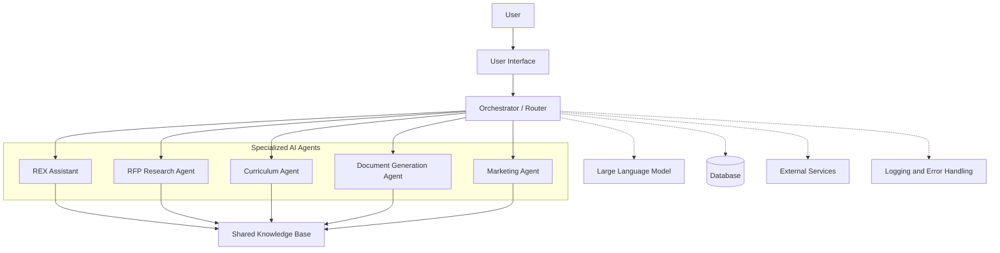

# REX AI – System Architecture

## Architecture Diagram

## Overview

REX AI uses an orchestrator to route user requests to five specialized AI agents. The agents use the large language model and shared knowledge base to support their tasks. The architecture also includes a database, external services, and logging and error handling.

## Request Flow

1. The user submits a request through the interface.
2. The orchestrator routes the request to the appropriate agent.
3. The agent processes the request using the LLM and relevant knowledge.
4. The agent accesses other services when needed.
5. The result is returned to the user.

## Implementation Status

This document describes the planned architecture. Components and integrations will be implemented incrementally.
