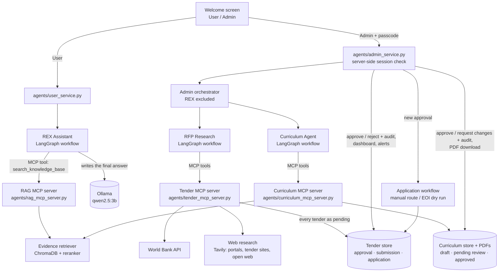
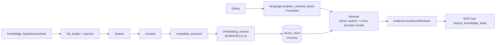

# REX AI – System Architecture

## Overview

REX AI is one Streamlit application (`rex_ai_app.py`) with two entry points
on its welcome screen:

- **User** – learners chat with **REX Assistant** directly. No orchestrator
  is involved, so the User interface can never reach an admin agent.
- **Admin** – after a passcode check on the server, admins use the
  **Admin orchestrator**, which routes requests to every agent *except* REX
  Assistant (RFP Research, Curriculum Research, Document Generation and Marketing). The admin
  dashboard also hosts the review queue for web research.

All five MCP servers (knowledge base, tenders, curricula, documents, marketing) are reached through the same client code
(`agents/mcp_tool_client.py`). The client registers itself so that the server subprocesses this process started are closed when
the application exits (`atexit`; `close()` can be called repeatedly); a process the application did not start is never touched. Only capabilities that reach outside an
agent are tools: REX's knowledge-base search, the RFP agent's
source searches and tender catalogue, and the Curriculum Agent's catalogue,
research, framework, validation, storage and PDF tools, the Document Generation Agent's document tools and the
Marketing Agent's approved-course and campaign tools. Admin decisions,
applications and curriculum approval are not tools: an MCP server cannot tell who is calling, so they stay
behind the admin session in `AdminService`.

The Document Generation Agent (Agent 4) and the Marketing Agent (Agent 5), both described below, are implemented and
registered on the Admin orchestrator.

**Historical diagrams.** `docs/REX AI Multi-Agent Workflow Diagram.png` and
`docs/mermaid-diagram.png` are Sprint 1 concept diagrams. They show every
request, including learners', going through one orchestrator, and they
include the planned Document Generation and Marketing agents. The diagram
above is the current architecture: learners reach REX directly, and the
Admin orchestrator excludes REX.

## Curriculum Agent (Admin workflow)

Agent 3 (`agents/curriculum_research/`). The full design is in
[CURRICULUM_AGENT_ARCHITECTURE.md](CURRICULUM_AGENT_ARCHITECTURE.md).

- **Workflow A (a requested curriculum):**
  1. Understand the request (English or Arabic).
  2. Fill in facts the academy catalogue states.
  3. Ask once for anything essential that is still missing (topic, total hours, level).
  4. Research the topic, only on approved sites (off until the owner approves the list).
  5. Generate the curriculum in three structured model calls.
  6. Validate it with deterministic rules, then run one repair pass if needed.
  7. Align it with a framework, if one was named.
  8. Save it as `pending_review` if valid, otherwise as `draft`.
  9. Render the PDF and reply.
- **Revisions** ("make it 30 hours", "add a module on Git", "translate it
  to Arabic") create a new version; older versions are kept.
- **Workflow B (catalogue planning):** the agent reads the catalogue and
  the deterministic gap report. The model suggests up to five courses that
  cite real gap ids. Each suggestion is checked for overlap with existing
  courses. "generate suggestion N" drafts one.
- **Alignment** uses only approved framework files. *Covered* and
  *partially covered* need existing outcome, module or assessment ids as
  evidence; otherwise the result is *unable to determine*. Alignment is
  never accreditation.
- **Tools** go only through the Curriculum MCP server
  (`agents/curriculum_mcp_server.py`, 13 tools). There is no approve tool:
  only `AdminService.approve_curriculum` / `request_curriculum_changes`,
  with the admin token and the audit history, change a curriculum's review
  status. Admins use the **Curricula** tab.

## Document Generation Agent (Admin workflow)

Agent 4 (`agents/document_generation/`) turns an **approved** curriculum into a training document. It is a LangGraph
workflow (`graph.py`): `understand -> fetch_curriculum -> write -> save -> render -> reply`. Any step can stop the run
with a clear message; nothing is reported as a success unless the document was saved and its PDF rendered.

- **Source**: only a curriculum version whose review status is `approved` (set by `AdminService.approve_curriculum`).
  The agent reads it through its own MCP server (`agents/document_mcp_server.py`, tool `get_approved_curriculum`),
  which opens the Curriculum Agent's store read-only in effect. A draft, pending or changes-requested curriculum is
  refused with the reason. A newer unapproved revision never replaces the approved source.
- **Ten document types.** Nine are generated (`templates.py`): course description, course proposal, participant guide,
  capstone project brief, learning outcomes and assessment plan, instructor guide, presentation outline (a PDF outline,
  not a slide file), question bank and assessment rubrics. The tenth, the **curriculum PDF**, is not generated: the
  Documents tab offers a read-only download of the Curriculum Agent's own PDF of the approved version
  (`DocumentToolbox.approved_curriculum_pdf`, which calls Agent 3's existing renderer and writes nothing).
- **No invention**: `composer.py` copies the curriculum's facts (title, objectives, outcomes, modules, hours,
  assessments, capstone) into the document as `source: "curriculum"` blocks. The model writes only narrative parts
  (`source: "generated"`; schemas in `schemas.py`, prompts in `prompts.py`). A field the curriculum does not record (for
  example the training format) is listed in `content["missing"]` and printed as "not specified"; the admin may supply it
  (`source: "admin"`).
- **Generation, one module at a time** (`generator.py`, `units.py`). The five original types make one model call. The
  four newer types (instructor guide, presentation outline, question bank, rubrics) write the text that covers the whole
  document once (where there is some), then make one call per module (per assessment for rubrics), checking each unit as
  soon as it is written. Progress is reported step by step to the Documents tab. Hours, point scores and rubric
  weights are computed in code (`units.py`), never by the model: a rubric always totals exactly 100 points.
- **Validation** (`validation.py`). Every model answer is checked against the approved curriculum before anything is
  saved: no accreditation claims, no hour figures the curriculum does not state, no minute-level timings (newer types),
  exactly the required module or assessment ids, and no empty fields. Further checks, for the newer types and mostly
  language-aware:
  - *Question bank*: exactly two multiple-choice, one true/false and one short-answer question per module; four distinct
    options with exactly one correct; no "all/none of the above" (English and Arabic forms); no numbering or position
    index in an option; options not reused by another question, even reordered; questions grounded in the module's own
    topics and not repeated; answers at most 80 words and explanations at most 60.
  - *Rubrics*: one criterion per linked outcome; four performance levels that really differ (a level that is the previous
    one plus an extra clause is rejected); assessor instructions that do not repeat the assessment's purpose.
  - *All newer types*: no characters from another writing system, no repeated or looping sentences, no text that ends in
    the middle of a sentence, and in Arabic no English words except technical terms (those in the curriculum or in
    `terms.py`) and none glued to Arabic letters.
  The save tool validates the document again: a content dict passed in is never trusted.
- **Repair attempts**. If the first answer fails a check, the model is asked once more with the exact problems (question,
  option numbers, quoted text). The **question bank** gets one more, targeted attempt: only the questions still flagged
  are rewritten, one small call each, and merged in code, so valid questions are never changed. The maximum is two
  repairs after the first answer. Every attempt is checked in full; invalid output is never corrected silently and, if it
  still fails, **nothing is saved** and the error names the module and the check. Other types get no second repair.
- **Tools** (`document_tools.DocumentToolbox`, exposed by the MCP server): `list_document_types`,
  `list_approved_curricula`, `get_approved_curriculum`, `save_document_draft`, `render_document_pdf`, `get_document`,
  `list_documents`. There is no approve tool, no file-path argument and no file-content tool. The save tool checks that
  text copied from the curriculum equals what recomposing it from the approved curriculum gives, and that the `extra`
  fields are known, trimmed, single-line and within their limits. Documents made with an earlier wording of the
  composition (the instructor notice, module-hours and question headings) still validate against that wording and are
  never rewritten (`compose(..., legacy=True)`). `list_approved_curricula` is paged (`limit` up to 200, `offset`, with
  `total` and `has_more`), read from `CurriculumStore.list_approved/count_approved` (two read-only methods added to the
  Curriculum Agent's store).
- **Storage** (`document_store.py`, `agents/document_generation/documents.sqlite3`, `DOCUMENT_DB_PATH`; PDFs in
  `agents/document_generation/documents/`, `DOCUMENT_OUTPUT_DIR`): `documents`, `document_versions`, `document_audit`.
  Each record names the curriculum id and version. Versions are immutable; an approved version and its PDFs are never
  replaced. Status: `draft -> pending_review -> approved`, separate from the curriculum's. Every version has a **review
  PDF** (`GDOC-..._v1_en.pdf`, made at generation, cover "Pending review") and, once approved, an **approved PDF**
  (`GDOC-..._v1_en_approved.pdf`, cover "Approved by the academy" and "Approved on <date>"). The approved PDF is made and
  written *before* the approval is recorded, and `DocumentStore.approve` records the status change and that file in one
  transaction, so a version is never approved without it; if making the file fails nothing is approved. Columns added
  after the first release (`approved_filename`, `approved_sha256`, `approved_pages`, `approved_size_bytes`) are added to an
  existing database when the store opens (additive, idempotent). The head row's `status` describes the *latest* version;
  anything that consumes a document must read `DocumentStore.get_approved()` (the version in `approved_version`).
- **PDF export** (`pdf.py`). One renderer serves every type: sections of paragraph, bullet, heading and table blocks. A
  heading is always kept on the same page as the block that follows it. Multiple-choice options are lettered A-D (أ ب ج د
  in Arabic) when drawn, never in the stored text. Score tables give the criterion column room. It reuses the Curriculum
  Agent's bundled fonts, Arabic letter shaping and right-to-left layout (`curriculum_research/pdf.py`).
- **Admin only** (`AdminService`, every call checks the session): generate, edit (only generated/admin text; a save is a
  new version that needs review again; this also applies to an approved version, which stays the approved one until the
  new version is approved), approve (`DocumentToolbox.approve_document`: re-checks that the curriculum version is still
  approved, makes the approved PDF, then records the approval), download (the approved PDF for an approved version, the
  review PDF otherwise; the curriculum PDF through `AdminService.approved_curriculum_pdf`). A failure listing approved
  curricula is raised and shown, never reported as "none approved". The Streamlit **Documents** tab drives these; it
  sends the chosen curriculum and type in `context["document_request"]`, which the orchestrator routes to Agent 4
  without keyword guessing. Writing can take several minutes on a small local model, so the tab shows each step.
- **Routing**: chat requests such as "Generate a course description for CUR-..." are recognised by
  `understanding.is_document_request` (a request verb plus a document-type phrase, unless the sentence asks to create a
  curriculum itself: "Create a curriculum about SQL with an assessment plan" stays with the Curriculum Agent), read per
  deliverable by `agents/routing.py` (see "Routing by deliverable" under Authorization); if no curriculum is named the
  agent lists the approved ones and a reply with a number or id continues the request.
- **Language**: a document is written in its curriculum's language (English or Arabic). It is not translated.
- **Known limitation**: with the default small local model (`qwen2.5:3b`), Arabic question banks are not reliably
  generated: in recent real runs some failed validation after both repairs and were, correctly, not saved. Validation was
  deliberately not relaxed. English generation, and the other types, passed in the runs made.
- **Not implemented**: e-mail distribution (no integration exists in the project).

## Marketing Agent (Admin workflow)

Agent 5 (`agents/marketing/`) writes marketing campaigns for an **approved** course. It is a LangGraph workflow
(`graph.py`): `understand -> fetch_course -> audience -> write -> save -> reply`. Any step can stop the run with a clear
message; nothing is reported as a success unless the campaign passed every check and was saved as pending review.

- **Source: approved courses only.** The agent reads courses through its own MCP server (`agents/marketing_mcp_server.py`,
  tools `list_approved_courses` and `get_approved_course`). The toolbox (`marketing_tools.py`) uses the Curriculum Agent's
  public store methods (`get`, `list_approved`, `count_approved`) and never its tables; it applies its own copy of the
  "approved only" rule (a head with an `approved_version` whose version status is approved; a newer unapproved revision
  never replaces it), and `tests/test_marketing_tools.py` checks that this rule agrees with Agent 4's for every status a
  curriculum can be in. A draft, pending or changes-requested curriculum is refused with the reason; if none is approved
  the agent says an administrator must approve one first. In the chained request "Create a curriculum and a marketing
  campaign" the draft the Curriculum Agent just wrote (`previous_results`) is ignored: Agent 5 asks for an approved course.
- **Audience.** The campaign is written for the course's own `target_audience`, which the administrator confirms or
  overrides in the Marketing tab before generation (`audience`: `source` is `curriculum` or `admin`). If the course states
  none and none is supplied, the agent asks; it never invents one. Tone (professional, friendly, inspiring, formal), a goal
  and extra facts (for example a start date) are optional; the administrator's own words are a legitimate source of facts.
- **What is generated.** A strategy (objective, target audience, main message, recommended channels, content sequence,
  call to action; no budgets, forecasts or guaranteed results) and, per selected channel, 1, 2 (default) or 3 variations
  that must differ: social media captions with hashtags, Facebook/Instagram ad copy, LinkedIn posts, e-mail (subject,
  preview, body, button), WhatsApp messages, campaign headlines and call-to-action suggestions, each within its
  platform's length limits (`schemas.LIMITS`). The administrator may generate only the channels they need. The campaign
  is written in the course's language (English or Arabic) and is not translated.
- **Generation and validation** (`generator.py`, `validation.py`). One model call for the strategy and one per channel,
  each checked as soon as it is written. The checks reject what the approved course does not support: numbers and hour
  figures it does not state; prices, fees, "free", discounts and urgency; guarantees and job or salary promises;
  superlatives; certificate and accreditation claims; links, e-mail addresses and phone numbers; month names and
  deadlines; claims about required experience; text in another writing system; in Arabic, English words that are not
  technical terms and English glued to Arabic letters; repeated sentences; unfinished text; wrong length; and variations
  that are too alike. A term the curriculum or the administrator's own words contain is allowed. The checks are
  heuristics: they block the common ways of inventing facts, which is why an administrator approves every campaign.
- **One repair.** A part that fails is asked for again once, with the exact problems (channel, variation, quoted term).
  If it still fails nothing is saved and the error names the content type. The whole campaign is checked again before it
  is saved, and the save tool checks it a third time.
- **Storage and lifecycle** (`marketing_store.py`, `agents/marketing/marketing.sqlite3`, `MARKETING_DB_PATH`, gitignored):
  its own tables `campaigns`, `campaign_versions`, `campaign_audit`, modelled on Agent 4's documents but separate from them.
  `draft -> pending_review -> approved`. The agent can only save `pending_review` (valid) or `draft`; approval exists only in
  `AdminService.approve_campaign` (the MCP server has no approve tool). Versions are immutable: an edit or a regeneration is
  a new version, and an approved version stays the approved one until a newer version is approved. Only
  `MarketingStore.get_approved()` is "ready for distribution"; draft and pending-review content never is.
- **Admin only** (`AdminService`, every call checks the session): generate, list, edit (any strategy or variation text;
  the course facts cannot be edited; the edit is validated and a campaign that fails the checks is kept as a draft that
  cannot be approved), approve (explicit, audited, the course version must still be approved) and download (the
  **approved** version only, as UTF-8 Markdown or JSON). The Streamlit **Marketing** tab drives these and shows the
  strategy and the variations side by side; it passes the choices in `context["marketing_request"]`, which the
  orchestrator routes to Agent 5 without keyword guessing. Chat requests ("Write a social media campaign for approved
  course CUR-123") reach Agent 5 when they ask for a marketing deliverable (see "Routing by deliverable"); a course id in
  the text does not decide the route. A request without a course lists the approved courses and a reply with a number or id
  continues it (state in the shared `ConversationStore` under `marketing`).
- **Follow-up questions are tied to the request that caused them.** When the agent asks for the audience (the course states
  none), it stores a pending question with the original request, the course, the options chosen and a timestamp. The
  next message of that conversation is read by `understanding.classify_reply`: a short description of a group of people is the
  audience and the original request continues; "cancel" (English or Arabic) drops the question; a new request ("Create a
  curriculum about SQL") drops it and is routed on its own; small talk, an empty message, text with links or markup, or
  something that is not a group of people never becomes the audience, and the agent asks again (asking again does not extend
  the time). A pending question expires after 15 minutes (`PENDING_TTL_SECONDS`; the clock is injectable, so tests do not
  wait); a late reply is then treated as a new message. State is per conversation id, so another conversation never sees it.
- **Out of scope and never done:** publishing, sending e-mail, sending WhatsApp messages, scheduling, or any other
  distribution. Approval only makes content downloadable.
- **Known limitation:** with the default small local model (`qwen2.5:3b`) a full campaign makes eight model calls and takes
  many minutes; Arabic output is checked strictly and may fail validation, in which case nothing is saved.

## Authorization

The User/Admin choice on the welcome screen is navigation only and grants
nothing.

- `REX_ADMIN_PASSCODE` is read on the server (environment or `.env`) and
  compared in constant time. It is never sent to the browser or logged.
  If it is not set, admin access is disabled.
- A correct passcode returns a random session token kept in server memory
  with a 30-minute idle timeout. The UI stores only that token.
- Every `AdminService` method checks the token, including review
  decisions, tender searches, agent requests, listings and alerts. A missing, forged,
  expired or signed-out token raises `AdminAuthError`.
- After 5 wrong passcodes, that browser session is locked out for 60 seconds. Failures are counted per client (the app
  gives each browser session its own random client id), so one person's mistakes do not lock the other administrators out.
  Starting new sessions to get fresh attempts is limited by a ceiling over all clients (25 failures lock every client for
  60 seconds), and the per-client records are bounded in number.
- Review decisions are attributed to `admin-session-<hash>`, never to the
  token itself.

This is a single shared passcode for a demo deployment. It proves an
admin is present, not which admin: there is no individual administrator identity, and the audit trails record the session
(`admin-session-<hash>`), not a person. Per-person accounts are a remaining limitation.

### Routing by deliverable

The Admin orchestrator decides which agents run from what the request asks to *receive*, not from the subject it mentions
(`agents/routing.py`, used by `Orchestrator._make_plan`; it imports nothing from the orchestrator). The text is split into
clauses (commas, "and", "then", "plus", Arabic "ثم"), the topic after a course noun is ignored ("a curriculum about
digital marketing" is a curriculum, not a marketing campaign), and each clause is one of: a document (one of Agent 4's
types, taking precedence), a marketing deliverable (campaign, social media posts, ads, captions, LinkedIn posts, e-mail
or WhatsApp copy for a course), or a curriculum to create. Examples:

| Request | Agents |
|---|---|
| Create a curriculum about digital marketing. | Curriculum |
| Create a curriculum about marketing analytics. | Curriculum |
| Create a social media campaign for approved course CUR-123. | Marketing |
| Write LinkedIn posts promoting approved course CUR-123. | Marketing |
| Create a course description for curriculum CUR-123. | Document Generation |
| Generate a question bank for CUR-123 and create a marketing campaign for the same course. | Document Generation, Marketing |
| Create a curriculum about data analysis and prepare a course proposal. | Curriculum, Document Generation |

A request that asks for two or more deliverables runs every requested agent in order. Replies that continue an open
question (a course number, an audience) go to the agent that asked, as before. Forced routing from the tabs
(`context["document_request"]`, `context["marketing_request"]`) is unchanged, and the User side never reaches the
orchestrator. Routing is a heuristic: it does not depend on the shape of a course id, but a request phrased in an
unusual way can fall through to the generic rules.

## REX Assistant (User workflow)

LangGraph nodes: `detect_language → understand → ask_question | general |
retrieve → generate`, plus `handle_consent`.

- **Two modes**, chosen per message:
  - *Personalized discovery* asks for background, career goal, skill
    level, training preference (online/offline), budget and available
    time, one at a time. The learner can skip a question or ask for
    recommendations at any point.
  - *Direct course questions* are answered straight away from the
    knowledge base, even mid-discovery. Discovery resumes afterwards.
- **Retrieval is separate from generation.** REX calls the MCP tool
  `search_knowledge_base`, which returns evidence chunks and a status
  (`ok`, `no_results`, `empty_index`, `invalid_request`, `error`).
  REX then writes the answer itself (`generate_answer()` in its graph), citing [n]
  sources. When there is no usable evidence, REX returns a fixed,
  honest message and makes no LLM call.
- **Language.** REX replies in the language the learner writes in
  (Arabic, Egyptian Arabic, Arabizi or English), and the language stays
  the same across short replies such as "ok". Arabic queries are
  normalized and translated for the English embedding model.
- **Privacy.** Conversation state stays in the UI session. Learner
  details are saved only after explicit consent.

## Knowledge base (RAG)

Retrieval only: the knowledge base returns evidence, and REX writes the
answer. One pipeline is used for every dataset.

**Formats** (`knowledge_base/parsers.py`):
- **Page formats.** PDF keeps page numbers; PPTX gives one page per slide; DOCX keeps headings and table rows in order; HTML keeps visible headings, lists and tables; TXT and Markdown are read as text.
- **Record formats.** CSV and XLSX give one record per row (with the sheet name for XLSX). JSON gives one record per object, carrying the file's top-level values such as an update date.
- **Bad files.** A renamed or corrupted file, a scanned PDF with no text, or a garbled extraction fails with a clear error and is listed in `files_failed`. It is never indexed silently.

**Chunking** (`knowledge_base/chunker.py`, `strategy=`):
- **Document-aware (always).** Headings build a section hierarchy across pages: Markdown `#`, numbered `1.2`, ALL CAPS above Title Case. Small sections under the same branch are packed up to `max_chars`; records are never merged with each other.
- **Recursive (when a unit is too large).** Text is split at paragraph, then line, then sentence, then word boundaries, with a word-aligned overlap.
- **Semantic.** Sentence embeddings find topic shifts: breaks fall where adjacent-sentence distance is in the top 15% for that section. `auto` (the default) uses it only for oversized prose; `semantic` uses it for every multi-sentence section; `document` never calls the model.
- **Context header.** Every chunk starts with its section path (for example "Flutter Mobile App Development > Learning Outcomes"), so a retrieved passage always says which item it belongs to.
- **Size.** `max_chars` is 1000 because the embedding model reads at most 256 tokens.

**Chunk metadata (stored in Chroma):**

| Field | Meaning |
|---|---|
| `source`, `document_id`, `filename`, `file_type` | Project-relative source path (portable) |
| `page`, `page_end` | PDF page or slide; `page_end` when a chunk spans pages |
| `section`, `section_path` | Heading, and the full heading path |
| `record_id` | Row or object identifier for CSV, XLSX and JSON (or "row N") |
| `chunk_id`, `chunk_strategy` | Position; `document`, `recursive`, `semantic` or `record` |
| `field_<name>` | "Key: value" facts written in the source, plus the record's fields, inherited by subsections. Numbers stay numbers (`field_fee_egp <= 6000` works as a filter). Nothing is inferred. |
| `dates`, `urls`, `keywords` | Found in the text, stored as "a; b" |
| `embedding_model`, `content_hash` | Queries against an index built with another model are refused ("rebuild") |

**Re-ingestion:**
- Running the pipeline again replaces each document's vectors, so there are no duplicates and no stale chunks.
- Documents deleted since the last run lose their vectors, tracked through `knowledge_base/metadata/ingestion_manifest.json`.
- Other collections in the same store are never touched.

**Query translation** (`knowledge_base/language.py` with the existing `translator.py`):
1. The original question is always kept; English queries pass through untranslated.
2. Arabic, Egyptian Arabic and Arabizi are normalised: Egyptian words become MSA, Arabic-Indic digits become 0–9, and Arabic-spelled technology names become Latin script (فلاتر → Flutter).
3. Only the Arabic part is translated with MarianMT. Latin names, codes and numbers are kept verbatim.
4. A failed, empty or untranslated result is reported as `translation: failed`, and the original text is searched.

The embedding model is English-only, so Arabic queries are translated before embedding. Stored documents are never translated.

**Response** (`search_knowledge_base`):
- status: `ok`, `no_results`, `empty_index`, `invalid_request` or `error`;
- the original question and the query actually embedded, with translation status;
- chunks with reference, text, source file name, page, section, section path, record ID, relevance score and `fields`.

**Domain logic stays in REX.** The course-listing search hint, the recommendation layout and the evidence checks live in `agents/course_intent.py` and `agents/rex_assistant/recommendation.py`, not in the generic engine. Answer writing itself is REX's own code (`agents/rex_assistant/prompts.py`, `generate_answer()` in `graph.py`); `knowledge_base/` only ingests and retrieves.

**Evaluation** (`knowledge_base/evaluation.py`):
- 32 questions (21 English, 8 Arabic, 3 mixed; two listing items carry REX's own `retrieval_query` with its listing hint) in `knowledge_base/datasets/andalusia_catalogue/eval_set.json`.
- A hit counts only if the chunk contains every expected string, for example the course name *and* its fee.
- On the current catalogue: **Recall@5 = 1.0, MRR = 0.98**. The original pipeline on the same documents scored 0.33 and 0.22; part of that gap is the XLSX, JSON and HTML formats it could not read.
- The set is small and was written alongside the data, so treat it as a regression check, not a benchmark.

## RFP Research (Admin workflow)

LangGraph: `validate_request → query_apis → web_research →
filter_relevant → detect_duplicates → assess_and_filter →
apply_business_rule → store_opportunities → compose_response`.

- **Scope.** Only Egypt and Saudi Arabia. Other countries are refused.
  The countries come from the search form, else from the request text,
  else both.
- **Sources.**
  - World Bank Procurement Notices API (Egypt).
  - Etimad (Saudi Arabia) has no public API and is reported as
    unavailable, never as "no tenders".
  - **Web research for both countries** (`web_tenders.py`, Tavily): the
    official portal (`etenders.gov.eg`, `tenders.etimad.sa`) with an
    Arabic query, tender aggregator sites, and the open web in English and
    Arabic. The admin's categories and priority organisations or sectors
    are added to the queries.
- **Extraction.** An LLM chain reads each page's text and extracts the
  tenders it announces: title, issuing organisation, country, reference,
  deadline, publication date, eligibility, training category, submission
  link and documents. A field the page does not state stays empty. Code
  then checks the country, normalises dates, adds document links found
  in the page and lists the missing fields.
- **Filters.** Training keywords; expired deadlines; old notices with no
  deadline; works and supply contracts whose title names no training; the
  admin's categories and deadline range.
- **Duplicates.** Within this conversation, within this run, and against
  the stored tenders (same URL, or the same title and country on another
  site).
- **Assessment.** Separate LLM chains judge relevance and qualification.
  Qualification uses the admin's eligibility notes; with no stated
  eligibility it is `unknown`.
- **Business rule.** Egypt tenders are flagged for immediate review;
  Saudi tenders enter the monitored pipeline. Tenders that mention a
  priority organisation or sector are marked.
- **Web content is untrusted.** It is length-capped and stripped of
  control characters, and only http(s) URLs are kept. The LLM prompts
  treat it as data. The UI escapes it.
- **Failures are explicit.** A missing key reports
  `awaiting_credentials`, and a failed search reports `error`; every
  source's status is listed in the reply. If saving fails, the reply
  says so instead of "waiting for review".
- **MCP tools.** The sources and the tender store are reached only
  through `search_procurement_notices`, `search_tender_web_pages`,
  `find_known_tenders` and `save_discovered_tenders` (pending only). The
  LLM chains, filters, business rule and reply stay in the agent.

## Tender review, dashboard and alerts

1. Every tender found, from the API or the web, is stored in
   `rfp_opportunities.sqlite3` as **pending**.
2. An admin approves or rejects it (or returns it to pending). Every
   decision is recorded in `opportunity_audit` (previous status,
   decision, reviewer, time). A tender found again keeps its decision.
3. Approved tenders form the searchable **Tender dashboard** (country,
   category, keyword).
4. New pending tenders raise an in-app alert until the admin marks them
   as seen.

Tenders are not added to REX's course knowledge base.

## Applications after approval

Approval, submission and award are three separate statuses
(`approval_status`, `submission_status`, `application_status`).

1. Approving a tender opens a dialog showing how it is applied for and
   a checkbox authorising REX AI to submit on the academy's behalf.
2. The approval is saved and audited, then the application workflow
   (`agents/rfp_research/applications.py`) starts automatically:
   - it detects the route from the source;
   - it claims the tender atomically, so nothing runs twice;
   - it checks the prerequisites against the academy's application
     profile (real details and documents entered by the admin).
3. **No source has a submission API.** Etimad needs a Nafath login and
   the authorised signer; Egyptian portals need a registered supplier and
   often signed envelopes; listing sites only republish. These end as
   **requires manual action**, with the official steps.
4. World Bank notices asking for expressions of interest by email get a
   prepared email (to the contact address from the official API, built
   only from the profile). This is a **dry run**: nothing is sent.
5. A tender becomes **applied** only when the admin records a verified
   manual submission (date, reference, confirmation tick). Outcomes
   (awarded, not awarded, withdrawn) follow.

Every run is kept in `application_attempts`. A run whose result is
unknown (for example after a restart) blocks new runs until the admin
says whether it was sent.

## Configuration

`.env` in the project root (gitignored):

| Variable | Purpose |
|---|---|
| `TAVILY_API_KEY` | Enables RFP web research (needed for Saudi tenders). Without it, web research reports `awaiting_credentials`. |
| `REX_ADMIN_PASSCODE` | Enables the Admin interface. Without it, admin access is disabled. |
| `CURRICULUM_LLM_MODEL` | Model for the Curriculum Agent (default: REX's model, `qwen2.5:3b`). |
| `CURRICULUM_RESEARCH_DOMAINS` | Approved research sites for the Curriculum Agent (comma list). Empty by default, so research is off. |
| `CURRICULUM_DB_PATH`, `CURRICULUM_DOCUMENTS_DIR`, `CURRICULUM_FRAMEWORKS_DIR` | Optional locations of the curriculum store, its PDFs and the approved framework files. |
| `MARKETING_LLM_MODEL`, `MARKETING_DB_PATH` | Optional model for the Marketing Agent (default: the Curriculum Agent's) and the location of its database. |

## Storage

| File | Contents |
|---|---|
| `knowledge_base/documents/` | Indexed documents (the generated demo catalogue) |
| `knowledge_base/datasets/andalusia_catalogue/` | Structured source of the demo catalogue, its generator and evaluation set (not indexed) |
| `knowledge_base/vector_db/` | ChromaDB index (course catalogue) |
| `agents/rfp_research/rfp_opportunities.sqlite3` | Tenders (`opportunities`, with approval, submission and application status), `opportunity_audit`, `alert_state`, `application_attempts`, `application_profile`, `application_documents` |
| `agents/rfp_research/application_documents/` | The academy's uploaded application documents (gitignored) |
| `agents/conversation_state.sqlite3` | Admin-side agent conversation state |
| `agents/curriculum_research/curricula.sqlite3` | Curricula, versions, PDF records and review audit (gitignored) |
| `agents/curriculum_research/documents/` | Curriculum PDFs (gitignored) |
| `agents/curriculum_research/frameworks/` | Approved framework files for alignment (none shipped) |
| `agents/marketing/marketing.sqlite3` | Marketing campaigns, versions and review audit (`campaigns`, `campaign_versions`, `campaign_audit`; gitignored) |
| `agents/rex_assistant/leads.jsonl` | Learner details saved with consent |

## SQLite usage

Each agent owns its own database file; no agent reads another's tables (the Marketing and Document agents read curricula
through the Curriculum store's public methods). All stores open their connections through `agents/sqlite_utils.py`:

- a busy timeout of 30 seconds, so a second writer waits for the first instead of failing at once, and
  `PRAGMA foreign_keys = ON` for every connection;
- writes run as one explicit transaction (`BEGIN IMMEDIATE`, commit, rollback on any error) under the store's lock, so
  a failure part-way leaves nothing behind. Checks that decide a write are made *inside* that transaction: approving or
  requesting changes on a curriculum re-reads the version's status there, so two reviewers (two processes) cannot both
  succeed (the second gets "only a version pending review can be reviewed");
- no transaction is held while a model, a network call or an MCP tool runs: the agents compute first and save last;
- if the database stays locked past the timeout, the store raises its normal error with a short "database busy" message.
  Nothing retries automatically, so an approval is never applied twice;
- the journal mode is left as SQLite's default (rollback journal), **not WAL**. The project folder lives in OneDrive, WAL
  adds `-wal` and `-shm` files next to the database that a sync client can copy out of step, and it changes the database file
  on disk; the write volume (a handful of administrators) does not need it. The ignore rules cover the companion files anyway.
  Existing schemas were not changed (no foreign-key declarations were added to tables that already exist): databases created
  earlier open and work unchanged.

Concurrency is tested with threads and with real separate processes (`tests/test_sqlite_concurrency.py`,
`tests/test_curriculum_review.py`).
