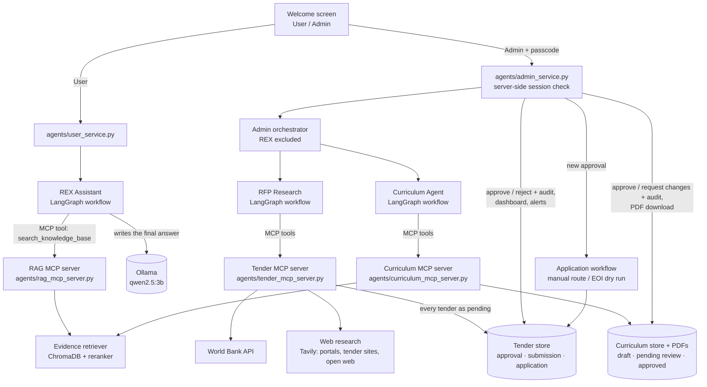
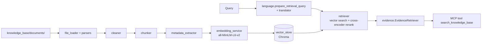

# REX AI – System Architecture

## Overview

REX AI is one Streamlit application (`rex_ai_app.py`) with two entry points
on its welcome screen:

- **User** – learners chat with **REX Assistant** directly. No orchestrator
  is involved, so the User interface can never reach an admin agent.
- **Admin** – after a passcode check on the server, admins use the
  **Admin orchestrator**, which routes requests to every agent *except* REX
  Assistant (RFP Research and Curriculum Research today). The admin
  dashboard also hosts the review queue for web research.

All three MCP servers are reached through the same client code
(`agents/mcp_tool_client.py`). Only capabilities that reach outside an
agent are tools: REX's knowledge-base search, the RFP agent's
source searches and tender catalogue, and the Curriculum Agent's catalogue,
research, framework, validation, storage and PDF tools. Admin decisions,
applications and curriculum approval are not tools: an MCP server cannot tell who is calling, so they stay
behind the admin session in `AdminService`.

Planned agents (Document Generation, Marketing) are not implemented yet.
When added, they register on the Admin orchestrator like the others.

**Historical diagrams.** `docs/REX AI Multi-Agent Workflow Diagram.png` and
`docs/mermaid-diagram.png` are Sprint 1 concept diagrams. They show every
request, including learners', going through one orchestrator, and they
include the planned Document Generation and Marketing agents. The diagram
above is the current architecture: learners reach REX directly, and the
Admin orchestrator excludes REX.

## Curriculum Agent (Admin workflow)

Agent 3 (`agents/curriculum_research/`). The full design is in
[CURRICULUM_AGENT_ARCHITECTURE.md](CURRICULUM_AGENT_ARCHITECTURE.md).

- **Workflow A (a requested curriculum):**
  1. Understand the request (English or Arabic).
  2. Fill in facts the academy catalogue states.
  3. Ask once for anything essential that is still missing (topic, total hours, level).
  4. Research the topic, only on approved sites (off until the owner approves the list).
  5. Generate the curriculum in three structured model calls.
  6. Validate it with deterministic rules, then run one repair pass if needed.
  7. Align it with a framework, if one was named.
  8. Save it as `pending_review` if valid, otherwise as `draft`.
  9. Render the PDF and reply.
- **Revisions** ("make it 30 hours", "add a module on Git", "translate it
  to Arabic") create a new version; older versions are kept.
- **Workflow B (catalogue planning):** the agent reads the catalogue and
  the deterministic gap report. The model suggests up to five courses that
  cite real gap ids. Each suggestion is checked for overlap with existing
  courses. "generate suggestion N" drafts one.
- **Alignment** uses only approved framework files. *Covered* and
  *partially covered* need existing outcome, module or assessment ids as
  evidence; otherwise the result is *unable to determine*. Alignment is
  never accreditation.
- **Tools** go only through the Curriculum MCP server
  (`agents/curriculum_mcp_server.py`, 13 tools). There is no approve tool:
  only `AdminService.approve_curriculum` / `request_curriculum_changes`,
  with the admin token and the audit history, change a curriculum's review
  status. Admins use the **Curricula** tab.

## Authorization

The User/Admin choice on the welcome screen is navigation only and grants
nothing.

- `REX_ADMIN_PASSCODE` is read on the server (environment or `.env`) and
  compared in constant time. It is never sent to the browser or logged.
  If it is not set, admin access is disabled.
- A correct passcode returns a random session token kept in server memory
  with a 30-minute idle timeout. The UI stores only that token.
- Every `AdminService` method checks the token, including review
  decisions, tender searches, agent requests, listings and alerts. A missing, forged,
  expired or signed-out token raises `AdminAuthError`.
- After 5 wrong passcodes, login is locked for 60 seconds.
- Review decisions are attributed to `admin-session-<hash>`, never to the
  token itself.

This is a single shared passcode for a demo deployment. It proves an
admin is present, not which admin.

## REX Assistant (User workflow)

LangGraph nodes: `detect_language → understand → ask_question | general |
retrieve → generate`, plus `handle_consent`.

- **Two modes**, chosen per message:
  - *Personalized discovery* asks for background, career goal, skill
    level, training preference (online/offline), budget and available
    time, one at a time. The learner can skip a question or ask for
    recommendations at any point.
  - *Direct course questions* are answered straight away from the
    knowledge base, even mid-discovery. Discovery resumes afterwards.
- **Retrieval is separate from generation.** REX calls the MCP tool
  `search_knowledge_base`, which returns evidence chunks and a status
  (`ok`, `no_results`, `empty_index`, `invalid_request`, `error`).
  REX then writes the answer itself (`generate_answer()` in its graph), citing [n]
  sources. When there is no usable evidence, REX returns a fixed,
  honest message and makes no LLM call.
- **Language.** REX replies in the language the learner writes in
  (Arabic, Egyptian Arabic, Arabizi or English), and the language stays
  the same across short replies such as "ok". Arabic queries are
  normalized and translated for the English embedding model.
- **Privacy.** Conversation state stays in the UI session. Learner
  details are saved only after explicit consent.

## Knowledge base (RAG)

Retrieval only: the knowledge base returns evidence, and REX writes the
answer. One pipeline is used for every dataset.

**Formats** (`knowledge_base/parsers.py`):
- **Page formats.** PDF keeps page numbers; PPTX gives one page per slide; DOCX keeps headings and table rows in order; HTML keeps visible headings, lists and tables; TXT and Markdown are read as text.
- **Record formats.** CSV and XLSX give one record per row (with the sheet name for XLSX). JSON gives one record per object, carrying the file's top-level values such as an update date.
- **Bad files.** A renamed or corrupted file, a scanned PDF with no text, or a garbled extraction fails with a clear error and is listed in `files_failed`. It is never indexed silently.

**Chunking** (`knowledge_base/chunker.py`, `strategy=`):
- **Document-aware (always).** Headings build a section hierarchy across pages: Markdown `#`, numbered `1.2`, ALL CAPS above Title Case. Small sections under the same branch are packed up to `max_chars`; records are never merged with each other.
- **Recursive (when a unit is too large).** Text is split at paragraph, then line, then sentence, then word boundaries, with a word-aligned overlap.
- **Semantic.** Sentence embeddings find topic shifts: breaks fall where adjacent-sentence distance is in the top 15% for that section. `auto` (the default) uses it only for oversized prose; `semantic` uses it for every multi-sentence section; `document` never calls the model.
- **Context header.** Every chunk starts with its section path (for example "Flutter Mobile App Development > Learning Outcomes"), so a retrieved passage always says which item it belongs to.
- **Size.** `max_chars` is 1000 because the embedding model reads at most 256 tokens.

**Chunk metadata (stored in Chroma):**

| Field | Meaning |
|---|---|
| `source`, `document_id`, `filename`, `file_type` | Project-relative source path (portable) |
| `page`, `page_end` | PDF page or slide; `page_end` when a chunk spans pages |
| `section`, `section_path` | Heading, and the full heading path |
| `record_id` | Row or object identifier for CSV, XLSX and JSON (or "row N") |
| `chunk_id`, `chunk_strategy` | Position; `document`, `recursive`, `semantic` or `record` |
| `field_<name>` | "Key: value" facts written in the source, plus the record's fields, inherited by subsections. Numbers stay numbers (`field_fee_egp <= 6000` works as a filter). Nothing is inferred. |
| `dates`, `urls`, `keywords` | Found in the text, stored as "a; b" |
| `embedding_model`, `content_hash` | Queries against an index built with another model are refused ("rebuild") |

**Re-ingestion:**
- Running the pipeline again replaces each document's vectors, so there are no duplicates and no stale chunks.
- Documents deleted since the last run lose their vectors, tracked through `knowledge_base/metadata/ingestion_manifest.json`.
- Other collections in the same store are never touched.

**Query translation** (`knowledge_base/language.py` with the existing `translator.py`):
1. The original question is always kept; English queries pass through untranslated.
2. Arabic, Egyptian Arabic and Arabizi are normalised: Egyptian words become MSA, Arabic-Indic digits become 0–9, and Arabic-spelled technology names become Latin script (فلاتر → Flutter).
3. Only the Arabic part is translated with MarianMT. Latin names, codes and numbers are kept verbatim.
4. A failed, empty or untranslated result is reported as `translation: failed`, and the original text is searched.

The embedding model is English-only, so Arabic queries are translated before embedding. Stored documents are never translated.

**Response** (`search_knowledge_base`):
- status: `ok`, `no_results`, `empty_index`, `invalid_request` or `error`;
- the original question and the query actually embedded, with translation status;
- chunks with reference, text, source file name, page, section, section path, record ID, relevance score and `fields`.

**Domain logic stays in REX.** The course-listing search hint, the recommendation layout and the evidence checks live in `agents/course_intent.py` and `agents/rex_assistant/recommendation.py`, not in the generic engine. Answer writing itself is REX's own code (`agents/rex_assistant/prompts.py`, `generate_answer()` in `graph.py`); `knowledge_base/` only ingests and retrieves.

**Evaluation** (`knowledge_base/evaluation.py`):
- 32 questions (21 English, 8 Arabic, 3 mixed; two listing items carry REX's own `retrieval_query` with its listing hint) in `knowledge_base/datasets/andalusia_catalogue/eval_set.json`.
- A hit counts only if the chunk contains every expected string, for example the course name *and* its fee.
- On the current catalogue: **Recall@5 = 1.0, MRR = 0.98**. The original pipeline on the same documents scored 0.33 and 0.22; part of that gap is the XLSX, JSON and HTML formats it could not read.
- The set is small and was written alongside the data, so treat it as a regression check, not a benchmark.

## RFP Research (Admin workflow)

LangGraph: `validate_request → query_apis → web_research →
filter_relevant → detect_duplicates → assess_and_filter →
apply_business_rule → store_opportunities → compose_response`.

- **Scope.** Only Egypt and Saudi Arabia. Other countries are refused.
  The countries come from the search form, else from the request text,
  else both.
- **Sources.**
  - World Bank Procurement Notices API (Egypt).
  - Etimad (Saudi Arabia) has no public API and is reported as
    unavailable, never as "no tenders".
  - **Web research for both countries** (`web_tenders.py`, Tavily): the
    official portal (`etenders.gov.eg`, `tenders.etimad.sa`) with an
    Arabic query, tender aggregator sites, and the open web in English and
    Arabic. The admin's categories and priority organisations or sectors
    are added to the queries.
- **Extraction.** An LLM chain reads each page's text and extracts the
  tenders it announces: title, issuing organisation, country, reference,
  deadline, publication date, eligibility, training category, submission
  link and documents. A field the page does not state stays empty. Code
  then checks the country, normalises dates, adds document links found
  in the page and lists the missing fields.
- **Filters.** Training keywords; expired deadlines; old notices with no
  deadline; works and supply contracts whose title names no training; the
  admin's categories and deadline range.
- **Duplicates.** Within this conversation, within this run, and against
  the stored tenders (same URL, or the same title and country on another
  site).
- **Assessment.** Separate LLM chains judge relevance and qualification.
  Qualification uses the admin's eligibility notes; with no stated
  eligibility it is `unknown`.
- **Business rule.** Egypt tenders are flagged for immediate review;
  Saudi tenders enter the monitored pipeline. Tenders that mention a
  priority organisation or sector are marked.
- **Web content is untrusted.** It is length-capped and stripped of
  control characters, and only http(s) URLs are kept. The LLM prompts
  treat it as data. The UI escapes it.
- **Failures are explicit.** A missing key reports
  `awaiting_credentials`, and a failed search reports `error`; every
  source's status is listed in the reply. If saving fails, the reply
  says so instead of "waiting for review".
- **MCP tools.** The sources and the tender store are reached only
  through `search_procurement_notices`, `search_tender_web_pages`,
  `find_known_tenders` and `save_discovered_tenders` (pending only). The
  LLM chains, filters, business rule and reply stay in the agent.

## Tender review, dashboard and alerts

1. Every tender found, from the API or the web, is stored in
   `rfp_opportunities.sqlite3` as **pending**.
2. An admin approves or rejects it (or returns it to pending). Every
   decision is recorded in `opportunity_audit` (previous status,
   decision, reviewer, time). A tender found again keeps its decision.
3. Approved tenders form the searchable **Tender dashboard** (country,
   category, keyword).
4. New pending tenders raise an in-app alert until the admin marks them
   as seen.

Tenders are not added to REX's course knowledge base.

## Applications after approval

Approval, submission and award are three separate statuses
(`approval_status`, `submission_status`, `application_status`).

1. Approving a tender opens a dialog showing how it is applied for and
   a checkbox authorising REX AI to submit on the academy's behalf.
2. The approval is saved and audited, then the application workflow
   (`agents/rfp_research/applications.py`) starts automatically:
   - it detects the route from the source;
   - it claims the tender atomically, so nothing runs twice;
   - it checks the prerequisites against the academy's application
     profile (real details and documents entered by the admin).
3. **No source has a submission API.** Etimad needs a Nafath login and
   the authorised signer; Egyptian portals need a registered supplier and
   often signed envelopes; listing sites only republish. These end as
   **requires manual action**, with the official steps.
4. World Bank notices asking for expressions of interest by email get a
   prepared email (to the contact address from the official API, built
   only from the profile). This is a **dry run**: nothing is sent.
5. A tender becomes **applied** only when the admin records a verified
   manual submission (date, reference, confirmation tick). Outcomes
   (awarded, not awarded, withdrawn) follow.

Every run is kept in `application_attempts`. A run whose result is
unknown (for example after a restart) blocks new runs until the admin
says whether it was sent.

## Configuration

`.env` in the project root (gitignored):

| Variable | Purpose |
|---|---|
| `TAVILY_API_KEY` | Enables RFP web research (needed for Saudi tenders). Without it, web research reports `awaiting_credentials`. |
| `REX_ADMIN_PASSCODE` | Enables the Admin interface. Without it, admin access is disabled. |
| `CURRICULUM_LLM_MODEL` | Model for the Curriculum Agent (default: REX's model, `qwen2.5:3b`). |
| `CURRICULUM_RESEARCH_DOMAINS` | Approved research sites for the Curriculum Agent (comma list). Empty by default, so research is off. |
| `CURRICULUM_DB_PATH`, `CURRICULUM_DOCUMENTS_DIR`, `CURRICULUM_FRAMEWORKS_DIR` | Optional locations of the curriculum store, its PDFs and the approved framework files. |

## Storage

| File | Contents |
|---|---|
| `knowledge_base/documents/` | Indexed documents (the generated demo catalogue) |
| `knowledge_base/datasets/andalusia_catalogue/` | Structured source of the demo catalogue, its generator and evaluation set (not indexed) |
| `knowledge_base/vector_db/` | ChromaDB index (course catalogue) |
| `agents/rfp_research/rfp_opportunities.sqlite3` | Tenders (`opportunities`, with approval, submission and application status), `opportunity_audit`, `alert_state`, `application_attempts`, `application_profile`, `application_documents` |
| `agents/rfp_research/application_documents/` | The academy's uploaded application documents (gitignored) |
| `agents/conversation_state.sqlite3` | Admin-side agent conversation state |
| `agents/curriculum_research/curricula.sqlite3` | Curricula, versions, PDF records and review audit (gitignored) |
| `agents/curriculum_research/documents/` | Curriculum PDFs (gitignored) |
| `agents/curriculum_research/frameworks/` | Approved framework files for alignment (none shipped) |
| `agents/rex_assistant/leads.jsonl` | Learner details saved with consent |
